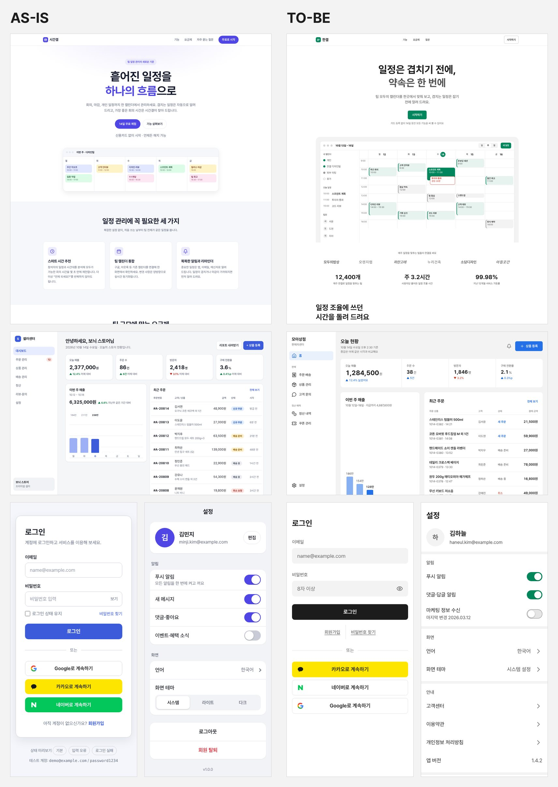

# suta

Claude Code와 Codex가 React UI를 만들 때 쓰는 스킬입니다. 키보드로 쓸 수 있고, 포커스가 제자리로 돌아오고, 좁은 화면에서 넘치지 않고, 동작 줄이기 설정을 따르는 UI를 만들게 돕습니다. 프로젝트에 복사해 쓰는 UI 패턴 57종과 편집 후 검사가 함께 들어 있습니다.

[English](README.md) · [라이브 데모](https://guksu.github.io/suta/) · [설치](#설치) · [상세 안내](docs/guide.md)

## 무엇이 들어 있나

- **레이아웃·상호작용 기준.** 키보드 조작, 대화상자를 열고 닫을 때의 포커스 이동과 복귀, 320~390px 넘침, 글자 대비, 동작 줄이기. 프로젝트에 디자인 체계가 있어도 적용합니다. 색·카드·화면 구성 같은 suta의 기본값은 디자인 기준이 없는 프로젝트에서만 쓰고, 기존 토큰과 컴포넌트는 그대로 둡니다.
- **패턴 57종.** 모달, 바텀시트, 토스트, 드롭다운, 셀렉트, 폼 입력, 제스처 등. 패턴마다 의존성 없는 TypeScript 코어, React 래퍼, CSS가 있고 키보드·스크린 리더 처리가 들어 있습니다. [데모에서 만져 보기](https://guksu.github.io/suta/)
- **편집 후 검사.** Claude Code·Codex 플러그인으로 설치하면 파일을 고칠 때마다 검사합니다. 11px 미만 글자, 장식 그림 안의 버튼, 화면보다 넓어지는 grid 틀, 레이아웃 속성 애니메이션, 동작 줄이기 누락 같은 error는 file:line과 함께 에이전트에게 돌려보냅니다. 스타일 경고는 알리기만 합니다.

## 같은 요청으로 잰 결과



Claude Code에서 같은 요청·모델·설정을 사용했습니다. 요청은 일정 관리 SaaS 랜딩, 판매자 대시보드, 로그인, 설정 화면입니다. 왼쪽은 미설치, 오른쪽은 suta 0.14이고, 조건마다 두 번 실행한 것 중 첫 번째입니다.

| 조건마다 8번 | suta 없이 | suta 0.14 |
|---|---|---|
| 접근성 위반 요소(axe, 390px) | 16 | 1 |
| 12px 미만 글자 | 24 | 0 |
| 24px 미만 터치 영역 | 25 | 7 |
| 320px에서 가로로 넘친 화면 | 1 | 1 |
| 가린 화면 비교에서 고른 횟수(판정 모델 둘, 각 16번) | 7번·9번 | 9번·7번 |
| 생성 시간·비용(중앙값) | 65초, 0.18달러 | 185초, 0.60달러 |

접근성 결과와 디자인 선호는 따로 봐야 합니다. 측정한 위반은 줄었지만 판정 모델의 선호는 갈렸습니다. 설정은 8번 모두, 로그인은 8번 중 6번 suta 없이 만든 쪽이 골라졌습니다. 판정 모델 하나는 화면을 만든 모델과 같습니다. 이 숫자는 suta 0.14의 결과이고 이후 버전으로는 다시 재지 않았습니다. 판정 모델은 0.14 랜딩 한 벌이 요청에 없던 고객사 로고와 통계를 넣은 점도 짚었습니다. 지금의 suta는 자료를 받지 않으면 그 구역을 만들지 않습니다. [실험 방법·전체 결과·한계](docs/comparisons.md)

키보드 예시는 [데모 첫 화면](https://guksu.github.io/suta/)에 있습니다. 걷기 리워드 앱을 suta 없이와 suta 0.11.0으로 만든 결과로, suta 쪽은 두 실행 모두 목표 달성 축하 창이 열릴 때 포커스를 창의 버튼으로 옮겼습니다(suta 없이는 문서 처음에 남았습니다).

## 설치

**Claude Code** — 대화창에서 실행합니다.

```text
/plugin marketplace add Guksu/suta
/plugin install suta@suta
```

**Codex** — 터미널에서 실행한 뒤 `/hooks`에서 suta의 편집 후 검사를 승인합니다.

```bash
codex plugin marketplace add Guksu/suta
codex plugin add suta@suta
```

**다른 에이전트 / 스킬만 설치** — 기준과 패턴을 설치합니다. 플러그인의 편집 후 검사는 포함하지 않습니다.

```bash
npx skills add Guksu/suta --skill suta
```

[설치 방법과 이전 버전에서 옮기기](docs/guide.md#설치) · [업데이트](docs/guide.md#업데이트) · [skills.sh](https://skills.sh/guksu/suta/suta)

## 첫 요청

설치한 뒤 에이전트에 이렇게 요청해 보세요.

> suta를 사용해서 이메일, 비밀번호, 로그인 버튼, 비밀번호 찾기 링크가 있는 로그인 화면을 만들어줘. 간단하게 구성하고 키보드로도 사용할 수 있게 해줘.

에이전트가 기준을 읽고 패턴 코드를 프로젝트에 맞게 가져다 씁니다. 프로젝트에 디자인 토큰이나 컴포넌트 라이브러리가 있으면 그것을 쓰고, 대비 부족이나 포커스 표시 누락 같은 사용 문제가 있을 때만 바꾼 뒤 무엇을 바꿨는지 알립니다. 플러그인은 편집 후 레이아웃·모션 문제도 검사합니다. 스킬과 패턴 설명서는 한국어로 작성되어 있습니다.

패턴은 [라이브 데모](https://guksu.github.io/suta/)에서 직접 만져 볼 수 있습니다. 정적 검사로 모든 UI 문제를 찾을 수는 없으므로 브라우저에서도 확인해야 합니다.

## 앞으로

직접 사용하면서 부족한 부분을 계속 수정하고, 기준과 패턴도 꾸준히 업데이트할 예정입니다. 사용해 보시고 불편한 점을 [이슈](https://github.com/Guksu/suta/issues)로 알려주시면 개선에 반영하겠습니다.

[릴리스](https://github.com/Guksu/suta/releases) · [화면 비교](docs/comparisons.md) · [벤치마크](docs/benchmark.md) · [기여하기](docs/guide.md#기여하기)

[](https://github.com/Guksu/suta/actions/workflows/deploy-demo.yml)


[](LICENSE)

## 라이선스

코드는 [MIT](LICENSE)입니다(© 2026 Guksu). 비교 이미지의 사진 라이선스는 [이미지 출처](docs/assets/CREDITS.md)에 있습니다.
