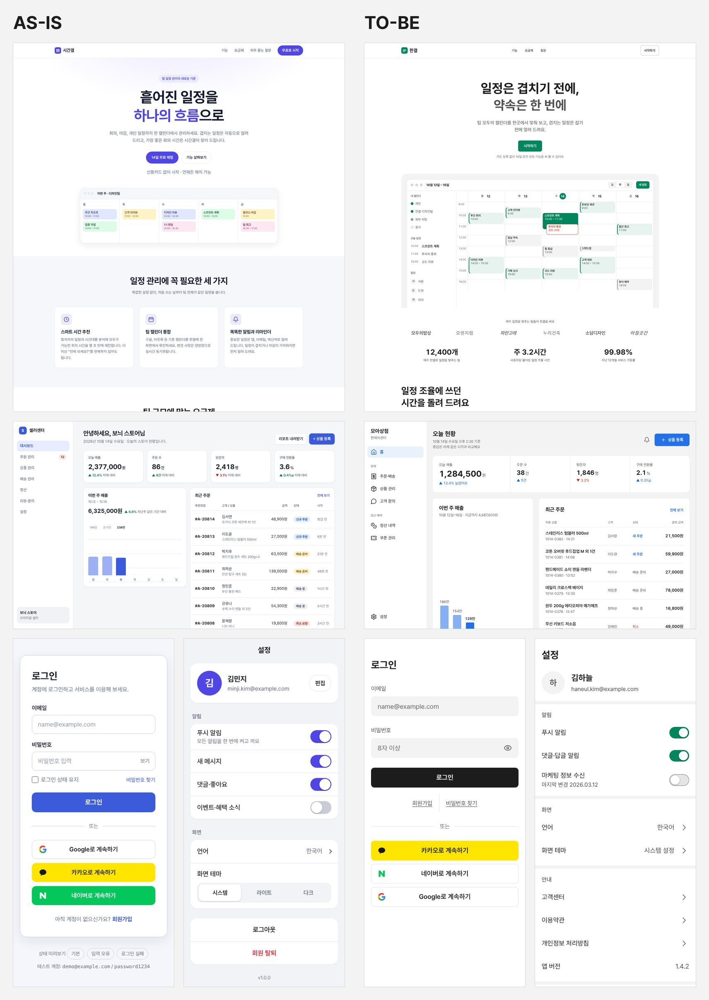

# suta

A UI skill for Claude Code and Codex, with layout, color and motion guidelines and code for 57 patterns.

I built suta to reduce the repetitive cards, excessive colors and unnecessary decoration I kept seeing in AI-generated UI.

[한국어](README.ko.md) · [Live demo](https://guksu.github.io/suta/) · [Install](#installation) · [Full guide](docs/guide.en.md)



Same requests, model and settings in Claude Code: a scheduling SaaS landing page, a seller dashboard, a login screen and a settings screen. Left: without suta. Right: suta 0.14. Each is the first of two runs per condition. Results vary, and generation took about three times longer with suta. [Method, all results and limitations](docs/comparisons.en.md)

## Installation

**Claude Code** — run in the chat:

```text
/plugin marketplace add Guksu/suta
/plugin install suta@suta
```

**Codex** — run in a terminal, then approve suta's post-edit check in `/hooks`:

```bash
codex plugin marketplace add Guksu/suta
codex plugin add suta@suta
```

**Other agents / skill only** — installs the guidelines and patterns without the plugin's post-edit check:

```bash
npx skills add Guksu/suta --skill suta
```

[Install options and migration](docs/guide.en.md#installation) · [Updating](docs/guide.en.md#updating) · [skills.sh listing](https://skills.sh/guksu/suta/suta)

## Try it

After installing, ask your agent:

> Use suta to build a login screen with email, password, a sign-in button and a password reset link. Keep it simple and make it usable with a keyboard.

The agent reads the guidelines and adapts the pattern code to your project. The plugin also checks layout and motion after edits. Skill and pattern documentation is in Korean; [English usage notes](docs/guide.en.md#how-it-works) are in the full guide.

Try the patterns in the [live demo](https://guksu.github.io/suta/). Browser checks are still needed; static checks cannot catch every UI problem.

## Follow development

I use suta in my own work and will keep fixing issues and updating the guidelines and patterns. If something feels wrong, [open an issue](https://github.com/Guksu/suta/issues) with your request and what happened.

[Releases](https://github.com/Guksu/suta/releases) · [Screen comparisons](docs/comparisons.en.md) · [Benchmark](docs/benchmark.en.md) · [Contributing](docs/guide.en.md#contributing)

[](https://github.com/Guksu/suta/actions/workflows/deploy-demo.yml)


[](LICENSE)

## License

The code is [MIT](LICENSE) (© 2026 Guksu). Licenses for the photos in the comparison image are in [Image credits](docs/assets/CREDITS.md).
