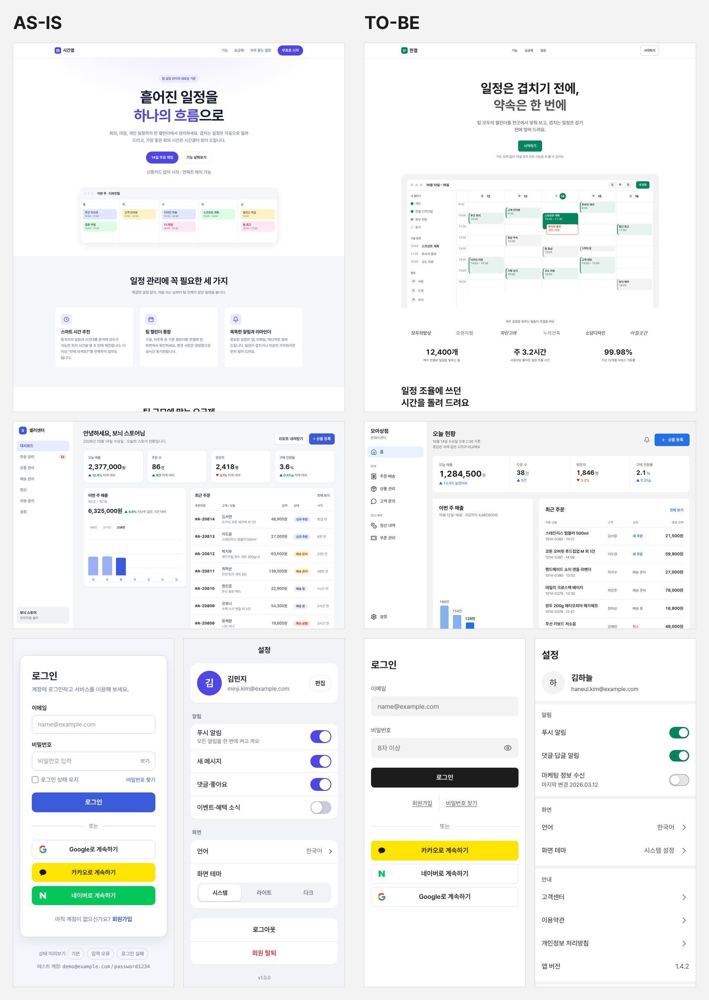

# suta

A skill for Claude Code and Codex that helps them build React UI that works with a keyboard, returns focus where it should, doesn't overflow on small screens and respects reduced motion. It comes with 57 UI patterns you copy into your project and a check that runs after each edit.

[한국어](README.ko.md) · [Live demo](https://guksu.github.io/suta/) · [Install](#installation) · [Full guide](docs/guide.en.md)

## What you get

- **Rules for layout and interaction problems.** Keyboard access, focus moving into and back out of dialogs, overflow at 320–390px, text contrast and reduced motion. These apply even when the project has its own design system. suta's visual defaults (color, cards, screen structure) apply only to projects without a design standard; existing tokens and components are kept. New screens without a standard get conventions for 24 screen types and type sizes and fonts chosen by industry.
- **57 patterns.** Modal, bottom sheet, toast, dropdown, select, form inputs, gestures and more. Each is a dependency-free TypeScript core, a React wrapper and CSS, with keyboard and screen-reader handling. [Try them in the demo](https://guksu.github.io/suta/).
- **A post-edit check.** As a Claude Code or Codex plugin, suta checks each edited file. Errors such as text under 11px, a button inside a decorative picture, a grid shell wider than the screen, layout-property animation or a missing reduced-motion block go back to the agent with file:line. Style warnings are only reported.

## Measured on the same requests



Same requests, model and settings in Claude Code: a scheduling SaaS landing page, a seller dashboard, a login screen and a settings screen. Left: without suta. Right: suta 0.14. Each is the first of two runs per condition.

| 8 runs per condition | Without suta | suta 0.14 |
|---|---|---|
| Accessibility violations (axe, 390px) | 16 | 1 |
| Text under 12px | 24 | 0 |
| Touch targets under 24px | 25 | 7 |
| Pages that scroll sideways at 320px | 1 | 1 |
| Picked in blind comparison (two judge models, 16 each) | 7 and 9 | 9 and 7 |
| Median generation time and cost | 65 s, $0.18 | 185 s, $0.60 |

Accessibility results and design preference are separate. The measured violations went down, but the judges' preference was split: the version without suta won settings in 8 of 8 comparisons and login in 6 of 8. One judge model was also the generating model. These four requests were measured with suta 0.14 and have not been re-measured with later versions. A judge also noted that a 0.14 landing page added customer logos and statistics that were not requested; current suta leaves such sections out unless you provide the material. [Method, all results and limitations](docs/comparisons.en.md)

### Screens without a convention (suta 0.17)

For 0.17 we measured screen types suta had no convention for (filters, composers, multi-field forms, articles) and the rewritten report convention with seven sets of requests from different industries. Each set has three requests, run 3 times per condition: 117 runs in all, 63 of them with suta 0.17 (the first set reused the no-suta runs from the 0.16 diagnosis). The table shows blind judgments (suta : without); each cell lists the requests in order as "default model·other model", with 6 judgments per model.

| Requests | Judgments |
|---|---|
| Composer · product filters · SaaS report | 2:4·3:3 / 2:4·1:5 / 2:4·2:4 |
| Book review · stay filters · store sales report | 1:5·1:5 / 5:1·5:1 / 2:4·1:5 |
| Secondhand listing · complaint status · magazine article | 0:6·1:5 / 2:4·3:3 / 1:5·0:6 |
| Meetup creation · library statistics · album review | 1:5·1:5 / 6:0·6:0 / 2:4·2:4 |
| Clinic booking · course creation · travel article | 4:2·4:2 / 3:3·3:3 / 0:6·0:6 |
| Dog grooming booking · job posting · home tour article | 4:2·3:3 / 5:1·2:4 / 6:0·4:2 |
| Vet clinic booking · car wash booking · stay listing | 4:2·3:3 / 5:1·6:0 / 6:0·2:4 |

- **Measurements:** accessibility violations (axe) were 0 on the suta side in the first five sets; in the sixth, one grooming run had 1 (text contrast); in the seventh, 0. Some measurements went against suta: all three course-creation runs animated a width (the canonical `segmented-control` thumb; 0 on the sixth set's job posting after the fix), meetup creation had 0.67 touch targets under 24px per page (0 without suta), and the SaaS report had 1.33 nested boxes per page (1 without suta). One library-statistics run scrolled sideways at 320px, as did one run without suta.
- **Judgments:** across the 21 requests the default judge was even at 63 : 63 and suta lost 53 : 73 with the other judge. The default judge is also the generating model. It chose suta on all three requests in both the sixth and seventh sets (15 : 3 each). The seventh set's stay listing was re-judged after fixing two capture defects (a bottom fixed bar cut off on long pages; a wide bar drawn too high); on nearly identical captures the other judge moved from 4 : 2 to 3 : 3 to 2 : 4 on that request.
  - suta won 5 requests with both models: stay filters, library statistics, clinic booking, the home tour article and car wash booking.
  - It lost 9 requests with both models: product filters, 2 reports (SaaS, store sales), 3 writing screens (book review, listing, meetup) and 3 article pages.
  - The other 7 were tied with at least one model (composer, complaint status, course creation, grooming booking, vet booking) or split by judge (job posting 5 : 1 and 2 : 4; stay listing 6 : 0 and 2 : 4).
- **Time and cost:** per request, the median generation time was 0.95–2.2 times and the median cost 1.2–3.3 times that of the runs without suta.
- **Not measured again:** the fixes made after the last set: in forms, choice cards in one row match in height down to the visible box, and the label-to-control gap is the same for every field.
- **Limits:** three runs per condition, and one judge model is also the generating model.

[Results and screens for each set](docs/comparisons.en.md)

For a keyboard example, the [demo home page](https://guksu.github.io/suta/) shows a walking-rewards app built with and without suta 0.11.0: with suta, the goal-celebration dialog moved focus to its button instead of leaving it at the top of the page, in both runs.

## Installation

**Claude Code** — run in the chat:

```text
/plugin marketplace add Guksu/suta
/plugin install suta@suta
```

**Codex** — run in a terminal, then approve suta's post-edit check in `/hooks`:

```bash
codex plugin marketplace add Guksu/suta
codex plugin add suta@suta
```

**Other agents / skill only** — installs the guidelines and patterns without the plugin's post-edit check:

```bash
npx skills add Guksu/suta --skill suta
```

[Install options and migration](docs/guide.en.md#installation) · [Updating](docs/guide.en.md#updating) · [skills.sh listing](https://skills.sh/guksu/suta/suta)

## Try it

After installing, ask your agent:

> Use suta to build a login screen with email, password, a sign-in button and a password reset link. Keep it simple and make it usable with a keyboard.

The agent reads the guidelines and adapts the pattern code to your project. If the project already has design tokens or a component library, suta uses them and changes them only for usability problems such as low contrast or a missing focus state, and it says what it changed. The plugin also checks layout and motion after edits. Skill and pattern documentation is in Korean; [English usage notes](docs/guide.en.md#how-it-works) are in the full guide.

Try the patterns in the [live demo](https://guksu.github.io/suta/). Browser checks are still needed; static checks cannot catch every UI problem.

## Follow development

I use suta in my own work and will keep fixing issues and updating the guidelines and patterns. If something feels wrong, [open an issue](https://github.com/Guksu/suta/issues) with your request and what happened.

[Releases](https://github.com/Guksu/suta/releases) · [Screen comparisons](docs/comparisons.en.md) · [Benchmark](docs/benchmark.en.md) · [Contributing](docs/guide.en.md#contributing)

[](https://github.com/Guksu/suta/actions/workflows/deploy-demo.yml)


[](LICENSE)

## License

The code is [MIT](LICENSE) (© 2026 Guksu). Licenses for the photos in the comparison image are in [Image credits](docs/assets/CREDITS.md).
