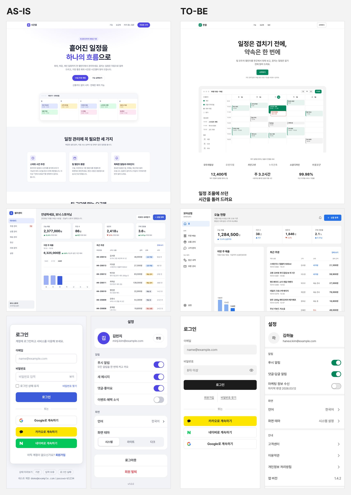

# suta

A skill for Claude Code and Codex that helps them build React UI that works with a keyboard, returns focus where it should, doesn't overflow on small screens and respects reduced motion. It comes with 57 UI patterns you copy into your project and a check that runs after each edit.

[한국어](README.ko.md) · [Live demo](https://guksu.github.io/suta/) · [Install](#installation) · [Full guide](docs/guide.en.md)

## What you get

- **Rules for layout and interaction problems.** Keyboard access, focus moving into and back out of dialogs, overflow at 320–390px, text contrast and reduced motion. These apply even when the project has its own design system. suta's visual defaults (color, cards, screen structure) apply only to projects without a design standard; existing tokens and components are kept. New screens without a standard get conventions for 24 screen types and type sizes and fonts chosen by industry. When no screen type fits, the skeleton comes from the job the screen does (choosing, inspecting, entering, monitoring).
- **57 patterns.** Modal, bottom sheet, toast, dropdown, select, form inputs, gestures and more. Each is a dependency-free TypeScript core, a React wrapper and CSS, with keyboard and screen-reader handling. The manuals of the 53 component patterns include a table of what happens after you add the pattern (fast responses, failures, long text, disabled state, forced colors) and who handles it. Three shadow steps and five stacking steps are shared as tokens. [Try them in the demo](https://guksu.github.io/suta/).
- **A post-edit check.** As a Claude Code or Codex plugin, suta checks each edited file. Errors such as text under 11px, a button inside a decorative picture, a grid shell wider than the screen, layout-property animation or a missing reduced-motion block go back to the agent with file:line. Style warnings are only reported.

## Measured on the same requests



Same requests, model and settings in Claude Code: a scheduling SaaS landing page, a seller dashboard, a login screen and a settings screen. Left: without suta. Right: suta 0.14. Each is the first of two runs per condition.

| 8 runs per condition | Without suta | suta 0.14 |
|---|---|---|
| Accessibility violations (axe, 390px) | 16 | 1 |
| Text under 12px | 24 | 0 |
| Touch targets under 24px | 25 | 7 |
| Pages that scroll sideways at 320px | 1 | 1 |
| Picked in blind comparison (two judge models, 16 each) | 7 and 9 | 9 and 7 |
| Median generation time and cost | 65 s, $0.18 | 185 s, $0.60 |

Accessibility results and design preference are separate. The measured violations went down, but the judges' preference was split: the version without suta won settings in 8 of 8 comparisons and login in 6 of 8. One judge model was also the generating model. These four requests were measured with suta 0.14 and have not been re-measured with later versions. A judge also noted that a 0.14 landing page added customer logos and statistics that were not requested; current suta leaves such sections out unless you provide the material. [Method, all results and limitations](docs/comparisons.en.md)

### Measured again across versions

| Measurement | Runs | Blind judgments (default model, other model) | Accessibility violations (axe) |
|---|---|---|---|
| suta 0.17 vs. no suta: 21 requests for screen types that had no convention | 117 | 63 : 63, 53 : 73 | 0 on the 0.17 side in six of seven sets |
| suta 0.19 vs. suta 0.17: 6 requests that match no screen convention | 36 | 19 : 17, 20 : 16 | 0 for 0.19; for 0.17, 0.17 per app page and 1.67 per web page |

- **Newer versions did not win more judgments.** Versions 0.18 and 0.19 added a screen design order and a detail standard, yet blind comparisons against 0.17 were effectively tied. Results split by request: both judges preferred 0.19 for parcel tracking and a leave request, and 0.17 for a class schedule and stock management.
- **The reason judges cited most was an element nobody asked for.** On the class schedule that 0.19 lost, judges pointed to the bottom tab bar in the 0.17 screens and called them more complete. suta does not add features or sections that were not requested; it lists them as suggestions in its report. While that rule stands, this kind of judgment will not move much.
- **In the 0.19 vs. 0.17 measurement, overflow, clipped text, text under 12px and touch targets under 24px were zero on both sides.**
- **One fix based on the judges' reasons worked and one was reverted.** Adding a check mark to the selected choice moved the targeted request from 1 : 3 and 0 : 4 to 3 : 1 and 3 : 1 (two runs per condition). Three rules written from the main measurement's losing reasons did not help when measured again, so they were removed.
- **Limits:** two or three runs per condition, and one judge model is also the generating model. Generation takes longer and costs more than without suta (in the 0.17 measurement, 0.95–2.2 times the median time and 1.2–3.3 times the median cost per request).

[Requests, screens and per-set judgments](docs/comparisons.en.md)

### What was fixed in the pattern code (suta 0.18–0.20)

Apart from the judgments, the 53 component patterns were read against their code and defects were fixed. Tests went from 754 to 1,322.

- Pull-to-refresh did not work on touch: the browser cancelled the gesture after about 22px.
- The bottom tab bar was drawn above an open sheet and its scrim.
- Swipe-to-delete and drag-to-reorder treated a cancelled gesture as a release, deleting the row or committing the order.
- The quantity stepper's + and − buttons did not respond to the keyboard, and the long-press menu did not open with Enter or Space.
- The drawer and the zoom lightbox did not move, trap or restore focus.
- The floating label and the select placeholder had 3.2:1 contrast.
- With dark color tokens, menus, sheets and modals kept a white surface and their text disappeared (0.20; 1.09:1 on the dropdown menu).
- In right-to-left screens (`dir="rtl"`) swipe-to-delete did not open (0.20).

These were checked in headless Chromium and jsdom tests, not with real screen readers, iOS, Android or Safari. The [0.19.0](https://github.com/Guksu/suta/releases/tag/v0.19.0) and [0.20.0](https://github.com/Guksu/suta/releases/tag/v0.20.0) release notes list the patterns whose behavior changed.

For a keyboard example, the [demo home page](https://guksu.github.io/suta/) shows a walking-rewards app built with and without suta 0.11.0: with suta, the goal-celebration dialog moved focus to its button instead of leaving it at the top of the page, in both runs.

## Installation

**Claude Code** — run in the chat:

```text
/plugin marketplace add Guksu/suta
/plugin install suta@suta
```

**Codex** — run in a terminal, then approve suta's post-edit check in `/hooks`:

```bash
codex plugin marketplace add Guksu/suta
codex plugin add suta@suta
```

**Other agents / skill only** — installs the guidelines and patterns without the plugin's post-edit check:

```bash
npx skills add Guksu/suta --skill suta
```

[Install options and migration](docs/guide.en.md#installation) · [Updating](docs/guide.en.md#updating) · [skills.sh listing](https://skills.sh/guksu/suta/suta)

## Try it

After installing, ask your agent:

> Use suta to build a login screen with email, password, a sign-in button and a password reset link. Keep it simple and make it usable with a keyboard.

The agent reads the guidelines and adapts the pattern code to your project. If the project already has design tokens or a component library, suta uses them and changes them only for usability problems such as low contrast or a missing focus state, and it says what it changed. The plugin also checks layout and motion after edits. Skill and pattern documentation is in Korean; [English usage notes](docs/guide.en.md#how-it-works) are in the full guide.

Try the patterns in the [live demo](https://guksu.github.io/suta/). Browser checks are still needed; static checks cannot catch every UI problem.

## Follow development

I use suta in my own work and will keep fixing issues and updating the guidelines and patterns. If something feels wrong, [open an issue](https://github.com/Guksu/suta/issues) with your request and what happened.

[Releases](https://github.com/Guksu/suta/releases) · [Screen comparisons](docs/comparisons.en.md) · [Benchmark](docs/benchmark.en.md) · [Contributing](docs/guide.en.md#contributing)

[](https://github.com/Guksu/suta/actions/workflows/deploy-demo.yml)


[](LICENSE)

## License

The code is [MIT](LICENSE) (© 2026 Guksu). Licenses for the photos in the comparison image are in [Image credits](docs/assets/CREDITS.md).
