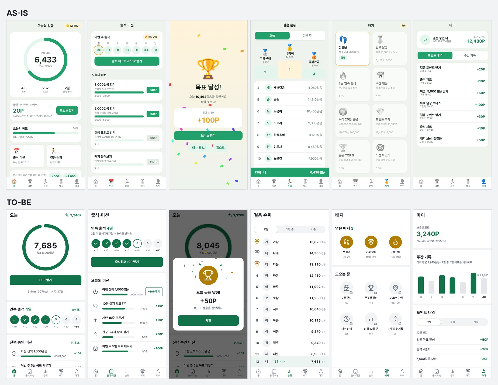

# suta: screen comparisons

[README](../README.md) · [한국어](comparisons.md)

## Screen comparisons

We gave Claude Code the requests below. One side had nothing installed. The other side had only suta installed. Model and settings were the same.

### Mobile webview: e-commerce

> Build the e-commerce screens for a mobile webview: home, product list, product detail, my page, cart, settings, and a GNB (bottom navigation). *(Translated from the original Korean request.)*

From left: home, product list, product detail, cart, my page, settings. Captured at 390px wide. The food photos are credited in [Image credits](assets/CREDITS.md).

We ran it once without suta and four times with suta 0.8. The bottom row is the third of the four runs. The table compares the two rows in the image.

| | Without suta | With suta |
|---|---|---|
| Color | Orange on the banner, categories, badges, stars and buttons | One brown accent. Only the discount rate is red |
| Icons | Emoji | Line icons of one size and stroke |
| Product cards | BEST, NEW and "popular" badges | Discount rate, price and rating |
| Home | No search field | A search field at the top |
| Detail bottom bar | Four controls: wish, quantity, add to cart, buy | Wish and Buy. Options and quantity are picked in a sheet that opens from Buy |
| Bottom tabs | The cart screen pins both the tab bar and the order button | Cart is an icon on the right of the header. Tabs are hidden on detail and cart |
| Accessibility violations (axe, 6 screens) | 111 color-contrast issues | 0 |

All four suta runs included a home search field, a cart icon in the header and a purchase sheet, and hid the bottom tabs on detail and cart screens. Three used a dark green accent, and the axe accessibility checker found 0 to 2 violations per run. Generation time increased from 2.3 minutes to 5 to 7 minutes. See the [method and per-run results](research/2026-10-08-commerce-webview.md) (Korean).

### Desktop: stock trading website

> Build a stock trading platform website. It needs home (market overview), stock detail (chart, order book, order), my assets, watchlist, search, trade history, settings and a GNB. *(Translated from the original Korean request.)*

Left is the home screen, right is the stock detail screen, captured at 1440px wide. Stock names and prices are sample data.

We ran it four times without suta and twice with suta 0.10. The image shows the first run of each condition. The table covers all 7 screens.

| | Without suta (4 runs) | With suta 0.10 (2 runs) |
|---|---|---|
| Accessibility violations (axe, 1440px) | 63 to 277, mostly color contrast | 0 |
| Rising-price color | `#e8383d` and similar, 4.1:1 contrast on white | `#d0262d`, at least 4.5:1 contrast |
| Order button within the first screen | 2 of 4 runs | Both runs |
| Search field in the header | All 4 runs | Both runs (with a `/` shortcut hint) |
| Fixed sell/buy bar on the mobile stock detail | None | Both runs |
| Generation time and cost | 3 to 4.4 minutes, $0.54 to $0.75 | 7.4 to 14.5 minutes, $1.51 to $1.72 |

Two models compared 14 pairs of screens without knowing which used suta. Each pair was shown twice with the order reversed. The judges selected suta in 23 and 24 of their 28 comparisons. One judge was the same model used to generate the screens. These model judgments on a small sample do not establish a general quality difference.

Version 0.10 added order panel and search field placement guidelines based on 10 stock trading websites. See the [stock trading website study](research/2026-10-09-securities-web.md) (Korean) for the method and comparison with the previous version.

### Mobile web app: walking rewards (gamification)

> Build a walking rewards app. It's a gamified app where walking earns points. It needs home (today's steps, claim points), check-in and missions, goal celebration, step ranking, badges, my page (point history, weekly record) and bottom tabs. *(Translated from the original Korean request.)*

From left: home, check-in and missions, goal celebration, step ranking, badges, my page. Captured at 390px wide. Steps, points and rankings are sample data.

We ran suta 0.11.0 twice and compared the results with two earlier runs without suta. The image shows the first run of each condition. The table covers all 6 screens per run.

| | Without suta (2 runs) | With suta 0.11 (2 runs) |
|---|---|---|
| Accessibility violations (axe, 390px) | 51 and 35, mostly color contrast | 5 and 0 |
| Emoji on screen | 41 and 64 (tabs, badges, medals, flames) | 0. Line icons and gold, silver and bronze medal icons |
| Celebration | A separate page. An emoji trophy bounces and confetti keeps falling | A dialog over the current screen. A trophy on a gold disc and pieces that burst once |
| Infinite animations on the idle celebration screen | 25 and 28 | 0 |
| Focus when the celebration opens | Start of the document | The "OK" button |
| Badges | One run showed unearned badges as color emoji, the other used a lock emoji | Earned badges on a gold disc, unearned ones gray with a lock and a progress count |
| Generation time and cost | 2.1 to 2.2 minutes, $0.30 to $0.34 | 4.7 to 8.9 minutes, $0.98 to $1.62 |

The 5 violations on the suta side are 4 hand-picked gray labels (4.35:1 contrast on the light gray background) and 1 points link whose spoken name differs from its visible text ("3,240P").

Two models compared 12 pairs of screens with the installation condition hidden, showing each pair twice with the order reversed. Both selected suta in 20 of 24 comparisons. In the other 4, they preferred the dedicated celebration page and ranking podium from the first run without suta. They also noted that suta's next-reward message appeared to contradict the completed goal, and that the pinned rank row covered the end of the list.

There were only two runs per condition. One judge was also the screen generation model, and the judges saw still images, so they did not compare motion. This evaluation also included "fun and motivation that fit this app." See the [walking rewards study](research/2026-10-12-walking-reward.md) (Korean) for earlier versions and per-run results.

## Benchmark

Requests for eight screen types—detail, form, settings, dashboard, landing, cart, list and interaction—were run twice per condition. The table shows round 2 results: browser measurements of pages generated with suta 0.6.0 and without suta.

| 16 pages per condition | Without suta | With suta 0.6.0 |
|---|---|---|
| Accessibility violations (axe, total) | 87 | 13 |
| Boxes nested in boxes (total) | 41 | 1 |
| Gradients, blurs, large shadows (total) | 47 | 0 |
| Touch targets under 24px (total) | 27 | 0 |
| Pages with text under 12px | 4 | 0 |
| Pages that scroll sideways at 320px | 2 | 0 |
| Pages whose primary button is blue, indigo or violet | 10 | 0 |

The table includes both accessibility findings and counts of decorative elements. Fewer colors or decorations alone do not establish better design quality.

In comparisons with the installation condition hidden, two judge models selected suta in 11 and 19 of 32 comparisons. One judge was the same model used to generate the screens; neither chose a tie. Their preferences differed, so the results did not establish a visual preference for either condition.

Median generation time per page increased from 61 to 103 seconds. See the [benchmark document](benchmark.en.md) for the method and full results.

## Limitations

- Experiments used one to four runs per condition. Results vary even with the same request.
- The rule values come from 1,104 screens of 31 Korean apps and 19 reference websites. Conventions elsewhere may differ.
- The agent reads more, so it takes longer and costs more. In the e-commerce test, 2.3 minutes and $0.39 became 5 to 7 minutes and $1.35 to $1.55.
- Static checks alone cannot reliably detect missing styles or unresponsive buttons. The UI still needs to be checked in a browser.
- Screen generation experiments used only Claude Code's default model.
