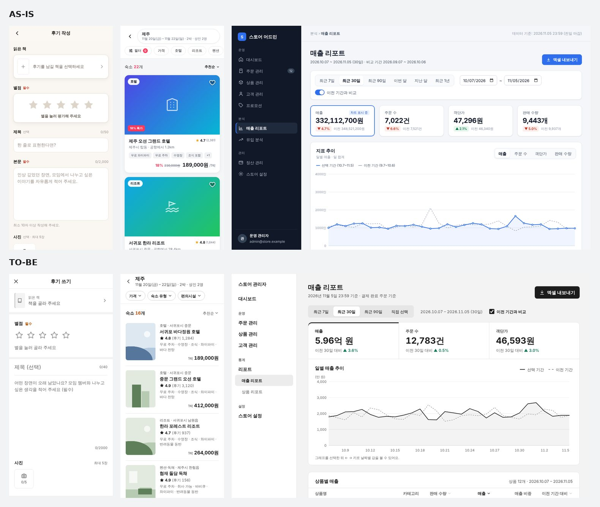
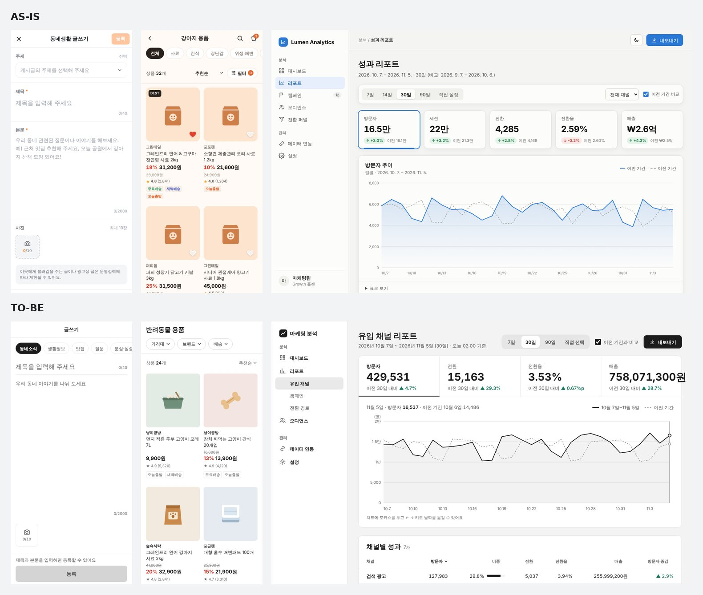
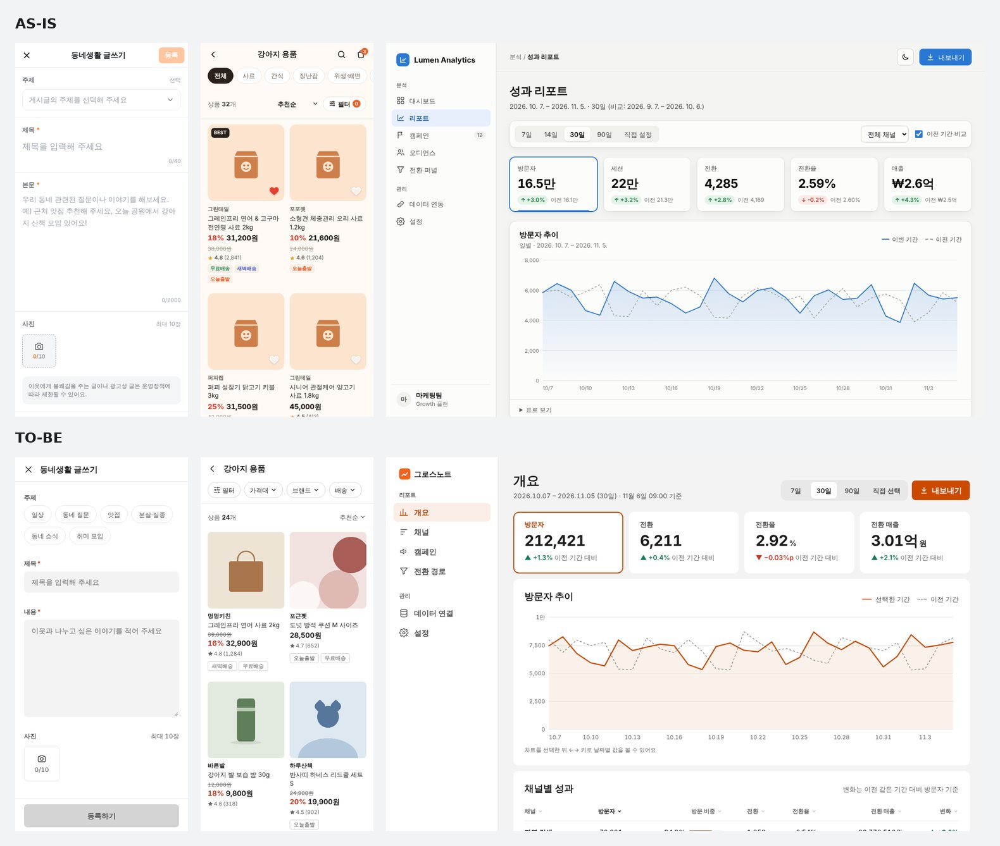
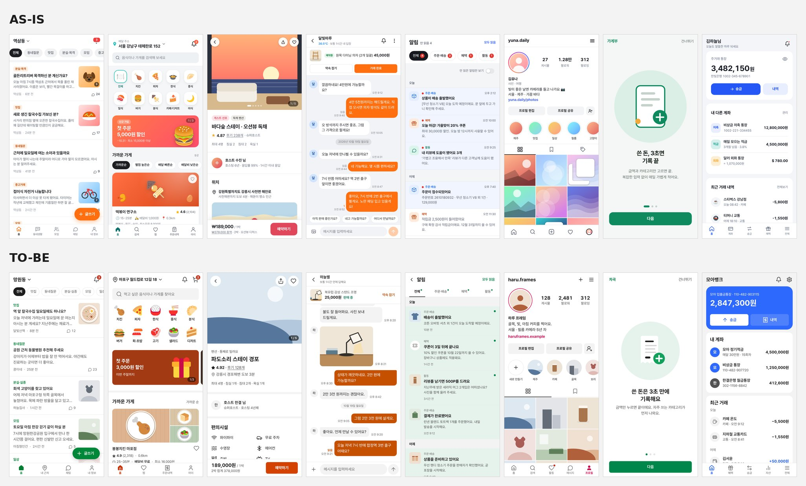
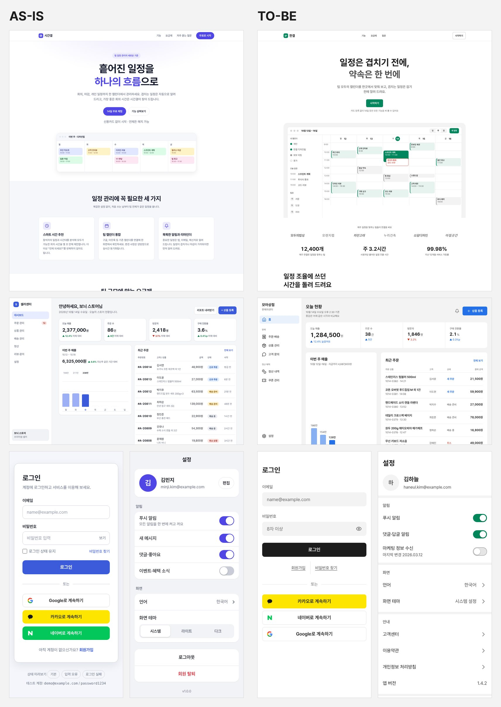
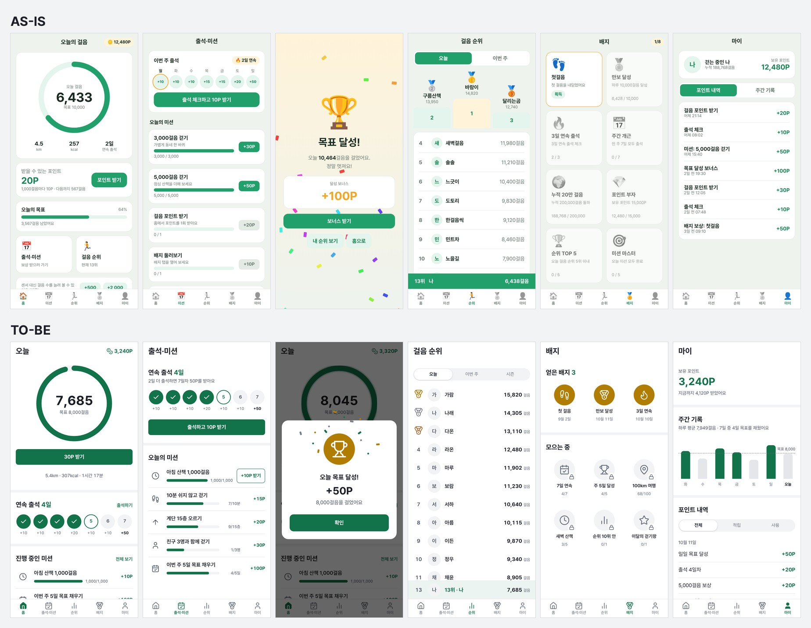
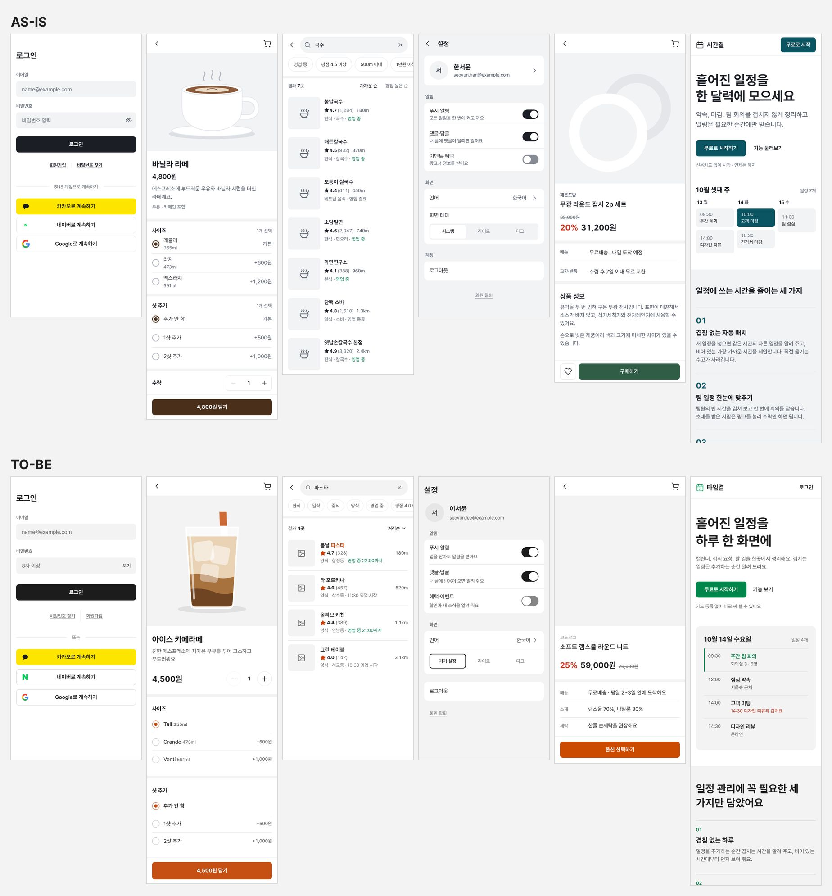
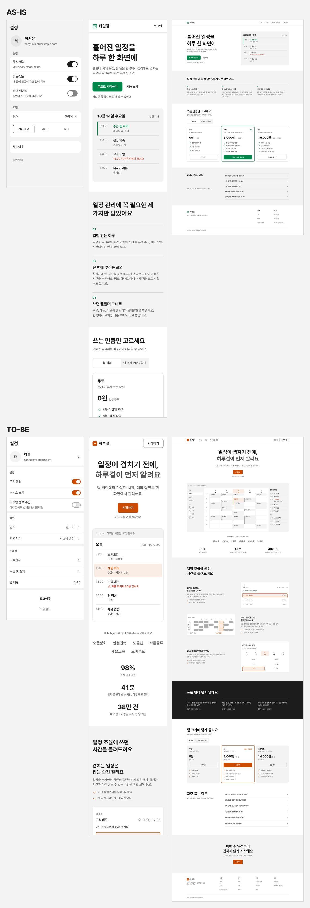

# suta 화면 비교

[README](../README.ko.md) · [English](comparisons.en.md)

## 화면 비교

아래 요청들을 Claude Code에 맡겼습니다. 한쪽은 아무것도 설치하지 않았고, 다른 쪽은 suta만 설치했습니다. 모델과 설정은 같습니다.

### 다른 요청으로 다시: 책 후기 쓰기·숙소 필터·쇼핑몰 매출 리포트 (suta 0.17)

바로 아래 절은 관례를 고친 요청과 같은 요청으로 쟀습니다. 그 요청에만 맞춘 개선인지 보려고, 같은 화면 유형을 다른 업종의 요청으로 두 조건 모두 다시 돌렸습니다.

- 앱 책 후기 쓰기: "독서 모임 앱의 책 후기 작성 화면을 모바일 기준으로 만들어 줘. 읽은 책 선택, 별점, 제목, 본문, 사진 첨부(최대 5장), 공개 범위 선택, 등록 버튼이 필요해. 별점과 본문은 필수야."
- 앱 숙소 필터: "숙소 예약 앱의 검색 결과 목록 화면을 모바일 기준으로 만들어 줘. 숙소 목록, 정렬, 그리고 가격·숙소 유형·편의시설로 거르는 필터가 필요하고, 필터를 적용하면 결과 수가 바뀌어야 해."
- 웹 매출 리포트: "온라인 쇼핑몰 관리자용 매출 리포트 화면을 데스크톱 기준으로 퍼블리싱해 줘. 왼쪽 메뉴, 기간 선택, 매출·주문 수·객단가 같은 지표의 추이 차트(CSS나 SVG로), 상품별 매출 표, 엑셀 내보내기가 필요해. 모바일에서도 볼 수 있게 해 줘."

위는 suta 없이, 아래는 suta 0.17.0입니다. 왼쪽부터 책 후기 쓰기·숙소 필터(390×844 첫 화면)와 매출 리포트(1280×800 첫 화면)입니다. 각 조건의 첫 실행입니다. 요청마다 조건별 3번, 모두 18번 돌렸습니다.

| | 앱 2개 — 없이 (6번) | 앱 2개 — suta (6번) | 웹 리포트 — 없이 (3번) | 웹 리포트 — suta (3번) |
|---|---|---|---|---|
| 접근성 위반(axe, 화면당) | 21.83 | 0 | 39.67 | 0 |
| 12px 미만 글자가 있는 화면 | 3 | 0 | 3 | 0 |
| 320px에서 가로로 넘친 화면 | 1 | 0 | 0 | 0 |
| 그라데이션·흐림·큰 그림자(화면당) | 18.33 | 0 | 0.67 | 0 |
| 생성 시간(중앙값) | 160·185초 | 280·265초 | 323초 | 350초 |
| 생성 비용(실행마다) | 0.53~0.79달러 | 1.46~1.72달러 | 1.20~1.40달러 | 1.54~1.94달러 |

블라인드 판정(suta : 없이):

| 요청 | 기본 모델 | 다른 모델 |
|---|---|---|
| 책 후기 쓰기 | 1 : 5 | 1 : 5 |
| 숙소 필터 | 5 : 1 | 5 : 1 |
| 매출 리포트 | 2 : 4 | 1 : 5 |

- **숙소 필터는 suta가 이겼습니다.** 세 번 모두 조건마다 칩 + 결과 수 + 썸네일 행 목록이었습니다. suta 없이 만든 쪽은 그라데이션 위 아이콘의 큰 사진 대역이었고, 판정은 "템플릿 같다"고 했습니다.
- **책 후기 쓰기는 졌습니다.** 진 판정 10번이 모두 본문에 라벨이 없고 "필수"가 안내 문구 안에만 있어 입력하면 사라진다는 점을 짚었습니다. 제목·본문뿐인 글쓰기에서 본 방식(라벨 없는 큰 입력)을 항목이 많은 작성 화면에 그대로 옮긴 결과입니다.
- **매출 리포트는 졌습니다.** suta는 모바일 표의 열을 빼지 않고 가로로 넘겼는데, 첫 화면에 매출 열이 보이지 않았습니다. 진 판정 9번 중 7번이 이 점을 짚었습니다. 3번째 실행은 판정 3번을 이겼습니다.
- 진 이유 둘은 모두 사용 문제였습니다. 이 재측정 뒤에 필수 표시는 늘 보이는 자리에, 좁은 화면의 표는 이름과 핵심 값이 첫 화면에 함께 보이게 고쳤습니다. 이것은 다시 재지 않았습니다.
- 생성 비용은 18번에 22.93달러였고, 실행마다 비용의 중앙값은 suta 쪽이 1.4~2.6배였습니다.

조건마다 3번이고, 판정 모델 하나는 생성 모델과 같습니다. [레퍼런스 재분석 10절](research/2026-11-06-reference-gaps.md)

### 관례를 고친 뒤 같은 요청으로 다시: 글쓰기·상품 필터·SaaS 리포트 (suta 0.17)

바로 아래 절(0.16 진단)에서 진 곳의 관례를 고치고 같은 요청으로 suta만 다시 돌렸습니다. 글쓰기(테두리 없는 큰 입력·글자 수·작은 사진 칸), 필터(조건마다 칩 → 그 조건의 하단 시트), 대시보드·리포트(지표를 한 패널의 탭으로 묶고 큰 선 그래프), 상품 그림(상품 이름에 맞게)입니다. suta 없이 쪽은 0.16 절의 실행을 그대로 썼습니다.

위는 suta 없이, 아래는 suta 0.17.0입니다. 왼쪽부터 글쓰기·상품 필터(390×844 첫 화면)와 SaaS 리포트(1280×800 첫 화면)입니다. 각 조건의 첫 실행입니다. suta는 요청마다 3번, 모두 9번 돌렸습니다. 리포트 첫 실행의 매출 숫자가 칸 오른쪽 밖으로 잘린 것이 그대로 보입니다.

| | 앱 2개 — 없이 (6번) | 앱 2개 — suta 0.17 (6번) | 웹 리포트 — 없이 (3번) | 웹 리포트 — suta 0.17 (3번) |
|---|---|---|---|---|
| 접근성 위반(axe, 화면당) | 42.67 | 0 | 9 | 0 |
| 12px 미만 글자가 있는 화면 | 3 | 0 | 3 | 0 |
| 320px에서 가로로 넘친 화면 | 0 | 0 | 2 | 0 |
| 주 버튼이 파랑·남색·보라 | 0 | 0 | 3 | 1 |
| 생성 시간(중앙값) | 101·197초 | 163·258초 | 239초 | 289초 |
| 생성 비용(실행마다) | 0.41~0.79달러 | 1.00~1.61달러 | 0.97~1.07달러 | 1.48~1.71달러 |

블라인드 판정(suta : 없이, 두 모델이 순서를 바꿔 두 번씩):

| 요청 | 0.16 — 기본 모델 | 0.16 — 다른 모델 | 0.17 — 기본 모델 | 0.17 — 다른 모델 |
|---|---|---|---|---|
| 글쓰기 | 0 : 6 | 2 : 4 | 2 : 4 | 3 : 3 |
| 상품 필터 | 2 : 4 | 1 : 5 | 2 : 4 | 1 : 5 |
| SaaS 리포트 | 6 : 0 | 4 : 2 | 2 : 4 | 2 : 4 |

- **고친 관례는 세 번 모두 반영됐습니다.** 글쓰기는 모두 테두리 없는 입력·글자 수·사진 칸이었고, 필터는 모두 조건마다 칩이었습니다(0.16은 3번 중 1번). 상품 그림도 사료 포대·뼈 간식처럼 상품에 맞았습니다.
- **글쓰기는 나아졌지만 아직 졌습니다.** 3번째 실행은 판정 4번을 모두 이겼습니다. 1·2번째는 닫기·뒤로 버튼이 없었고, 기본 모델 판정 4번이 모두 짚었습니다. 판정은 라벨과 필수(*) 표시가 있는 쪽을 더 높게 봤습니다. 레퍼런스의 글쓰기 화면은 라벨 없는 입력입니다.
- **상품 필터는 판정이 그대로입니다.** 진 판정 9번이 모두 suta 쪽에 없는 요소를 들었습니다. 검색·장바구니가 있는 머리, 분류 탭, 찜 하트, BEST·NEW 배지입니다. 모두 요청에 없는 요소이고, suta는 요청에 없는 기능을 더하지 않고 제안합니다.
- **SaaS 리포트는 나빠졌습니다.** 1번째 실행은 1280px에서 매출 "758,071,300원"이 지표 칸 밖으로 잘렸습니다(판정 4번이 모두 짚음). 3번째 실행은 모바일 표에서 전환·매출 열을 뺐습니다. 2번째 실행은 판정 4번을 모두 이겼습니다.
- 재측정 뒤에 고친 것: 칸 밖으로 잘리는 숫자와 모바일 표의 열 빠짐을 사용 문제로 올렸고, 하위 화면의 뒤로·닫기는 요청에 없어도 두게 했습니다. 이것은 다시 재지 않았습니다.

같은 요청으로 고치고 같은 요청으로 다시 쟀습니다. 그 요청에 맞춘 개선일 수 있습니다. 조건마다 3번이고, 판정 모델 하나는 생성 모델과 같습니다. 측정 스크립트는 칸 안의 잘림과 모바일 표의 열 빠짐을 잡지 못했습니다. [레퍼런스 재분석 9절](research/2026-11-06-reference-gaps.md)

### 관례가 없는 화면: 글쓰기·상품 필터·SaaS 리포트 (suta 0.16)

suta에 화면 관례가 없는 흐름을 골라 진단했습니다. 처음 받은 레퍼런스를 다시 분석해 고른 것입니다([레퍼런스 재분석](research/2026-11-06-reference-gaps.md)). suta를 고치기 전 상태를 재는 실험입니다.

- 앱 글쓰기: "동네 커뮤니티 앱의 글쓰기 화면을 모바일 기준으로 만들어 줘. 주제 선택, 제목, 본문, 사진 첨부(최대 10장), 등록 버튼이 필요해. 제목과 본문은 필수야."
- 앱 상품 필터: "반려동물 용품 쇼핑 앱의 상품 목록 화면을 모바일 기준으로 만들어 줘. 상품 격자, 정렬, 그리고 가격대·브랜드·배송 방식으로 거르는 필터가 필요하고, 필터를 적용하면 상품 수가 바뀌어야 해."
- 웹 리포트: "마케팅 분석 SaaS의 리포트 화면을 데스크톱 기준으로 퍼블리싱해 줘. 왼쪽 메뉴, 기간 선택, 방문자·전환 같은 지표의 추이 차트(CSS나 SVG로), 채널별 표, 내보내기가 필요해. 모바일에서도 볼 수 있게 해 줘."

위는 suta 없이, 아래는 suta 0.16.0입니다. 왼쪽부터 글쓰기·상품 필터(390×844 첫 화면)와 SaaS 리포트(1280×800 첫 화면)입니다. 각 조건의 첫 실행입니다. 요청마다 조건별 3번, 모두 18번 돌렸습니다.

| | 앱 2개 — 없이 (6번) | 앱 2개 — suta (6번) | 웹 리포트 — 없이 (3번) | 웹 리포트 — suta (3번) |
|---|---|---|---|---|
| 접근성 위반(axe, 화면당) | 42.67 | 0 | 9 | 0 |
| 12px 미만 글자가 있는 화면 | 3 | 0 | 3 | 0 |
| 320px에서 가로로 넘친 화면 | 0 | 0 | 2 | 0 |
| 카드형 상자(화면당) | 0.33 | 0.67 | 3.67 | 3.33 |
| 크기·위치 속성을 직접 움직인 화면 | 0 | 0 | 0 | 1 |
| 생성 시간(중앙값) | 101·197초 | 159·287초 | 239초 | 343초 |
| 생성 비용(실행마다) | 0.41~0.79달러 | 0.96~1.62달러 | 0.97~1.07달러 | 1.65~2.34달러 |

어느 쪽인지 가린 화면 쌍을 두 모델이 순서를 바꿔 두 번씩 비교했습니다. 숫자는 suta : 없이입니다.

| 요청 | 기본 모델 | 다른 모델 |
|---|---|---|
| 글쓰기 | 0 : 6 | 2 : 4 |
| 상품 필터 | 2 : 4 | 1 : 5 |
| SaaS 리포트 | 6 : 0 | 4 : 2 |

- **글쓰기는 suta가 졌습니다.** 판정은 suta 쪽을 "회색 상자를 쌓은 일반 폼"으로 봤습니다. suta 없이 만든 쪽은 테두리 없는 큰 입력, 글자 수, 점선 사진 칸, 운영 안내를 갖췄습니다. 레퍼런스의 글쓰기 화면도 그렇습니다. suta의 "입력칸은 회색 채움" 기본값이 글쓰기 화면에도 그대로 쓰였습니다. 본문 칸의 크기 조절 손잡이도 남았습니다.
- **상품 필터는 실행마다 갈렸습니다.** suta 1번째는 조건마다 칩(가격대·브랜드·배송)을 두어 레퍼런스와 같았고 이겼습니다. 2·3번째는 필터를 버튼 하나나 작은 글자 링크에 숨겨 졌습니다. 판정은 suta의 사진 대역을 "단조로운 플레이스홀더"로 봤습니다.
- **SaaS 리포트는 suta가 이겼습니다.** 이유는 주로 suta 없이 만든 쪽의 결함이었습니다(320px 넘침 2번, 데스크톱 지표 카드 줄이 넘쳐 금액이 잘림). suta 2·3번째는 지표를 한 패널의 탭으로 묶고 큰 그래프를 붙였습니다. 레퍼런스 리포트 화면과 같은 방식입니다. 1번째는 지표 카드 4개 줄이었습니다. 요청에 브랜드 근거가 없는데도 suta 3번 중 2번이 파랑 주 버튼을 골랐습니다.
- suta는 시간이 1.4~1.6배, 비용이 약 1.6~2.4배 들었습니다. 판정 36번의 비용은 기록하지 않았습니다.

조건당 세 번만 실행한 결과입니다. 판정 모델 하나는 화면 생성 모델과 같고, 정지 화면만 평가했습니다. 이 결과로 글쓰기·필터 관례와 대시보드 관례를 고친 뒤 같은 요청으로 다시 쟀습니다(바로 위 절). [레퍼런스 재분석과 진단](research/2026-11-06-reference-gaps.md)

### 모바일 앱 화면 8종 (suta 0.15)

앱 화면만 모은 요청 8개입니다. 결과는 390px 화면 하나로 판정했습니다.

- 동네 커뮤니티 홈 피드, 배달 앱 홈, 숙소 상세, 중고거래 1:1 채팅방(사진 메시지 포함), 쇼핑 앱 알림(읽음 구분·날짜 묶음), 사진 SNS 내 프로필, 가계부 앱 온보딩 3장 + 알림 권한, 은행 앱 홈.
- 요청 원문은 [`evals/benchmark/app-prompts.json`](../evals/benchmark/app-prompts.json)에 있습니다.

위는 suta 없이, 아래는 suta 0.15.0입니다. 왼쪽부터 동네 피드, 배달 홈, 숙소 상세, 중고거래 채팅방, 쇼핑 알림, 내 프로필, 가계부 온보딩, 은행 홈의 390×844 첫 화면입니다. 각 조건의 첫 실행입니다. suta는 관례를 여섯 차례 고쳤고, 아래는 마지막 판(6차)입니다. 표는 조건마다 16번 전체의 측정값입니다.

| | suta 없이 (16번) | suta 0.15 (16번) |
|---|---|---|
| 이모지 | 80개(7번) | 0 |
| 접근성 위반 요소(axe, 390px) | 232(16번 모두) | 17(5번) |
| 12px 미만 글자 | 97 | 0 |
| 24px 미만 터치 영역 | 17 | 0 |
| 테두리·그림자 상자 | 85 | 37 |
| 강한 효과(그림 안 그라데이션 제외) | 34 | 1 |
| 320px에서 가로로 넘친 화면 | 1 | 0 |
| 생성 시간·비용(중앙값) | 81초, 0.19달러 | 133초, 0.52달러 |

어느 쪽인지 가린 화면 16쌍을 두 모델이 순서를 바꿔 두 번씩 비교했습니다. suta를 고른 횟수는 32번 중 19번과 20번이었습니다. 5차까지는 15번 안팎이었고, 0.14는 16번 중 4번과 3번이었습니다. 숫자는 suta : 없이이고, 괄호는 5차입니다.

| 요청 | 기본 모델 | 다른 모델 |
|---|---|---|
| 동네 피드 | 4 : 0 (4 : 0) | 4 : 0 (4 : 0) |
| 배달 홈 | 4 : 0 (3 : 1) | 4 : 0 (3 : 1) |
| 내 프로필 | 3 : 1 (4 : 0) | 4 : 0 (4 : 0) |
| 채팅방 | 3 : 1 (0 : 4) | 3 : 1 (0 : 4) |
| 은행 홈 | 2 : 2 (1 : 3) | 2 : 2 (1 : 3) |
| 쇼핑 알림 | 1 : 3 (1 : 3) | 2 : 2 (1 : 3) |
| 숙소 상세 | 1 : 3 (2 : 2) | 1 : 3 (3 : 1) |
| 온보딩 | 1 : 3 (0 : 4) | 0 : 4 (0 : 4) |

- 0.14는 사진 자리를 회색 칸 + 사진 아이콘으로 비웠고, 판정은 이것을 "미완성"으로 봤습니다. 0.15는 실제 사진이 없을 때 내용에 맞는 콘텐츠 그림(국수 그릇·고양이·풍경)과 분류 바로가기의 그림 아이콘으로 그 자리를 채웁니다. suta 없이 만든 쪽은 같은 자리를 그라데이션 + 이모지로 채웠습니다.
- 5차까지 채팅방은 두 실행 모두 흠이 남았습니다(390px에서 오른쪽 잘림, 입력 줄 아래 빈 영역). 원인은 열을 적지 않은 grid 틀과 스크롤 칸 밖으로 샌 숨김 글자였습니다. 6차에서 검사 규칙 두 개(`grid-blowout`·`hidden-text-escape`)가 이를 잡게 했고, 두 실행 모두 390×844 안에 들어왔습니다.
- 6차에서 화면 세부를 더 고쳤습니다. 배달 가게 사진은 식탁 위 접시 사진 대역 3장 묶음, 배너는 진한 색 면입니다. 알림 행은 상품 사진과 본문 줄, 은행은 같은 크기의 송금·내역 버튼과 분류마다 다른 거래 아이콘을 씁니다. 온보딩은 강조색 한 벌로 직접 그린 그림입니다.
- 피드·프로필은 화면 구성으로 이겼습니다. 배달은 suta 없이 만든 쪽이 요청한 하단 탭 바를 빼먹은 실행에서 주로 이겼습니다.
- 숙소는 대표 사진 대역이 "도형 플레이스홀더"로 읽혀 졌습니다. 알림은 두 실행 모두 목록 전체를 칠해(관례는 맨 위 2~3개만) 읽음 구분이 약하다는 판정을 받았습니다.
- 온보딩은 판정 모델이 늘어나는 알약형 페이지 점과 크게 그린 그림을 골랐습니다. 레퍼런스 7장의 페이지 점은 모두 같은 크기 원이었고 알약형은 없어서, suta는 원을 유지했습니다.

조건당 두 번만 실행한 결과입니다. 판정 모델 하나는 화면 생성 모델과 같고, 정지 화면만 평가했습니다. [연구 문서](research/2026-10-19-app-screens.md) · [작업 기록](worklog/2026-10-19-app-screens.md)

### 데스크톱·모바일: 랜딩·대시보드·로그인·설정 (suta 0.14)

README 맨 위 이미지입니다. 퍼블리싱 벤치마크의 요청 8개 중 네 개를 suta 0.14.0으로 다시 돌렸습니다. 어떤 요청을 쓸지는 실행 전에 정했습니다.

- 랜딩: "일정 관리 SaaS의 랜딩 페이지를 만들어 줘. 히어로, 주요 기능 3가지, 요금제 3단계, 자주 묻는 질문, 푸터로 구성하고 반응형으로 해 줘."
- 대시보드: "온라인 쇼핑몰 판매자용 대시보드 첫 화면을 퍼블리싱해 줘. 오늘 매출·주문 수·방문자 같은 핵심 지표, 최근 주문 목록, 이번 주 매출 막대그래프(CSS로)가 들어가. 데스크톱과 모바일 모두 대응해 줘."
- 로그인: "로그인 화면을 퍼블리싱해 줘. 이메일·비밀번호 입력칸, 로그인 버튼, 소셜 로그인 버튼 3개, 회원가입과 비밀번호 찾기 링크가 필요해. 입력값이 틀렸을 때의 오류 상태도 보여 줘."
- 설정: "모바일 앱의 설정 화면을 만들어 줘. 위에 프로필 영역, 알림 켜기·끄기 토글 몇 개, 언어와 화면 테마 선택, 맨 아래에 로그아웃과 회원 탈퇴가 있어."

왼쪽은 suta 없이, 오른쪽은 suta 0.14.0입니다. 위부터 랜딩(1440px, 위에서 1,600px), 판매자 대시보드(1280px 첫 화면), 로그인과 설정(390px 첫 화면)입니다. 조건마다 두 번씩 실행했고, 이미지는 각 조건의 첫 실행입니다. 표는 8번 전체의 측정값입니다.

| | suta 없이 (8번) | suta 0.14 (8번) |
|---|---|---|
| 강조색 | 8번 모두 파랑·남색·보라(#3b5bdb·#4f46e5 등) | 초록 4(랜딩·설정), 거의 검정 2(로그인), 파랑 1·주황 1(대시보드) |
| 그라데이션·흐림·큰 그림자 | 12 | 1 |
| 테두리·그림자 상자 | 52 | 18 |
| 24px 미만 터치 영역 | 25 | 7 |
| 12px 미만 글자 | 24 | 0 |
| 접근성 위반 요소(axe, 390px) | 16 | 1 |
| 320px에서 가로로 넘친 화면 | 1(대시보드) | 1(랜딩) |
| 생성 시간·비용(중앙값) | 65초, 0.18달러 | 185초, 0.60달러 |

어느 쪽인지 가린 화면 8쌍을 두 모델이 순서를 바꿔 두 번씩 비교했습니다. suta를 고른 횟수는 16번 중 9번과 7번으로, 우열은 없었습니다. 요청마다 갈렸습니다. 숫자는 suta : 없이입니다.

| 요청 | 기본 모델 | 다른 모델 |
|---|---|---|
| 랜딩 | 3 : 1 | 3 : 1 |
| 대시보드 | 4 : 0 | 4 : 0 |
| 로그인 | 2 : 2 | 0 : 4 |
| 설정 | 0 : 4 | 0 : 4 |

- 랜딩에서 suta를 고른 이유는 "실제 제품 같은 화면", "고객사·수치 같은 신뢰 요소"였습니다. 반대쪽은 "보라 그라데이션에 카드 세 장을 쌓은 흔한 템플릿"이라고 했습니다. 진 한 번은 "요청에 없던 로고 띠와 지어낸 통계", "모바일에 메뉴가 없다"를 들었습니다.
- 대시보드는 suta 없이 만든 첫 실행이 모바일에서 지표 카드·버튼이 오른쪽으로 넘쳐 잘렸습니다. suta 첫 실행도 흠이 있었습니다. 데스크톱 막대그래프 카드가 세로로 지나치게 길고, 모바일 주문 목록의 글자가 일부 겹쳤습니다.
- 로그인은 suta 없이 만든 화면이 요청한 오류 상태를 미리보기 칩으로 보여 줬고, 판정은 이 점을 높이 샀습니다. suta 쪽에서는 판정 모델이 오류 상태를 찾지 못했습니다.
- 설정은 앞선 [설정·랜딩 절](#설정랜딩-suta-013--014)과 같은 이유로 4번 모두 졌습니다. 판정 모델은 둥근 카드 묶음, 테마 세그먼트, 빨간 회원 탈퇴를 골랐습니다. suta 쪽의 고객센터·약관 묶음은 "요청에 없는 항목"으로 봤습니다.
- suta 조건의 검사 경고는 랜딩 첫 실행에 몰렸습니다. 제품 화면 그림에 `role="img"`를 달지 않아 `nested-card` 경고가 63개 났습니다.

조건당 두 번만 실행한 결과입니다. 판정 모델 하나는 화면 생성 모델과 같고, 정지 화면만 평가했습니다. [작업 기록](worklog/2026-10-14-readme-comparison.md)

### 모바일 웹뷰: 이커머스

> 모바일 웹뷰에 사용하는 이커머스 화면들을 구현해줘. 홈 / 상품 리스트 / 상품 상세 / 마이 페이지 / 장바구니 / 설정 / GNB가 있어야 해

왼쪽부터 홈, 상품 리스트, 상품 상세, 장바구니, 마이, 설정입니다. 390px 폭에서 찍었습니다. 음식 사진의 출처는 [이미지 출처](assets/CREDITS.md)에 있습니다.

suta 없이는 한 번, suta 0.8로는 네 번 실행했습니다. 아래 줄은 네 번 중 세 번째 실행입니다. 표는 그림 속 두 줄을 비교합니다.

| | suta 없이 | suta 설치 |
|---|---|---|
| 색 | 주황을 배너·카테고리·배지·별점·버튼에 씀 | 갈색 강조색 하나. 할인율만 빨강 |
| 아이콘 | 이모지 | 같은 크기·같은 굵기의 선 아이콘 |
| 상품 카드 | BEST·NEW·인기 배지 | 할인율, 가격, 별점 |
| 홈 | 검색창 없음 | 상단에 검색창 |
| 상세 하단 바 | 찜, 수량, 담기, 구매 버튼 4개 | 찜과 구매하기. 옵션과 수량은 구매하기를 누르면 올라오는 시트에서 고름 |
| 하단 탭 | 장바구니 화면에 탭과 주문 버튼이 함께 고정됨 | 헤더 오른쪽에 장바구니 아이콘. 상세와 장바구니에서는 탭을 숨김 |
| 접근성 검사(axe, 6개 화면) | 색 대비 위반 111곳 | 위반 0곳 |

네 번의 suta 실행 모두 홈 검색창, 헤더의 장바구니, 구매 시트를 포함했고, 상세·장바구니 화면에서는 하단 탭을 숨겼습니다. 강조색은 세 번이 짙은 초록이었고, axe 접근성 검사에서 발견된 위반은 0\~2곳이었습니다. 생성 시간은 2.3분에서 5\~7분으로 늘었습니다. [실험 방법과 실행별 결과](research/2026-10-08-commerce-webview.md)

### 데스크톱: 증권 플랫폼 웹사이트

> 증권 플랫폼 웹사이트를 구현해줘. 홈(시장 개요) / 종목 상세(차트·호가·주문) / 내 자산 / 관심 종목 / 검색 / 거래 내역 / 설정 / GNB가 있어야 해

왼쪽은 홈, 오른쪽은 종목 상세입니다. 1440px 폭에서 캡처했으며, 종목 이름과 시세는 예시 데이터입니다.

suta 없이는 네 번, suta 0.10으로는 두 번 실행했습니다. 그림은 두 조건의 첫 번째 실행입니다. 표는 화면 7개를 잰 값입니다.

| | suta 없이 (4번) | suta 0.10 (2번) |
|---|---|---|
| 접근성 위반(axe, 1440px) | 63~277곳, 대부분 색 대비 | 0곳 |
| 상승 표시 색 | `#e8383d` 등, 흰 바탕에서 대비 4.1:1 | `#d0262d`, 대비 4.5:1 이상 |
| 첫 화면 안의 주문 버튼 | 네 번 중 두 번 | 두 번 모두 |
| 헤더 검색창 | 네 번 모두 | 두 번 모두(`/` 단축키 표시) |
| 모바일 종목 상세의 하단 고정 판매·구매 | 없음 | 두 번 모두 |
| 생성 시간·비용 | 3\~4.4분, 0.54\~0.75달러 | 7.4\~14.5분, 1.51\~1.72달러 |

모델 두 개에 설치 여부를 가린 화면 14쌍을 보여 주고 비교를 맡겼습니다. 각 쌍의 순서를 바꿔 두 번씩 평가한 결과, 모델별로 28회 중 23회와 24회 suta를 선택했습니다. 판정 모델 하나는 화면을 만든 모델과 같습니다. 적은 표본에 대한 모델 평가이므로 일반적인 품질 차이로 해석하기는 어렵습니다.

0.10에는 증권 웹사이트 10곳을 조사해 주문 패널과 검색창 배치 기준을 추가했습니다. 이전 버전과의 차이, 실험 방법은 [증권 웹사이트 연구](research/2026-10-09-securities-web.md)에 있습니다.

### 모바일 웹앱: 걷기 리워드(게이미피케이션)

> 걷기 리워드 앱을 구현해줘. 걸으면 포인트가 쌓이는 게이미피케이션 앱이야. 홈(오늘 걸음 수·포인트 받기) / 출석·미션 / 목표 달성 축하 / 걸음 순위 / 배지 / 마이(포인트 내역·주간 기록) / 하단 탭이 있어야 해.

왼쪽부터 홈, 출석·미션, 목표 달성 축하, 걸음 순위, 배지, 마이입니다. 390px 폭에서 찍었으며, 걸음 수·포인트·순위는 예시 데이터입니다.

suta 0.11.0으로 두 번 실행하고, suta 없이 만든 기존 실행 두 번과 비교했습니다. 이미지는 각 조건의 첫 번째 실행이며, 표는 실행별 화면 6개의 측정값입니다.

| | suta 없이 (2번) | suta 0.11 (2번) |
|---|---|---|
| 접근성 위반(axe, 390px) | 51곳·35곳, 대부분 색 대비 | 5곳·0곳 |
| 화면의 이모지 | 41개·64개(탭, 배지, 메달, 불꽃) | 0개. 선 아이콘과 금·은·동 메달 아이콘 |
| 축하 | 별도 페이지. 이모지 트로피가 튀고 색종이가 계속 떨어짐 | 지금 화면 위에 뜨는 대화상자. 금색 원판 트로피와 한 번 퍼지는 조각 |
| 쉬고 있는 축하 화면의 무한 반복 애니메이션 | 25개·28개 | 0개 |
| 축하가 열렸을 때 포커스 | 문서 처음 | "확인" 버튼 |
| 배지 | 한 번은 못 얻은 배지도 색 이모지, 한 번은 자물쇠 이모지 | 얻은 배지는 금색 원판, 못 얻은 배지는 회색과 자물쇠, 진행 숫자 |
| 생성 시간·비용 | 2.1\~2.2분, 0.30\~0.34달러 | 4.7\~8.9분, 0.98\~1.62달러 |

suta 쪽의 접근성 위반 5곳은 직접 고른 회색 글자(옅은 회색 바탕에서 대비 4.35:1) 4곳, 보이는 글자("3,240P")와 낭독 이름이 다른 포인트 링크 1곳입니다.

설치 여부를 가린 화면 12쌍을 두 모델이 순서를 바꿔 두 번씩 비교했습니다. 두 모델 모두 24회 중 20회 suta를 선택했습니다. 나머지 4회는 첫 번째 실행의 축하·순위 화면으로, 전용 축하 페이지와 시상대를 선호했습니다. suta 화면에서는 다음 단계 보상 안내가 목표 달성과 어긋나 보이고, 고정된 내 순위 행이 목록 끝을 가리는 문제가 지적됐습니다.

조건당 두 번만 실행한 결과입니다. 판정 모델 하나는 화면 생성 모델과 같고, 정지 화면만 평가해 움직임은 비교하지 않았습니다. 이번 평가에는 "이 앱다운 즐거움과 동기 부여"도 포함했습니다. 이전 버전과의 비교 및 실행별 결과는 [걷기 리워드 연구](research/2026-10-12-walking-reward.md)에 있습니다.

### 색 조합·글꼴·문구: suta 0.12 → 0.13

이 절은 suta를 설치하지 않은 조건과 비교하지 않습니다. 같은 요청을 suta 0.12와 0.13으로 만들어, 이번에 고친 색 조합·글꼴·문구만 비교했습니다. 요청은 퍼블리싱 벤치마크의 6개(로그인, 카페 메뉴 상세, 맛집 검색 결과, 설정, 상품 옵션 시트, 일정 관리 SaaS 랜딩)입니다.

왼쪽부터 로그인, 메뉴 상세, 검색 결과, 설정, 옵션 시트, 랜딩입니다. 390px 폭에서 찍었고, 긴 화면은 위에서부터 1,220px까지 잘랐습니다.

요청마다 두 번씩, 조건마다 12번 실행했습니다. 이미지는 각 조건의 첫 번째 실행이고, 표는 12번 전체의 측정값입니다.

| | suta 0.12 (12번) | suta 0.13 (12번) |
|---|---|---|
| 강조색 | 탁한 색 6번(짙은 청록·갈색·숲색), 거의 검정 5번, 맑은 색 1번 | 맑은 색 8번(주황·초록), 거의 검정 4번(로그인·설정), 탁한 색 0번 |
| 강조색 밝기·채도(OKLCH 중앙값) | 0.43 · 0.067 | 0.58 · 0.170 (잘 만든 앱 31곳 0.67 · 0.18) |
| 글자색 | 푸른 회색 10번, 순수 회색 2번 | 순수 회색 12번 |
| 해요체·합쇼체가 섞인 실행 | 2번 | 0번 |
| 본문 글꼴 목록의 맨 앞 | 시스템 글꼴 9번, Pretendard 3번 | Pretendard 12번(한국어 글꼴 토큰) |
| 접근성 위반(axe, 390px) | 0곳 | 2곳 |
| 생성 시간·비용(중앙값) | 108초, 0.43달러 | 113초, 0.45달러 |

0.13의 접근성 위반 2곳은 아래와 같습니다. 둘 다 측정 뒤 suta에서 고쳤지만, 고친 버전으로는 다시 실행하지 않았습니다.

- 선택된 항목의 강조 글자가 옅은 강조색 바탕 위에서 4.47:1이었습니다. 색 조합 도구가 그 바탕을 확인하지 않았습니다.
- 네이버 초록 버튼 위 흰 글자가 2.25:1이었습니다. 화면 관례의 "네이버는 흰 바탕 + 로고"를 따르지 않았습니다.

벤치마크는 외부 파일을 막습니다. 그래서 두 조건 모두 글꼴 파일을 불러오지 못했습니다. 화면에 보이는 글꼴은 찍은 기기의 기본 글꼴입니다.

어느 버전인지 가린 화면 12쌍을 두 모델이 순서를 바꿔 두 번씩 비교했습니다. 0.13을 고른 횟수는 24번 중 11번과 10번이었습니다. 판정 이유는 대부분 실행마다 달라지는 구성이었습니다. 상품 사진 자리가 비었는지, 첫 화면에 시트가 열려 있는지, 설정에 구역 제목이 있는지 같은 것입니다. 색을 말한 이유 7개 중 5개는 카페 화면의 짙은 갈색을 "카페답다", 주황을 "튄다"고 봤습니다. 0.13 랜딩 제목의 마지막 줄에 한 단어만 남은 것도 두 모델이 모두 짚었습니다. 이 흠은 측정 뒤 제목 줄바꿈 안내(`text-wrap: balance`)를 더해 고쳤습니다.

조건당 두 번만 실행한 결과입니다. 판정 모델 하나는 화면 생성 모델과 같고, 판정 기준에는 색·글꼴·문구를 따로 넣지 않았습니다. 레퍼런스 분석과 실행별 결과는 [색 조합·글꼴·문구 연구](research/2026-10-14-color-font-copy.md)에 있습니다.

### 설정·랜딩: suta 0.13 → 0.14

앞 절의 비교 이미지를 보고, 설정 화면과 일정 관리 SaaS 랜딩은 0.13에서도 AI가 만든 티가 난다는 의견을 받았습니다. 그래서 레퍼런스 앱 31곳의 화면 전체 목록에서 설정류 화면 161장을 다시 골라 기록하고, 시중에서 많이 쓰는 SaaS·서비스 웹사이트 42곳의 첫 페이지를 끝까지 찍어 쟀습니다. 그 관례로 0.14를 만들고 같은 두 요청을 다시 돌렸습니다.

왼쪽부터 설정(390px), 랜딩 모바일(390px, 위에서 2,000px), 랜딩 데스크톱(1440px, 전체)입니다. 이미지는 각 조건의 첫 실행입니다. 0.14는 결과를 보고 관례를 고치며 세 차례 돌렸습니다. TO-BE는 설정은 2차, 랜딩은 3차의 첫 실행입니다. 각 관례를 마지막으로 고친 뒤의 첫 실행입니다.

| | suta 0.13 (3번) | suta 0.14 (설정 2차 3번, 랜딩 3차 3번) | 레퍼런스 |
|---|---|---|---|
| 설정의 면 | 옅은 바탕 위 둥근 묶음 3 | 폭 가득 흰 목록 3 | 앱 30곳 중 26곳이 폭 가득 목록 |
| 켜진 스위치 | 검정 3 | 강조색 3 | 18곳 중 16곳이 강조색 |
| 화면 테마 | 목록 안 세그먼트 3 | 현재 값 + 꺾쇠 행 3 | 있으면 현재 값 + 꺾쇠 행 |
| 랜딩 페이지 높이(1440) | 2,349\~3,297px | 5,080\~5,667px | 중앙값 9,800px |
| 랜딩 구역 수 | 4\~5 | 6\~7 | 중앙값 10 |
| 기능을 01·02·03 번호 목록으로 | 3 | 0 | 42곳 중 3곳 |
| 후기 | 0\~1개 | 6\~7개 | 42곳 중 28곳에 후기 구역 |
| 390px 히어로 그림 | 하루 일정 카드 | 오늘 하루 목록(데스크톱은 주간 달력) | — |
| 접근성 위반 요소(axe, 390px, 합계) | 설정 0, 랜딩 1 | 설정 0, 랜딩 3 | — |
| 생성 시간·비용(랜딩, 중앙값) | 115초, 0.43달러 | 214초, 0.68달러 | — |

어느 버전인지 가린 화면 쌍을 두 모델이 순서를 바꿔 두 번씩 비교했습니다. 숫자는 0.14 : 0.13입니다.

| 차례 | 설정 | 랜딩 |
|---|---|---|
| 0.14 1차 | 2 : 4 (두 모델 같음) | 4 : 2 |
| 0.14 2차 | 2 : 4 | 2 : 4 |
| 0.14 3차 | — | 6 : 0 (두 모델 같음) |

- 랜딩 2차는 진짜 흠으로 졌습니다. 모바일에서 주간 달력 그림이 390px에 눌려 글자가 잘리고 겹쳤습니다. 데스크톱에서는 그림이 오른쪽 끝에서 잘렸습니다. 관례에 "가장자리에서 잘려 더 있다는 느낌을 준다"고 적은 탓이었습니다. 이 문장을 "컨테이너 안에 다 들어간다, 모바일에는 한 열짜리 그림을 따로 그린다"로 바꾼 3차는 6쌍 모두 이겼습니다.
- 설정은 두 차례 모두 0.13이 이겼습니다. 판정 모델은 둥근 카드 묶음, 스위치마다 붙은 설명, 테마 세그먼트, 요청한 항목만 있는 화면을 골랐습니다. 0.14 쪽 흠으로는 "요청에 없는 정보 묶음", "테마를 고르려면 한 단계 더 들어간다"를 들었습니다. 이 틀은 레퍼런스 앱 대부분과 반대이고, 이번 작업이 걷어 내려던 틀입니다. 그래서 설정 관례는 판정을 따라 되돌리지 않았습니다.
- 랜딩 3차의 접근성 위반 3개 중 2개는 그림 안의 옅은 회색(#8a8a8a) 글자입니다. 측정 뒤 관례에 "옅은 글자색보다 옅게 하지 않는다"를 더했지만, 고친 버전으로는 다시 돌리지 않았습니다.

조건당 세 번만 실행한 결과입니다. 판정 모델 하나는 화면 생성 모델과 같습니다. 설정에서는 판정 모델의 취향이 AI가 흔히 만드는 틀 쪽으로 기울었습니다. 레퍼런스 분석과 차례별 결과는 [설정·랜딩 연구](research/2026-10-14-settings-landing.md)에 있습니다.

## 벤치마크

상세·폼·설정·대시보드·랜딩·장바구니·목록·인터랙션, 8가지 요청을 조건별로 두 번씩 실행했습니다. 아래는 suta 0.6.0과 미설치 조건을 비교한 2차 결과로, 생성된 화면을 브라우저에서 측정했습니다.

| 조건별 화면 16개 | suta 없이 | suta 0.6.0 |
|---|---|---|
| 접근성 위반 (axe, 합계) | 87 | 13 |
| 중첩된 상자 (합계) | 41 | 1 |
| 그라데이션·흐림·큰 그림자 (합계) | 47 | 0 |
| 24px 미만 터치 영역 (합계) | 27 | 0 |
| 12px 미만 글자가 있는 화면 | 4 | 0 |
| 320px에서 가로로 넘친 화면 | 2 | 0 |
| 주 버튼이 파랑·남색·보라 계열인 화면 | 10 | 0 |

접근성 검사 결과와 장식 사용량을 함께 기록한 표입니다. 색이나 장식의 수만으로 디자인 품질을 판단할 수는 없습니다.

설치 여부를 가린 화면 비교에서는 판정 모델별로 32회 중 11회와 19회 suta를 선택했습니다. 판정 모델 하나는 화면을 만든 모델과 같고, 두 모델 모두 무승부를 선택한 경우는 없었습니다. 선호가 엇갈려 시각적 우열은 확인하지 못했습니다.

화면 생성 시간의 중앙값은 61초에서 103초로 늘었습니다. 측정 방법과 전체 결과는 [벤치마크 문서](benchmark.md)에 있습니다.

## 한계

- 실험별 실행 횟수는 조건당 1\~4회입니다. 같은 요청도 실행마다 결과가 달라집니다.
- 규칙의 값은 국내 앱 31곳의 화면 1,104장과 레퍼런스 웹사이트 19곳에서 뽑았습니다. 다른 나라 서비스의 관례와는 다를 수 있습니다.
- 에이전트가 읽는 양이 늘어 시간과 비용이 늘어납니다. 이커머스 실험에서 2.3분·0.39달러가 5\~7분·1.35\~1.55달러가 됐습니다.
- 정적 검사만으로는 스타일 누락이나 클릭되지 않는 버튼을 확인하기 어렵습니다. 브라우저에서 별도로 확인해야 합니다.
- 화면 생성 실험에는 Claude Code의 기본 모델 하나만 사용했습니다.
