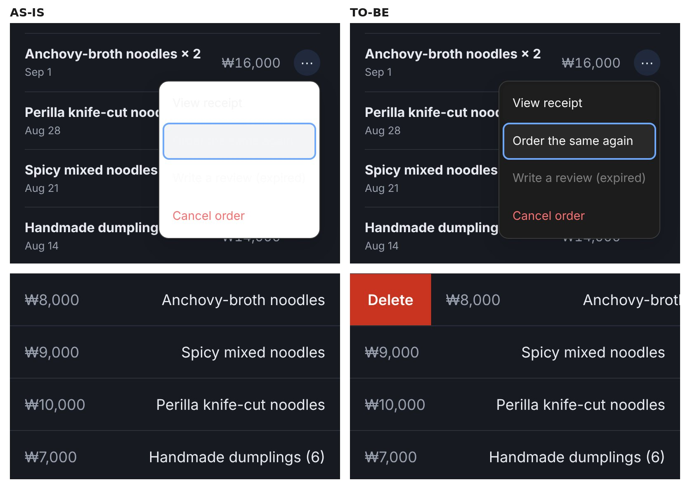

# suta 0.20.0

suta 0.20.0 fixes three things the 0.19.0 pattern review left open: springs that never ended, surfaces that ignored the color tokens, and right-to-left screens. The entry skill and its conventions are unchanged. Tests went from 1,297 to 1,322.

- **Surfaces follow the color tokens.** In 13 patterns the surface background was a fixed white while the text followed `--color-text` or was inherited. A project that set dark tokens got light text on a white surface. The background now falls back through `--color-surface`.
  - Affected: bottom-nav, bottom-sheet, card-expand, dropdown-menu, edge-swipe-back, hamburger-menu, long-press-menu, modal-dialog, otp-input, quantity-stepper, search-suggest, select, swipe-to-delete.
  - With `--color-surface: #1c1c1c` and `--color-text: #f5f5f5`, dropdown-menu text contrast went from 1.09:1 to 15.63:1.
  - The highlighted menu item follows too. dropdown-menu uses `--color-canvas` instead of a blue-gray. long-press-menu lays the text color at 8% instead of black at 6%, which was invisible on a dark surface.
- **Right-to-left screens (`dir="rtl"`).**
  - swipe-to-delete: the actions sit on the left and the row is swiped right. Before, the actions were placed off screen and the row did not open.
  - edge-swipe-back: the edge is the right one and the screen is dragged left. The previous screen waits on the right.
  - hamburger-menu: `side` accepts `start` and `end`, which follow the text direction. `left` and `right` stay physical.
  - long-press-menu: the menu aligns to the item's right edge and grows from that corner.
- **Springs always end.** The shared spring core (spring-physics, also copied into swipe-dismiss-viewer and edge-swipe-back) kept requesting frames forever in two cases.
  - Non-numeric input (a `NaN` velocity or target, zero stiffness or mass) now ends at the target, or at the start position if the target is not a number.
  - A setting that never settles, such as zero damping, now ends at the target after 10 seconds.



Top: a dropdown menu under dark color tokens. Bottom: the first row after a swipe to the right in `dir="rtl"`. Left is 0.19.0, right is 0.20.0.

## Behavior changes

If you copy these patterns again, note the following.

- `Drawer` (hamburger-menu): the default `side` is `start` instead of `left`. Left-to-right screens are unchanged. In `dir="rtl"` screens the drawer now opens from the right. Pass `side="left"` for the old behavior.
- swipe-to-delete, edge-swipe-back and long-press-menu flip direction in `dir="rtl"` screens.
- Projects that define `--color-surface` get that color on the 13 surfaces listed above. A per-pattern variable such as `--sheet-bg` still wins.
- A spring with zero damping stops after 10 seconds. For an endless oscillation use a CSS `animation`.

## Not covered

- Checked in headless Chromium with a mouse, and in jsdom tests. Touch devices, Safari's `:dir()` and screen readers were not tested.
- glass-nav still misplaces the active pill when its links overflow in `dir="rtl"`.
- story-progress leaves flipping the left and right tap zones to the project.
- Default border colors (`#d4d4d4` and similar) do not follow a token. They stay visible on a dark surface but do not match it.
- No new generation measurement was run for this version. The changes are in pattern code, not in the entry skill.

## Install

Claude Code, in the chat:

```text
/plugin marketplace add Guksu/suta
/plugin install suta@suta
```

Codex, in a terminal:

```bash
codex plugin marketplace add Guksu/suta
codex plugin add suta@suta
```

Approve suta's post-edit check in Codex `/hooks`.

Skill only, without the post-edit hook:

```bash
npx skills add Guksu/suta --skill suta
```

## Update

For Claude Code, run `claude plugin marketplace update suta` followed by `claude plugin update suta@suta`, then start a new session.

For Codex, run `codex plugin marketplace upgrade suta`, then check and update the installed suta version in the app's plugin settings. Marketplace refresh alone does not confirm an installed-plugin update.

For a skills CLI install, run `npx skills update suta` from the project where you installed it; select the scope where suta is installed. If you used our install script, rerun it with the same destination.

These commands follow the current marketplace branch. The source archive on this release preserves version 0.20.0.

[Live demo](https://guksu.github.io/suta/) · [Full guide](https://github.com/Guksu/suta/blob/v0.20.0/docs/guide.en.md) · [Screen comparisons](https://github.com/Guksu/suta/blob/v0.20.0/docs/comparisons.en.md) · [Work log (Korean)](https://github.com/Guksu/suta/blob/v0.20.0/docs/worklog/2026-11-15-readme-019-deferred-fixes.md) · [Full changelog](https://github.com/Guksu/suta/compare/v0.19.0...v0.20.0) · [Report an issue](https://github.com/Guksu/suta/issues)
