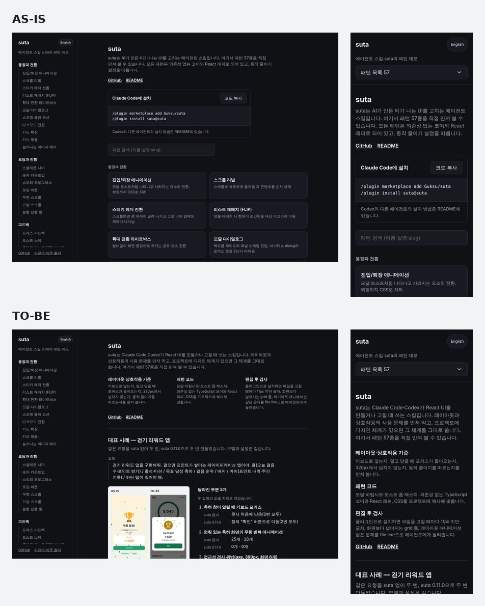

# 외부 개발자가 도입하기 쉽게 — 우선순위·사실 정보·진입 문서 구조·첫 화면

| 항목 | 내용 |
|------|------|
| 날짜 | 2026-11-05 |
| 작성 | 에이전트 (Claude Code) |
| 관련 경로 | `skills/suta/SKILL.md`, `skills/suta/references/`(새로 만듦), `skills/suta/patterns/layout-principles/references/{screen-conventions,tone,copy,react-native}.md`, `skills/suta/patterns/{layout-audit,motion-audit,layout-principles}/PATTERN.md`, `skills/suta/scripts/hookCore.ts`, `skills/suta/patterns/layout-audit/assets/auditLayout.ts`, `scripts/{buildCatalog,validateSkills}.mjs`·`scripts/lib/catalog.ts`, `demo/src/{App,HomeCase,i18n}.tsx?`·`styles.css`, `README.md`·`README.ko.md`, `docs/guide(.en).md`, `AGENTS.md` |

## 1. 개요

사용자가 suta를 외부 개발자가 이해하고 실제 프로젝트에 넣기 쉽게 고쳐 달라고 했다. 기능 수를 늘리지 말고, 사용자가 체감할 개선과 검증 가능한 근거에 집중하라는 요청이었다. 받은 분석 다섯 가지를 지금 코드에 대어 보고, 유효한 것만 고쳤다. 새 유료 LLM 평가나 벤치마크는 돌리지 않았고, 기존 측정 자료와 로컬 검사·브라우저 확인만 썼다.

## 2. 작업내용

### 분석이 지금도 맞는지

| 지적 | 지금 코드에서 확인한 것 | 판단 |
|---|---|---|
| 기존 디자인을 suta 금지선으로 바꾸게 한다 | `SKILL.md` 1단계 "금지선에 걸리는 색·구조까지 지키지는 않는다", 4단계 "상태 색 팔레트는 줄인다", `tone.md` 49줄 "이미 있는 체계라도 금지선에 걸리는 색은 지키지 않는다", `layout-principles/PATTERN.md` 3단계도 같았다. 같은 `SKILL.md`의 한계 절은 "체계가 있으면 그 값을 쓴다"여서 서로 어긋났다. 마무리 체크리스트는 취향 경고(`hue-count`·`tinted-surface` 등)까지 0을 요구했다 | 유효 |
| 요청하지 않은 것을 더하게 한다 | 설정 관례 "요청한 항목만 두면 비어 보인다 — 고객센터·약관·버전을 함께 둔다", 체크리스트 "고객센터·약관·버전 행이 있다", 랜딩 "기능·증거·후기·마지막 띠가 빠지면 빈 틀". 0.14 비교에서 판정 모델이 진 이유로 "요청에 없는 항목", "요청에 없던 로고 띠와 지어낸 통계"를 들었다 | 유효 |
| 검사 규칙이 취향을 강제한다 | error 규칙 8개(레이아웃 5·모션 3)는 모두 사용 문제였고, 훅도 error만 막는다 | 이미 해결. 규칙은 그대로 두었다. 다만 `layout-audit/PATTERN.md`의 "11px 미만만 error" 설명이 낡았고, warn 안내가 사용 문제와 취향을 나누지 않았다 |
| 랜딩의 사실 정보 | 증거 띠 "가상의 서비스면 지어낸 회사 이름을 글자 로고로", `SKILL.md` 문구 표·`copy.md`·`meta-copy` 고치는 법이 "지어낸 값이라는 안내는 코드 주석·README에" | 유효. README에 숨기는 방식을 직접 권하고 있었다 |
| 처음 읽는 지침이 길다 | `SKILL.md` 57,732바이트·363줄. `scripts/lib/catalog.ts` 주석의 권장 크기(약 5,000토큰)보다 훨씬 컸다. 사용 문제, 취향 기본값, 화면 유형별 체크리스트, 57행 카탈로그가 한 파일에 있었다 | 유효 |
| README·데모 첫 경험 | 비교 이미지·설치·영문 문서·57개 데모는 이미 있었다. 데모 첫 화면은 소개 → 설치 → 57개 목록이었고 사례가 없었다. 데모의 README 링크가 언어와 반대였다(한국어 화면 → 영어 `README.md`, 영어 화면 → 이동 안내뿐인 `README.en.md`) | 자료는 있고 연결이 없었다. 링크는 버그 |
| 평가의 불리한 결과 | `docs/comparisons.md`에 설정 0:4, 로그인 열세, 시간·비용 증가, 판정 모델 한계가 이미 있었다 | 이미 해결. 그대로 두고 README 표에 다시 드러냈다 |

### 고친 것과 이유

- **우선순위** — `SKILL.md` 맨 앞에 "사용자가 명시한 요구 → 기존 디자인 체계 → 실제 사용 문제 → suta 기본값"을 두었다. 사용 문제와 취향을 나눈 표(키보드·포커스·대비·넘침·동작 줄이기 대 카드·색 수·설정 구성·글꼴·말투)를 붙였다. 기존 스타일의 사용 문제는 그 값 하나만 고치고 범위를 보고한다(예: 3.9:1 회색 하나만 4.5:1로).
  - `tone.md`·`copy.md`·`layout-principles/PATTERN.md`·`react-native.md`·`screen-conventions.md`(머리말·설정)를 같은 기준으로 고쳤다.
  - `layout-principles/PATTERN.md` 예시의 강조색이 `#8a4b1f`(간장색)였다. `tone.md`와 `muddy-accent` 규칙이 피하라는 탁한 색이라, 브랜드색을 잇는 주석 + `palette.mjs`가 낸 `#ca4c00`(흰 글자 4.62:1)으로 바꿨다.
- **요청 범위** — 관례는 배치에 쓰고 더하는 근거로 쓰지 않는다고 적었다. 설정의 고객센터·약관·버전, 랜딩의 후기·로고 띠, 홈의 검색창도 요청에 없으면 제안만 한다. 요청한 상태는 실제 조작으로 그 상태가 되고 확인할 수 있어야 한다. "보여 달라"는 요청이면 상태별 화면이나 `?state=error`로 연다. `copy.md`의 "상태 확인은 개발 도구에서"와 부딪혀 두 문서를 맞췄다. 0.14 로그인이 "오류 상태를 찾지 못했다"로 진 것과 관련된다.
- **사실 정보** — `SKILL.md`에 실제 서비스와 명시적 가상 목업을 나눈 표를 두었다.
  - 실제 서비스: 고객사 로고·사용자 수·후기·성과 수치는 받은 자료만 쓴다. 없으면 구역을 만들지 않고 자료를 요청한다. 요청한 구역의 값(요금 등)을 받지 못했으면 한 곳에 모아 `확인 필요` 주석을 달고 보고에 나열한다.
  - 명시적 가상 목업: 지어낼 수 있지만 그 구역 안에 "예시" 표시를 화면에 보이게 둔다.
  - 랜딩 관례의 뼈대·증거 띠·하지 말 것, `copy.md` 7절, `meta-copy` 고치는 법(코드)과 규칙표, 체크리스트를 같은 기준으로 고쳤다. `meta-copy` 규칙 자체는 약화하지 않았다. 목업의 예시 표시가 걸리면 예외 주석으로 남긴다.
- **검사 안내** — 규칙의 심각도는 하나도 바꾸지 않았다. 대신 사용 문제와 취향을 나눠 안내한다.
  - `layout-audit/PATTERN.md` 규칙표에 "사용/취향" 열을 더했다. `motion-audit/PATTERN.md`에는 같은 구분을 한 문단으로 적었다.
  - 편집 후 검사 훅(`hookCore.ts`)은 사용 문제 warn(`input-zoom`·`accent-contrast` 등 10개)을 `[사용 문제]`로 앞에 둔다. 취향 warn에는 "프로젝트 디자인 체계의 값이면 그대로 둔다"를 붙인다(TDD, 테스트 3개).
- **진입 문서 구조** — 늘 필요한 것과 특정 작업에서만 필요한 것을 나눴다.
  - `SKILL.md`(늘 읽힘): 우선순위, 사용 문제와 취향, 요청 범위와 사실 정보, 작업 절차, 읽을 문서 표, 늘 지키는 선(접근성·조작·넘침·모션), 끝내기 전에, 패턴 색인(이름 + 데모 제목, 자동 생성).
  - `references/defaults.md`: 디자인 기준이 없을 때의 기본값 — 덜어내기, 뼈대, 톤, AI가 흔히 만드는 틀과 대안, 레이아웃·모션 값. 원문 줄을 그대로 옮기고 위 기준에 걸리는 행만 고쳤다.
  - `references/checklist.md`: 기준이 없을 때·화면 유형별 확인.
  - `references/catalog.md`: 패턴마다 한 줄 설명(자동 생성).
  - "읽을 문서" 표가 요청 유형마다 읽을 문서를 정한다.
  - `validateSkills.mjs`가 막는 것: 핵심 절 7개가 빠질 때, 참조 문서를 `SKILL.md`가 가리키지 않을 때(읽힐 길이 없는 문서), 참조 문서 안의 경로·링크가 설치된 스킬에서 풀리지 않을 때, 본문이 30,000바이트를 넘을 때. 절 이름과 연결을 일부러 깨서 실패하는 것을 확인했다.
  - `npm run catalog`가 색인과 카탈로그를 함께 만든다(TDD, 테스트 5개).
  - 크기: `SKILL.md` 57,732바이트·363줄 → 24,743바이트·188줄. 참조 문서 3개를 더하면 74,761바이트다. 요청마다 실제로 읽는 양이나 시간·비용은 재지 않았다.
- **README** — 소개를 "AI 슬롭을 줄인다"에서 세 가지로 바꿨다: 레이아웃·상호작용 기준, 패턴 코드, 편집 후 검사. 기존 0.14 비교 이미지 아래에 측정 표를 두었다. 표에는 불리한 결과도 그대로 넣었다(320px 넘침 1 대 1, 선호 판정 7·9 대 9·7, 설정 8번 모두·로그인 8번 중 6번 열세, 시간·비용 약 세 배). 0.14 수치라는 것과, 0.14 랜딩이 요청에 없던 로고·통계를 넣었다는 판정도 적었다. "첫 요청"에는 기존 디자인 체계를 유지한다는 한 줄을 더했다.
- **데모 첫 화면** — 패턴 목록보다 먼저 세 가지 가치, 대표 사례, 설치와 첫 요청을 둔다.
  - 대표 사례는 걷기 리워드 앱(suta 0.11.0, 조건마다 2번)이다. 기존 측정 중 색이 아니라 직접 확인할 수 있는 차이가 기록된 사례라 골랐다.
  - 이미지는 `docs/assets/walking-as-is-to-be.jpg`의 축하 화면 열을 잘라 만들었다(`demo/public/compare/walking-celebration.jpg`, 각 조건의 첫 실행).
  - 달라진 부분 3개: 축하 창이 열릴 때 포커스(문서 처음 → "확인" 버튼), 멈춘 화면의 무한 반복 애니메이션(25·28 → 0·0), axe 위반(51·35 → 5·0, 5곳의 내용 포함).
  - 같은 자리에 시간·비용 증가, 실행 수, 재측정하지 않았다는 것, 선호 판정과 접근성의 구분을 둔다.
  - 직접 확인하기: 축하 오버레이, 모달, 레이아웃 검사 데모로 가는 링크와 할 일을 적었다.
  - README 링크 버그를 고쳤다. 첫 화면 동작은 `home.test.tsx`(테스트 5개, 4개는 먼저 실패 확인)로 고정했다.
- **버전** 0.15.0 → 0.16.0. 설치된 스킬의 지침·훅 메시지가 바뀌어서다. PR만 만드는 요청이라 `docs/releases/v0.16.0.md`는 만들지 않았다. 초안은 `docs/drafts/2026-11-05-launch-drafts.md`에 있다.

### 실행한 검사

- `npm run build`·`npm run lint`·`npm test`(95개 파일, 837개 통과)·`npm run validate`가 통과했다. validate는 스킬 구조 검증, 선택 평가 476/476(트리거 + 패턴 57개), 통합 검사 `skills/suta` 192개 파일 error 0·warn 0이다.
- 시작 전 기준: 같은 네 명령이 모두 통과했다(테스트 825개, 선택 평가 476/476).
- `node skills/suta/scripts/audit.mjs demo/src`: 125개 파일 error 0·warn 0.
- 편집 후 검사 훅을 표본 CSS로 실행했다. `input-zoom`이 `[사용 문제]`로 맨 앞에, `spacing-off-scale`·`nested-card`가 취향 안내와 함께 나왔다.
- 브라우저(Playwright Chromium, 빌드한 데모를 `vite preview`로):
  - 축하 오버레이: "도장 찍기"에서 Enter → 포커스 "쿠폰 받기", Esc → 창 닫힘, 포커스 "도장 찍기"로 복귀.
  - 모달: "주문 취소"에서 Enter → "돌아가기", Esc → "주문 취소"로 복귀.
  - 첫 화면 320·390·1280px: 가로 넘침 0, 12px 미만 글자 0, 사례 이미지 로드, README 링크가 화면 언어대로, Tab으로 사례의 링크에 닿고 포커스 표시가 보인다.
  - 390px에서 "측정 방법" 링크와 "직접 확인하기" 제목이 붙는 것을 찾아 고쳤다(선택자 우선순위).
- description을 바꾸지 않아 트리거 평가는 그대로다. 패턴 선택 평가는 `PATTERN.md` description을 쓰므로 카탈로그를 옮겨도 그대로다.

### README·데모 전후

| | 전 | 후 |
|---|---|---|
| README 첫 문장 | 카드·색·장식을 줄이는 UI 스킬 | 키보드·포커스·넘침·동작 줄이기를 지키는 UI를 만들게 돕는 스킬 + 패턴 57종 + 편집 후 검사 |
| README 근거 | 이미지와 "약 세 배 오래 걸렸다" 한 줄 | 같은 이미지 + 측정 표 6행(불리한 행 포함) + 버전·판정 한계 + 키보드 예시 링크 |
| 데모 첫 화면 | 소개 → 설치 → 패턴 검색·목록 | 소개 → 세 가지 가치 → 대표 사례(전후 이미지·달라진 부분 3개·비용·한계·직접 확인 3곳) → 설치와 첫 요청 → 패턴 목록 |
| 데모 README 링크 | 한국어 화면 → 영어 README, 영어 화면 → 이동 안내 | 한국어 → `README.ko.md`, 영어 → `README.md` |

### 새로 재지 않아 아직 주장할 수 없는 것

- 진입 문서가 짧아져 토큰·시간·비용이 줄었는지. 에이전트가 참조 문서를 함께 읽으므로 요청당 읽는 양은 재지 않았다. 지금 말할 수 있는 것은 파일 구조뿐이다.
- 새 우선순위로 디자인 체계가 있는 프로젝트에서 원치 않는 변경이 줄었는지. 그런 프로젝트로 실행해 보지 않았다.
- 요청에 없는 구역(설정의 고객센터·약관, 랜딩의 증거 띠·후기)을 빼면 블라인드 선호가 어떻게 바뀌는지. 0.14 랜딩이 이긴 이유 중 하나가 "고객사·수치 같은 신뢰 요소"였으니 떨어질 수도 있다.
- 데모 대표 사례의 차이(포커스·무한 반복·axe)가 0.16.0에서도 같은지. 사례는 0.11.0 측정이다.
- 상태를 `?state=error`나 상태별 화면으로 보이라는 안내가 요청 누락을 줄이는지.

### 후속 외부 사용자 테스트에서 확인할 질문

1. 디자인 토큰이나 컴포넌트 라이브러리가 있는 실제 프로젝트에서 화면 하나를 suta로 고쳤을 때, 원하지 않은 스타일 변경이 있었나요? 바뀐 곳마다 이유(사용 문제)와 범위가 보고에 적혀 있었나요?
2. 데모 첫 화면만 보고 1분 안에 "suta가 무엇을 바꾸는지"와 "설치 후 무엇을 요청하면 되는지"를 말할 수 있었나요? 건너뛰거나 믿기 어려웠던 부분은 어디였나요?
3. 요청한 기능·상태 중 빠진 것이나, 요청하지 않았는데 생긴 구역·데이터가 있었나요? 편집 후 검사의 error·warn을 보고 무엇을 고칠지 바로 알 수 있었나요?

## 3. 주의사항

- 사용 문제 warn 목록은 세 곳에 있다. `hookCore.ts`의 `USABILITY_WARN_RULES`, `SKILL.md`의 "사용 문제와 취향", 두 검사 패턴의 규칙표다. 테스트는 이름이 실제 규칙인지만 본다. 규칙을 더하거나 분류를 바꾸면 세 곳을 함께 고친다.
- 데모 대표 사례(`demo/src/HomeCase.tsx`)와 README의 수치는 0.11.0·0.14 측정값이다. 새로 재면 숫자와 버전을 함께 바꾸고, 이미지는 각 조건의 첫 실행으로 다시 만든다.
- 390px 첫 화면에는 사례 제목까지만 들어온다. 세 가지 가치 목록이 위를 차지해서다. 사례 이미지는 한 번 스크롤해야 보인다.
- 새 참조 문서를 더하면 `SKILL.md` "읽을 문서" 표에 언제 읽는지 적어야 검사를 통과한다. `SKILL.md` 본문 상한은 30,000바이트다.
- 버전만 0.16.0으로 올렸다. 릴리스는 노트 파일을 main에 넣을 때 발행된다(`docs/releases/README.md`).
- 저장소 훅이 `git stash`를 막아, 데모 검사를 변경 전후로 비교하지 못했다. 변경 후 결과(error 0·warn 0)만 확인했다.
