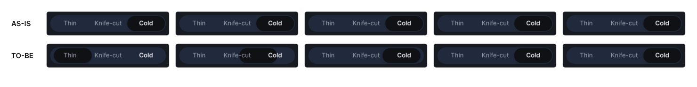

# segmented-control — thumb 전이를 transform 하나로, 슬라이드가 끊기던 결함

| 항목 | 내용 |
|------|------|
| 날짜 | 2026-11-06 |
| 작성 | Claude Code |
| 관련 경로 | `skills/suta/patterns/segmented-control/assets/segmented-control.css`·`moveSegmentThumb.ts`·`PATTERN.md`, `demo/src/tests/segmentedControl.test.tsx` |

## 1. 개요

벤치마크 측정이 `segmented-control`의 thumb `width` 전이를 레이아웃 애니메이션으로 셌다. 레이아웃 애니메이션은 매 프레임 배치를 다시 계산하는 전이를 말한다. 기본 칸은 같은 폭(`grid-auto-columns: 1fr`)이라 이동 중에 폭이 바뀌지 않는다. 그래서 전이를 `transform` 하나로 줄여도 모양이 같다.

전후를 캡처하다가 기존 결함을 찾았다. 칸을 눌러도 thumb가 미끄러지지 않고 끝 자리로 건너뛰었다. React 훅의 ResizeObserver는 `observe()` 직후 한 번 콜백을 부른다. 그 콜백이 `immediate: true`로 `transition: none`을 걸어 방금 시작한 슬라이드를 취소했다. 브라우저에서 `transitionstart` 바로 뒤에 `transitioncancel`이 나는 것으로 확인했다.

## 2. 작업내용

- `segmented-control.css`: thumb의 `transition`을 `transform` 하나로 바꿨다. `width`는 인라인으로 바로 맞는다. `motion-audit-ignore: layout-animation` 주석을 지웠다. 칸 폭을 내용대로(`auto`) 바꾼 변형에서는 폭이 바로 맞고 위치만 미끄러진다. 둥근 모서리가 찌그러지므로 `scaleX`는 여전히 쓰지 않는다.
- `moveSegmentThumb.ts`: `immediate: true`는 thumb가 이미 그 자리(같은 `transform`·`width`)면 아무것도 하지 않는다. 그래서 크기 감시의 첫 알림이 진행 중인 슬라이드를 끊지 않는다. 칸 폭이 실제로 바뀌면 전처럼 즉시 다시 맞춘다.
- `PATTERN.md`: 기술 선택 문단(전이는 transform 하나), 주의사항에 `immediate`의 같은 자리 동작과 이유를 적었다.
- 테스트 6개(TDD, 고치기 전 Red 확인):
  - CSS: thumb 전이에 `transform`이 있고 `width`가 없다. 무시 주석이 없다.
  - 코어: 같은 자리면 `immediate`여도 transition을 끄지 않는다. 자리가 바뀌면 즉시 맞춘다.
  - 훅: ResizeObserver 대역(가짜 구현)으로, 칸을 누른 뒤 첫 크기 알림이 와도 transition이 꺼지지 않는다. 칸 폭이 바뀌면 즉시 다시 맞춘다.
- README 2벌 배지 tests 741 → 747.

### 화면 비교

데모 첫 세그먼트에서 세 번째 칸을 누르고 0·50·100·150·250ms 장면을 찍었다. 전이를 20배 늦춰(CDP `Animation.setPlaybackRate`) 장면을 잡았다. AS-IS는 main(6c36459)을 따로 띄운 데모다.

| 장면 | AS-IS translateX | TO-BE translateX | 폭 |
|---|---|---|---|
| 0ms | 173px(끝 자리) | 8.4px | 85px |
| 50ms | 173px | 135.0px | 85px |
| 100ms | 173px | 166.8px | 85px |
| 150ms | 173px | 172.5px | 85px |

- reduced-motion(동작 줄이기 설정)에서는 전과 같이 `transition: none`이다.
- 게이트: build·lint·test(859)·validate(구조, 선택 평가 476/476, 통합 검사 error 0·warn 0).

## 3. 주의사항

- 슬라이드가 끊기던 결함은 React 훅에만 있었다. 순수 JS로 쓰면서 resize 때 `immediate: true`를 부르던 코드도 이제 같은 자리면 건너뛴다.
- 벤치마크는 다시 돌리지 않았다. 이 패턴을 복사한 화면에서 레이아웃 애니메이션 수가 줄어드는지는 다음 재측정에서 본다.
