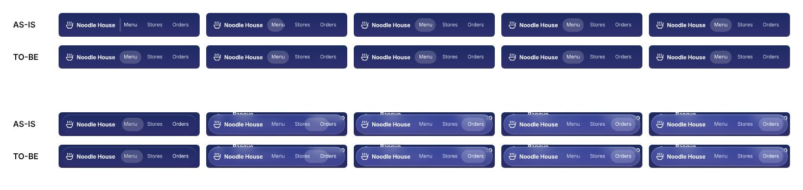

# glass-nav — 활성 알약을 clip-path로, 마운트 때 자라나던 움직임

| 항목 | 내용 |
|------|------|
| 날짜 | 2026-11-09 |
| 작성 | Claude Code |
| 관련 경로 | `skills/suta/patterns/glass-nav/assets/glass-nav.css`·`navSpyCore.ts`·`createGlassNav.ts`·`PATTERN.md`, `demo/src/tests/glassNavSpy.test.ts` |

## 1. 개요

segmented-control은 thumb의 `width` 전이를 뺐다(PR #62). glass-nav의 활성 알약은 그대로 `transform`과 `width`를 전이했다. 벤치마크 측정은 이것을 레이아웃 애니메이션으로 센다. 알약은 "segmented-control의 thumb과 같은 기법"이라는 이유로 무시 주석을 달고 있었는데, 그 근거가 바뀌었다.

같은 방법(`transform`만)은 쓸 수 없다. 링크마다 폭이 달라(데모에서 62·68·70px) 이동하는 동안 폭이 어긋난다. `scaleX`로 늘리면 둥근 끝이 찌그러진다.

고치기 전 동작을 찍다가 결함을 하나 더 찾았다. 마운트할 때 알약이 왼쪽 끝에서 폭 0으로 시작해 자라났다(5 → 48 → 59 → 62px). segmented-control에서 고친 것과 같은 종류의 가짜 움직임이다.

## 2. 작업내용

- `glass-nav.css`의 `.gnav-pill`을 바꿨다.
  - 링크 전체 폭에 깐다. 폭(`--_pill-track`)은 코어가 마지막 링크의 끝으로 준다(`pillTrack`). 처음에는 `inset: 0`(줄의 보이는 폭)이었으나 PR #65 리뷰가 결함을 찾았다(아래).
  - 기본값은 `clip-path: inset(0 100% 0 0 round var(--gnav-pill-radius, 999px))`(안 보임)이다. 모서리는 `--gnav-pill-radius`로 바꾼다. 인라인 스타일에 999px을 박으면 CSS로 바꿀 수 없어서다.
  - `transition`은 `clip-path` 하나다.
  - 무시 주석을 지웠다. reduced-motion 블록은 그대로 `transition: none`이다.
- `navSpyCore.ts`의 `pillFrame`은 활성 링크의 좌우 끝을 `inset(0 calc(100% - 끝) 0 왼쪽 round 999px)`으로 돌려준다.
  - 오른쪽은 알약 바탕 폭 기준 `calc(100% - 끝)`이다.
  - `clip-path`는 그리기만 다시 하고 레이아웃을 돌리지 않는다. 어느 폭에서도 알약 모양이다.
- `createGlassNav.ts`:
  - 배치마다 `--_pill-track`을 마지막 링크의 끝으로 준다. 이 폭은 전이하지 않는다.
  - 활성 링크의 폭이 0이면(숨긴 채 마운트) 놓지 않는다. 그래야 보일 때(`refresh`·창 크기)의 첫 배치가 전이 없이 놓인다.
  - 첫 배치는 전이 없이 놓는다.
  - `transition: none`을 건 채로 `getBoundingClientRect()`로 스타일을 확정하고, 다음 프레임에 되돌린다.
  - 확정하지 않으면 rAF의 복원이 먼저 돌아 전이가 그대로 일어난다. segmented-control에서 프로덕션 번들로 확인한 것과 같은 이유다.
- `PATTERN.md`: 활성 표시 행, `pillFrame` 설명, 왜 `clip-path`인가를 적었다.
- 테스트(TDD):
  - 처음 커밋: 새로 3개, 기존 3개를 새 동작으로 고쳤다. 고치기 전에 6개가 Red였다.
  - 리뷰 반영 커밋: 새로 3개(알약 바탕 폭, 두 번째 배치부터 전이·스타일 확정을 건드리지 않음, 숨긴 마운트), 기존 3개의 기대값(반경 변수)을 고쳤다. 두 번째 배치 테스트는 회귀 방지다. 리뷰가 모든 배치를 즉시로 바꿔도 13개가 다 통과한다는 것을 보였다.
  - 같은 실행에서 시간 초과로 실패한 2개는 연쇄 실패였다. 실패한 테스트가 가짜 타이머를 되돌리지 못해 생겼으므로, `afterEach`에서 실제 타이머로 되돌린다.
  - 내용: `pillFrame`의 clip-path, 첫 배치가 전이 없이 스타일을 확정, 두 번째부터는 전이를 건드리지 않음, CSS 전이가 `clip-path` 하나이고 무시 주석이 없음.
- README 2벌 배지 tests 748 → 754.

### 화면 비교

전이를 20배 늦춰 0·60·120·180·300ms를 찍었다. 위 두 줄은 마운트 직후, 아래 두 줄은 첫 링크에서 마지막 링크(Orders)로 옮길 때다. AS-IS는 main(`49e5d27`)을 따로 띄운 개발 서버 데모다.

| 장면 | AS-IS | TO-BE |
|---|---|---|
| 마운트 0·60·120ms | 폭 5 → 48 → 59px로 자라남 | 처음부터 62px 제자리 |
| 링크 이동 0·60·120·180·300ms | `transform`·`width` 전이, 폭 62 → 68 → 70 | `clip-path` 전이, 보이는 폭 62 → 68 → 70, 같은 모양 |

- 프로덕션 빌드(`vite preview`)에서도 마운트 직후 장면이 처음부터 제자리였다.
- compact 모드에서 접혔다 펼칠 때 알약이 활성 링크 위에 놓였다. 접혔을 때는 현재 메뉴 알약만 보인다.
- reduced-motion에서는 전이가 꺼진다.
- 리뷰가 찾은 결함과 확인:
  - 줄의 보이는 폭(`inset: 0`)에 깐 알약은, 줄이 옆으로 스크롤되면 뒤쪽 링크에 닿지 않았다. 320px에서 Tab으로 Orders에 가면 줄이 126px 스크롤되고 알약이 보이지 않았다. 390px에서 스크롤 칸으로 바꾼 줄에서도 잘렸다.
  - 고친 뒤 세 경우 모두 알약이 Orders 위에 main과 같은 자리로 놓인다(320px: 12~82px, 390px: 82~152px).
  - `--gnav-pill-radius: 8px`을 주면 알약 모서리가 8px이 된다.
- 게이트: build·lint·test(866)·validate(구조, 선택 평가 476/476, 통합 검사 error 0·warn 0).

## 3. 주의사항

- 이 패턴을 복사한 화면은 이제 벤치마크의 "레이아웃 속성을 움직인 화면"에 잡히지 않는다. `clip-path`는 측정의 레이아웃 속성 목록에 없다.
- `clip-path` 전이는 브라우저에 따라 합성(compositor)되지 않고 매 프레임 다시 그릴 수 있다. 알약 요소는 링크 전체 폭(데모 208×38)이지만 다시 그리는 넓이가 작고, 레이아웃은 돌리지 않는다.
- 오른쪽에서 왼쪽으로 쓰는 레이아웃에서 링크 줄이 넘치면 알약이 어긋난다(넘친 링크의 `offsetLeft`가 음수, 바탕은 왼쪽 0에서 시작). main의 `translateX` 방식은 맞았던 경우라 되돌아간 것이다. 리뷰가 막을 정도는 아니라고 봐서 PATTERN.md 주의사항에 적고 두었다.
- `control.refresh()`(글꼴 로드 뒤 다시 맞추기)는 두 번째 배치라 전이로 맞춘다. 전과 같다.
- 지난 작업 기록(`2026-09-21-glass-nav-spy.md`)의 "segmented-control과 같은 결정" 문장은 그때의 기록이라 고치지 않았다.
