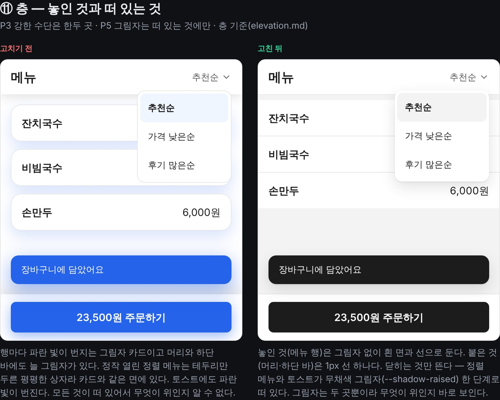
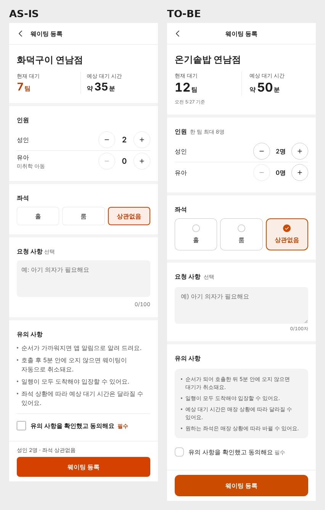

# 스킬의 깊이 — 설계 판단·디테일·층·패턴 (0.18.0)

| 항목 | 내용 |
|------|------|
| 날짜 | 2026-11-10 |
| 작성 | Claude Code |
| 관련 경로 | `skills/suta/SKILL.md`, `skills/suta/references/design.md`·`detail.md`, `skills/suta/patterns/layout-principles/references/elevation.md`·`assets/layout-tokens.css`·`layoutTokens.ts`, `skills/suta/patterns/layout-audit/assets/auditLayout.ts`, 패턴 22종의 `PATTERN.md`·`assets/`, `demo/src/demos/layout-principles/`, `docs/research/2026-11-10-depth.md` |

## 1. 개요

사용자가 "이 스킬을 분석해서 개선해줘. 난 이 스킬의 깊이를 개선하고 싶어"라고 요청했다. 분석해 보니 얕은 곳이 네 군데였고(설계 판단, 화면 디테일, 시각적 입체감, 패턴 문서와 코드), 사용자가 넷을 모두 골랐다.

0.17까지는 넓이를 늘려 왔다. 재측정에서 진 화면 유형마다 관례 절을 하나씩 더했다. 이번에는 관례가 나오는 자리(화면의 일), 요소 하나를 끝까지 만드는 기준, 화면의 앞뒤(층), 패턴을 붙인 뒤의 상황을 채웠다. 진단과 실측은 `docs/research/2026-11-10-depth.md`에 있다.

## 2. 작업내용

### 설계 판단 — `references/design.md`(새 문서)

- 화면을 한 문장으로 적는다(누가, 어떤 조건에서, 무엇을 하러 와서, 무엇을 하고 나간다). 문장에서 1순위·주 행동·밀도가 나온다.
- 화면의 일 여섯 가지(고르기·살피기·넣기·지켜보기·주고받기·넘기기)마다 뼈대의 축을 적었다. 관례 24종은 이 여섯 가지의 변형이다.
- 요소를 결정·근거·참고 세 층으로 나눈다. 반복 단위 안에서도 같은 질문을 한다.
- 맞는 화면 유형이 없으면 일이 같은 관례에서 뼈대를, 업종이 같은 관례에서 값을 빌린다.
- 코드 전에 설계 메모 다섯 줄을 남기고 결과와 맞춰 본다.
- `SKILL.md` 절차 4단계와 "읽을 문서" 표, `defaults.md` 2절, `screen-conventions.md` 머리말에서 가리킨다.

### 화면 디테일 — `references/detail.md`(새 문서)

- 요소마다 다섯 가지를 묻는다(내용·조작·상태·값 옆의 맥락·반응).
- 견본 데이터의 기준(개수·길이·상태·숫자·시각), 값의 종류별 조작 표, 컴포넌트 상태 한 벌(호버·눌림·포커스·선택·잠김·진행·오류·빈 값·불러오는 중), 마감 15가지.
- 재측정의 판정이 든 말("단조롭다", "평평한 목록이다", "구성이 빈약하다")별로 요청 범위 안에서 고치는 법.
- `SKILL.md` 절차에 7단계 "요소를 끝까지 만든다"를 더했다(뒤 단계 번호가 하나씩 밀렸다).
- 컴포넌트 상태를 다루는 기준은 0.17까지 스킬 어디에도 없었다.

### 층 — `elevation.md`, 토큰, 검사 규칙, 데모

- `layout-principles/references/elevation.md`(새 문서): 네 층(놓인 것·붙은 것·뜬 것·덮는 것), 그림자 3단계, 스크림, 겹치는 순서 5단계와 흔한 결함, 그림자 없이 앞뒤를 내는 법.
- 토큰: `--shadow-low`·`--shadow-raised`·`--shadow-overlay`, `--scrim`, `--z-sticky`(30)·`--z-overlay`(40)·`--z-popover`(50)·`--z-viewer`(90)·`--z-toast`(100). CSS와 TS 두 벌이고 `layout-audit`의 공유 코어 복사본을 맞췄다. 테스트 4개(TDD).
- 검사 규칙 2개(26 → 28, TDD 9개): `glow-shadow`(유채색이 번지는 바깥 그림자), `shadow-variety`(한 파일의 바깥 그림자 값 4종 이상). 둘 다 취향 warn이다.
  - 새 규칙이 데모의 "고치기 전" CSS(일부러 AI 슬롭으로 만든 예시)를 그대로 잡았다. 그 파일에는 무시 지시를 더했다.
  - `z-index` 큰 숫자를 잡는 규칙은 만들지 않았다. 실측한 사이트 35곳 중 15곳이 1000 이상을 썼다.
  - 토큰 사슬(`var(--x, var(--shadow-overlay, …))`)을 `effect-overuse`가 큰 그림자로 세던 것을 고쳤다(테스트 1개).
- 패턴 CSS를 토큰에 이었다. 토큰 파일이 없어도 같은 값으로 그려진다.
  - 그림자: 10종 → 3단계(유리·카드 묶음·옆 패널은 그 패턴의 표현이라 그대로).
  - 겹치는 순서: `bottom-nav` 50 → 30, 토스트 80 → 100, 뷰어 100 → 90, 셀렉트·툴팁·자동완성 → 50.
  - **결함 수정**: 하단 탭 바(50)가 열린 시트(41)와 스크림 위에 그려졌다. 브라우저에서 화면 맨 아래의 맨 위 요소가 고치기 전 `bottom-nav`, 고친 뒤 `bottom-sheet`인 것을 확인했다.
  - 기본 색: 푸른 회색(`#111827`·`#6b7280`·`#d1d5db` 등)을 색 토큰 사슬이나 같은 밝기의 순수 회색으로, 오류 빨강 두 가지(`#dc2626`·`#c8341f`)를 `--color-danger` 하나로 모았다.
  - **대비 수정**: `floating-label` 라벨과 `select` 안내 글자 `#8a93a1`(흰 면 3.2:1)을 `--color-text-tertiary`(#686868)로 바꿨다.
- 데모 ⑪ "층 — 놓인 것과 떠 있는 것"(한·영). 전후 마크업은 같고 CSS만 다르다.

- 실측: 공개 웹사이트 60곳 중 47곳(데스크톱 38·모바일 45). 처음 초안의 "고정 머리는 스크롤되면 1px 선"은 실측(스크롤 뒤에도 23곳 중 13곳이 선·그림자 없음)을 보고 "불투명한 면, 더한다면 선 하나"로 고쳤다.

### 패턴 문서와 코드 — 22종

패턴마다 문서·코드·데모·테스트를 읽고, 붙인 뒤 생기는 상황(컴포넌트 상태, 데이터 경계, 시간 경계, 환경)을 확인해 `## 상태와 경계` 표(상황 · 어떻게 되어야 하나 · 처리)와 `## 함께 쓰는 패턴`을 더했다. 표의 `assets` 행은 코드나 테스트로 확인한 것만 적었다. 서브 에이전트 넷이 병렬로 했고, 확인하지 못한 것은 3절에 모았다.

| 묶음 | 패턴 | 코드에서 찾아 고친 것(일부) |
|---|---|---|
| 로딩·피드백 | skeleton, loading-button, toast-stack, press-feedback, infinite-scroll | skeleton에 늦게 띄우기·최소 유지 코어(`createSkeletonGate`)와 글줄 높이(`1lh`). loading-button의 실패 뒤 재시도·잠긴 동안의 폼 제출. toast의 320px 넘침·쌓일 때 전체 다시 읽기. press-feedback의 잠긴 버튼 눌림. infinite-scroll의 `reset()`과 즉시 `retry()` |
| 입력 컨트롤 | switch, checkbox-radio, floating-label, select, form-shake-error, otp-input | 누르는 영역 44px, 부분 선택(`indeterminate`), 도움말·오류 문구 자리(`helperText`·`errorText`), select의 타이핑 찾기·잠긴 옵션·순수 JS 코어(`createSelect`), otp의 한 칸에 들어온 코드 전체 나누기 |
| 오버레이 | modal-dialog, bottom-sheet, dropdown-menu, tooltip, search-suggest | 시트의 포커스 이동·가두기·복귀와 닫힌 시트의 Tab 차단, 뒤로 가기로 닫기(`createBackDismiss`, 공유 코어), 메뉴를 맨 위 층(popover)으로, 툴팁의 가리킬 수 있음·터치 제외·가장자리 뒤집기(WCAG 1.4.13), 자동완성의 한글 조합 중 키 처리 |
| 내비·구조 | tab-indicator, accordion, carousel, bottom-nav, sticky-header, quantity-stepper | 탭 밑줄이 건너뛰던 결함(segmented-control과 같은 종류)과 넘친 탭 줄, 캐러셀의 30px로 번진 지금 장 점(0.15.0 이후 배포된 결함), 스테퍼의 + / − 버튼이 키보드로 눌리지 않던 것, 머리가 접히는 시점 |

- 고대비(`forced-colors`) 블록을 skeleton·loading-button·toast·switch·checkbox-radio·floating-label·select·otp-input·tooltip·dropdown-menu·bottom-sheet·modal-dialog·tab-indicator·carousel·bottom-nav·search-suggest·infinite-scroll에 더했다.
- 테스트 754 → 1,092개(검사 스크립트가 세는 수 980).

### 그 밖

- 버전 0.18.0(매니페스트 3개), README 3벌 배지, `docs/guide(.en).md`(새 문서 두 개·층 기준·검사 규칙), 데모 목록 설명(화면 11개).
- 요청문 `evals/benchmark/depth-app-prompts.json`·`depth-web-prompts.json`(관례에 없는 요청 3개).

### 검증

- `npm run build`·`npm run lint`·`npm test`(1,092 통과)·`npm run validate`(구조·선택 평가 476/476·통합 검사 error 0, warn 0).
- 브라우저: 데모 ⑪의 계산된 스타일(고친 뒤 행 그림자 없음, 메뉴·토스트 `--shadow-raised`), 고친 패턴 데모 12개를 390px로 열어 콘솔 오류와 가로 넘침 없음.

## 3. 주의사항

- **동작이 바뀐 공개 동작.** 설치한 프로젝트가 패턴을 다시 복사하면 달라지는 것이다.
  - `tooltip`: 열린 말풍선이 포인터를 받는다. 터치로는 뜨지 않고 누르면 닫힌다. 기본 `nowrap`이 최대 폭 20rem 줄바꿈으로 바뀌었다.
  - `dropdown-menu`: popover를 지원하는 브라우저에서 맨 위 층에 뜬다(`z-index`가 듣지 않는다).
  - `infinite-scroll`의 `retry()`는 바로 다시 부른다. `loading-button`은 실패 표시 중 다시 누르면 재시도한다.
  - `carousel` 훅의 `autoplayOn`은 "사용자가 켜 두었는가"가 됐다. `sticky-header`가 접히는 시점이 머리 높이만큼 빨라졌다.
  - `press-feedback`의 전이 속성이 `transform`에서 `scale`·`translate`로 바뀌었다. `skeleton-text`에 인라인 `height`를 1em보다 크게 준 곳은 막대가 1em로 잘린다.
  - 기본 색이 순수 회색·`--color-danger`로 바뀌었다. 공개 변수(`--menu-color` 등)를 준 프로젝트는 그대로다.
- **확인하지 못한 것.** 헤드리스 Chromium에서만 봤다.
  - 실제 화면 낭독기의 낭독, iOS·Android의 문자 자동 입력과 화면 키보드, Safari의 포커스 동작.
  - 브라우저 자동완성 상태의 `floating-label`(선택자가 있다는 것만 확인), `lh` 단위가 없는 브라우저의 skeleton.
  - `dropdown-menu`의 초성 찾기는 jsdom 테스트뿐이다. macOS 한글 자판이 버튼 위에서 낱자 키를 넘긴다는 전제를 확인하지 못했다.
  - 스크롤바 폭 보정(오버레이 스크롤바 환경이라 단위 테스트로만), `modal-dialog`의 "거부하면 다시 연다"(jsdom 테스트뿐).
- **남긴 한계.** 시트 위에 시트를 열면 둘째 스크림(40)이 첫 시트(41) 아래에 깔린다. 문서에 "한 번에 하나"로 적었다. 네이티브 `dialog`가 열린 동안의 토스트는 뒤에 깔린다(맨 위 층). `sticky-header`의 기본 배경은 어두운 바탕용 그대로다.
- **층의 그림자 값은 실측이 아니다.** 메뉴·모달을 열어 보지 않았다. 패턴 코드가 써 온 값을 세 단계로 모아, 실측한 떠 있는 요소의 범위 안에 두었다.
- **패턴 35종은 보강하지 않았다.** 이번에는 화면에 자주 쓰이는 22종만 했다. 제스처(pull-to-refresh·swipe-to-delete·drag-to-reorder 등)와 전환(page-transition·card-expand 등)이 남았다.
- **재측정(0.17 ↔ 0.18, 요청 3개 × 2번).** 블라인드 판정은 8 : 4·9 : 3으로 0.18 쪽이고 렌더 지표는 거의 같다. 다만 0.18의 6번 실행에서 `design.md`는 0번, `detail.md`는 1번, `elevation.md`는 0번 열렸다. 새 문서의 효과는 확인되지 않았고, 판정 차이는 `SKILL.md` 절차에 더한 문장에서 나온 것으로 보인다. 측정 뒤 절차 4·7단계에 "읽는다"를 명시했다(다시 재지 않음). 결과는 `docs/comparisons.md` "깊이" 절, 이미지는 `docs/assets/depth-as-is-to-be.jpg`다.
- 릴리스 노트(`docs/releases/v0.18.0.md`)는 쓰지 않았다. main에 들어가면 릴리스가 발행되므로 재측정 뒤에 쓴다.
- **후속 1(문서가 읽히는가).** "읽는다"를 명시해도 `design.md`는 6번 중 0번 열렸다. 설계 순서의 핵심을 `SKILL.md` 절차 4·7단계로 올리고 일화 문장 두 개를 덜어 냈다(본문 30,000바이트 한도). 그 판의 판정은 0.17과 6 : 6·6 : 6이었다. 0.18이 낫다는 근거는 아직 없다(`docs/research/2026-11-10-depth.md` 6절).
- **후속 2(선택 상태).** 고르는 칩은 흰 면 + 테두리, 고른 것은 색 + 체크 표시, 여러 줄 안내는 회색 채움 상자 하나. 대기 등록 판정이 1 : 3·0 : 4 → 3 : 1·3 : 1이 됐다(조건마다 2번).

