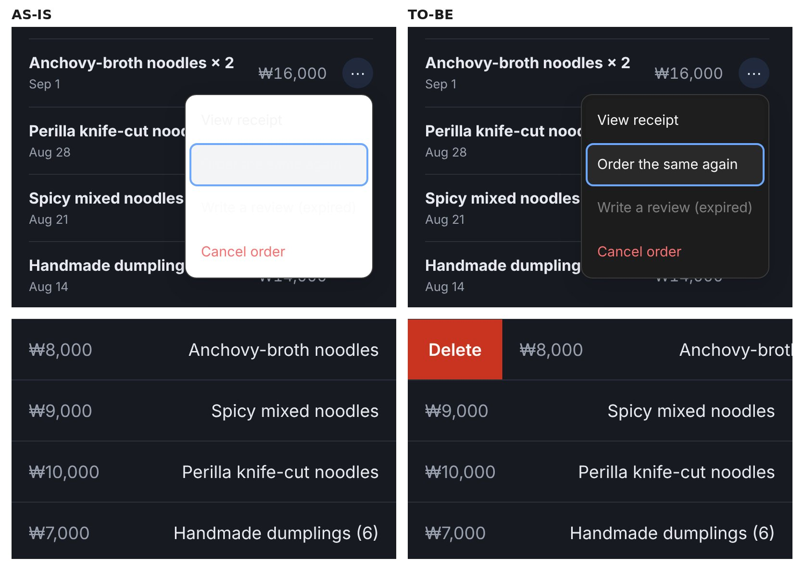

# README 0.19 갱신과 넘겨 둔 코드 수정

| 항목 | 내용 |
|------|------|
| 날짜 | 2026-11-15 |
| 작성 | Claude Code |
| 관련 경로 | `README.md`·`README.ko.md`, `docs/guide(.en).md`, `docs/comparisons(.en).md`, `skills/suta/patterns/` 15종의 `assets/`·`PATTERN.md`, `demo/src/tests/` |

## 1. 개요

README가 0.17 기준에 머물러 있었고, 상세 안내의 패턴 표에는 0.18~0.19에서 생긴 옵션이 없었다. 0.19 작업 기록이 "고치지 않고 넘긴 것"으로 남긴 코드 세 가지(스프링 코어의 `NaN`, 어두운 테마 토큰에서 메뉴 글자, `dir="rtl"`)도 그대로였다. 이 셋을 한 번에 정리했다.

## 2. 작업내용

### README 2벌

- "무엇이 들어 있나"에 0.18~0.19 내용을 더했다. 맞는 화면 유형이 없을 때 화면의 일에서 뼈대를 잡는 것, 컴포넌트 패턴 53종의 "상태와 경계" 표, 그림자·겹치는 순서 토큰이다.
- "관례가 없던 화면 (suta 0.17)" 절을 "버전을 올리며 다시 잰 것"으로 바꿨다. 0.17과 suta 없이(117번 실행, 63 : 63·53 : 73), 0.19와 0.17(36번 실행, 19 : 17·20 : 16)을 한 표에 두고, 판정이 비겼다는 것과 접근성 위반 수를 그대로 적었다.
- "패턴 코드에서 고친 것 (suta 0.18~0.19)" 절을 새로 뒀다. 테스트 754 → 1,297개와 결함 여섯 가지, 헤드리스 브라우저에서만 확인했다는 한계를 적었다.
- 옮긴 0.17 절은 `docs/comparisons.md`·`comparisons.en.md`의 "suta 0.17 일곱 묶음을 합치면"에 있다.

### 상세 안내의 패턴 표

`docs/guide.md`·`guide.en.md`의 41행을 0.18~0.19 기능에 맞게 고쳤다(`createSkeletonGate`, `createSelect`, `closeOnBack`, `syncHistory`, `revealTab`, `onChangeEnd`, `onRetry` 등). 적은 이름은 모두 `assets/`에서 찾아 확인했다. 이번 코드 수정에 맞춰 네 행(스프링·햄버거·밀어서 삭제·가장자리 뒤로가기)을 한 번 더 고쳤다.

### 코드 수정 A — 스프링 코어가 끝나지 않던 경우

`@shared-core`인 `spring.ts`·`animateSpring.ts`(원본 `spring-physics`, 복사본 `swipe-dismiss-viewer`·`edge-swipe-back`)를 고쳤다.

- 숫자가 아닌 입력(`NaN` 속도·목표, 0 이하의 강성·질량)이면 해도 숫자가 아니라서 정착 판정을 영영 통과하지 못했다. 이제 목표(목표도 숫자가 아니면 시작 위치)에 놓고 끝낸다.
- 감쇠 0처럼 멈추지 않는 설정은 10초에서 목표에 놓고 끝낸다(`springDuration`의 상한과 같은 값).
- 테스트 7개를 먼저 쓰고 실패를 확인한 뒤 고쳤다.

### 코드 수정 B — 면이 글자와 같은 토큰 묶음을 따르게

- 패턴 13종의 면 배경이 흰색 고정값이었다. 글자는 `--color-text`를 따르거나 물려받으므로, 프로젝트가 색 토큰을 어둡게 바꾸면 흰 면 위에 밝은 글자가 놓였다. 배경을 `var(--{패턴}-bg, var(--color-surface, #fff))`로 바꿨다(bottom-nav, bottom-sheet, card-expand, dropdown-menu, edge-swipe-back, hamburger-menu, long-press-menu, modal-dialog, otp-input, quantity-stepper, search-suggest, select, swipe-to-delete).
- 메뉴의 가리킨 항목 표시도 고쳤다. dropdown-menu의 푸른 회색 `#f3f4f6`은 `--color-canvas`로, long-press-menu의 검정 6%는 글자색 8%(`color-mix(in srgb, currentColor 8%, transparent)`)로 바꿨다. 검정 6%는 어두운 면에서 보이지 않는다.
- `demo/src/tests/patternSurface.test.ts`가 패턴 CSS 전체를 읽어 흰색 고정값으로 끝나는 면 배경을 막는다(테스트 3개, 실패 확인 후 수정).
- 브라우저 확인: 어두운 토큰(`--color-surface: #1c1c1c`·`--color-text: #f5f5f5`)을 준 드롭다운 메뉴의 글자 대비가 1.09 : 1에서 15.63 : 1이 됐다.

### 코드 수정 C — `dir="rtl"`

| 패턴 | 고치기 전 | 고친 뒤 |
|---|---|---|
| swipe-to-delete | 액션이 화면 밖 오른쪽에 놓이고 밀어도 열리지 않았다 | 액션이 왼쪽에 놓이고 오른쪽으로 밀어 연다 |
| edge-swipe-back | 왼쪽 끝에서만 시작했다 | 오른쪽 끝을 왼쪽으로 끈다. 이전 화면은 오른쪽에서 따라 나온다 |
| hamburger-menu | `side`가 `left`·`right`뿐이었다 | `start`(기본)·`end`가 글의 방향을 따른다. `left`·`right`는 그대로 고정이다 |
| long-press-menu | 항목의 왼쪽 선에 맞췄다 | 오른쪽 선에 맞추고 그 모서리에서 자라 나온다 |

- 제스처 코어는 판정을 한 방향 좌표로 하고 화면에 쓸 때만 부호를 뒤집는다. 글 방향은 누를 때마다 읽는다.
- 드로어의 `:dir()`는 `:where()`로 감쌌다. 특이성이 올라가면 열림 규칙의 `transform`을 이겨 드로어가 열리지 않는다.
- 테스트 15개를 먼저 썼다. 브라우저에서 네 패턴을 `dir="rtl"`로 열어 동작을 확인했다(드로어는 `side` 네 값 × 방향 두 가지).

### 화면 비교

위는 어두운 색 토큰을 준 드롭다운 메뉴다(데모가 덮어쓴 메뉴 색은 걷고 찍었다). 아래는 `dir="rtl"`에서 첫 행을 오른쪽으로 민 뒤다. 왼쪽은 고치기 전 커밋, 오른쪽은 고친 뒤다.

### 검증

`npm run build`·`npm run lint`·`npm test`(1,322 통과)·`npm run validate`(구조·선택 평가 476/476·통합 검사 error 0, warn 0). 검사 스크립트가 세는 테스트 수는 1,210이다.

## 3. 주의사항

- **동작이 바뀐 것.** 패턴을 다시 복사하면 달라진다.
  - `Drawer`의 `side` 기본값이 `left`에서 `start`가 됐다. 왼쪽에서 오른쪽으로 쓰는 화면에서는 같고, `dir="rtl"` 화면에서는 오른쪽에서 나온다. 예전처럼 두려면 `side="left"`를 넘긴다.
  - `dir="rtl"` 화면의 swipe-to-delete·edge-swipe-back·long-press-menu는 방향이 뒤집힌다.
  - 색 토큰 `--color-surface`를 정한 프로젝트에서는 패턴 13종의 면이 그 색을 따른다. 패턴별 변수(`--sheet-bg` 등)를 준 곳은 그대로다.
  - 감쇠 0인 스프링은 10초에서 끝난다. 끝없이 흔들리는 것을 의도했다면 CSS `animation`으로 옮긴다.
- **확인하지 못한 것.** 헤드리스 Chromium에서 마우스로만 봤다. 실제 터치 기기, Safari의 `:dir()`, 화면 낭독기는 확인하지 않았다.
- **남긴 것.**
  - glass-nav는 `dir="rtl"`에서 링크 줄이 넘치면 알약이 어긋난다(문서에 적힌 그대로).
  - story-progress의 좌우 탭 영역 뒤집기는 프로젝트 몫으로 남아 있다.
  - 테두리 기본값(`#d4d4d4` 등)은 토큰을 따르지 않는다. 어두운 면에서도 보이지만 색은 맞지 않는다.
  - segmented-control의 thumb(`#fff`)는 면 토큰에 잇지 않았다. 트랙과의 관계가 뒤집힐 수 있어서다.
- **버전.** 매니페스트는 0.19.0 그대로다. 패턴 코드가 바뀌었으므로 배포하려면 버전을 올리고 릴리스 노트를 써야 한다.
