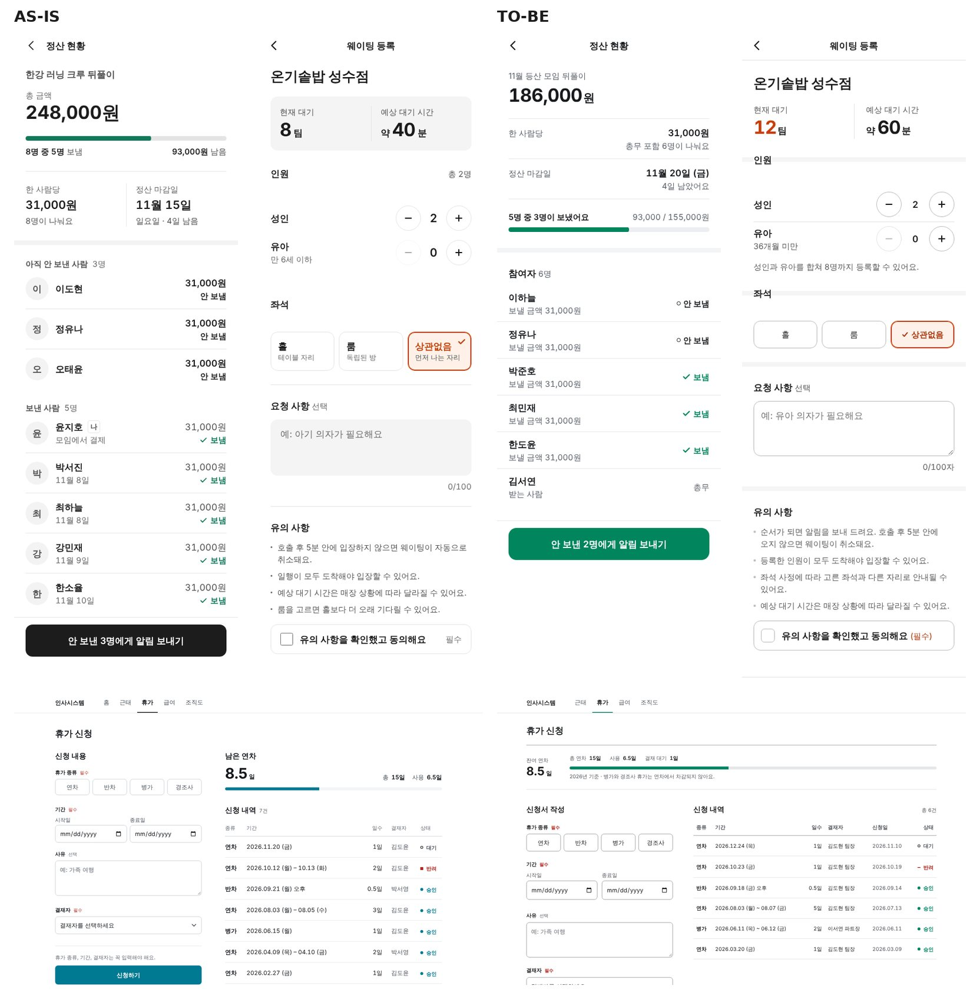

# 정보 위계 기준과 재측정

| 항목 | 내용 |
|------|------|
| 날짜 | 2026-11-16 |
| 작성 | Claude Code |
| 관련 경로 | `skills/suta/references/defaults.md`·`checklist.md`, `evals/benchmark/hierarchy-{app,web}-rubric(-alt).json`, `docs/worklog/assets/2026-11-16-hierarchy.jpg` |

## 1. 개요

항목별 판정(`docs/worklog/2026-11-15-rubric-judging.md`)에서 0.19는 정보 위계가 0.17보다 낮았다(9 : 11·8 : 15). 진 이유를 화면에서 확인해 기본값에 세 행을 넣고, 진 요청 네 개를 다시 만들어 쟀다. 위계 점수는 올랐지만 전체 승패는 그대로다.

## 2. 작업내용

### 진 이유

0.17이 정보 위계로 이긴 판정 26번의 이유와 다섯 쌍의 화면을 봤다. 반복된 것은 세 가지다.

- 화면이 답하는 값이 약하다. 웨이팅 등록에서 0.19는 대기 팀 수를 회색 상자 안 검은 글자로 뒀고 0.17은 강조색 큰 숫자로 뒀다.
- 손봐야 할 항목이 나머지와 섞였다. 정산 현황에서 0.19는 "안 보냄"을 한 목록에 검은 글자로 뒀다.
- 데스크톱 폼의 제출 버튼이 첫 화면 밖이다. 휴가 신청에서 선택 카드의 보조 설명과 안내 문구로 폼이 길어졌다.

### 고친 것

`references/defaults.md`의 레이아웃 표에 세 행, `checklist.md`에 확인 항목 한 줄을 넣었다. `SKILL.md`는 바이트 상한이라 그대로다.

- 화면이 답하는 값 하나를 첫 구역에서 가장 큰 글자로 둔다. 강조색을 써도 된다. 단계가 있는 상태는 진행 막대의 칸마다 단계 이름을 붙인다.
- 손봐야 할 항목은 목록 맨 위에 모으고 묶음 제목을 준다. 상태는 색 글자에 점·아이콘을 더한다.
- 데스크톱 작성 화면의 제출 버튼은 첫 화면(1280×720) 안에 둔다. 열의 순서는 화면의 일을 따른다.

### 재측정

네 요청(웨이팅 등록·정산 현황·휴가 신청·재고 관리)을 고친 기준으로 3번씩 만들고(12번), 같은 0.17 캡처와 항목별로 판정했다(두 모델, 48번, 실패 0). 점수는 suta : 0.17이다.

| 정보 위계 | 0.19 (기본 / 다른 모델) | 고친 뒤 (기본 / 다른 모델) |
|---|---|---|
| 웨이팅 등록 | 0 : 3 / 1 : 3 | 2 : 3 / 1 : 2 |
| 정산 현황 | 2 : 2 / 2 : 2 | 4 : 2 / 3 : 2 |
| 휴가 신청 | 1 : 3 / 0 : 4 | 0 : 6 / 3 : 3 |
| 재고 관리 | 3 : 2 / 3 : 1 | 4 : 0 / 4 : 0 |
| 합계 | 6 : 10 / 6 : 10 | 10 : 11 / 11 : 7 |

| 네 항목을 합친 승패(비김 0.5) | 0.19 | 고친 뒤 |
|---|---|---|
| 기본 모델 | 12 : 12 | 11 : 13 |
| 다른 모델 | 11.5 : 12.5 | 10.5 : 13.5 |

- 정보 위계는 두 모델 모두 올랐다. 재고 관리와 정산 현황에서 "부족 품목을 따로 묶고 빨갛게", "안 보낸 사람을 먼저"가 이유로 적혔다.
- 전체 승패는 달라지지 않았다. 위계에서 얻은 만큼 마감에서 잃었다. 재고 관리는 모바일에서 4열 표를 그대로 좁혀 품목 이름이 두 줄로 꺾였다(마감 0 : 4·0 : 3).
- 휴가 신청은 기본 모델에서 더 나빠졌다(0 : 6). 한 실행이 폼을 좁은 오른쪽 열로 밀었다. 처음 넣은 행의 "현황·목록이 주 내용이면 폼은 좁은 열에"가 신청 화면에 잘못 적용됐다. 이 구절을 "열의 순서는 화면의 일을 따른다"로 고쳤다(다시 재지 않음).
- 실행마다 기준을 따르는 정도가 다르다. 아래 첫 실행에서 웨이팅 등록은 대기 팀 수가 강조색이 됐지만, 정산 현황은 안 보낸 사람을 묶지도 색을 쓰지도 않았고 휴가 신청의 신청 버튼은 여전히 첫 화면 밖이다.

### 화면 비교

왼쪽은 0.19의 첫 실행, 오른쪽은 고친 기준의 첫 실행이다. 위는 정산 현황과 웨이팅 등록(390px), 아래는 휴가 신청(1280px 첫 화면)이다.

### 검증

`npm run validate`(구조·선택 평가 476/476·통합 검사 error 0, warn 0). 코드와 테스트는 바뀌지 않았다.

## 3. 주의사항

- **효과를 확정하지 못했다.** 요청 넷에 3번씩이고, 위계 점수의 변화는 판정 12번 안에서 4~5번이다. 전체 승패는 그대로다. 세 행은 지금 근거로는 "해롭지 않고 방향은 맞다"까지다.
- **되돌리지 않은 이유.** 지난번 세 가지(행 버튼 윤곽선 등)는 겨냥한 요청에서 더 나빠져 되돌렸다. 이번에는 겨냥한 항목(정보 위계)이 두 모델 모두 올랐고, 나빠진 한 곳은 원인이 된 구절을 고쳤다.
- **새로 본 결함.** 웨이팅 등록 첫 실행에서 구역 제목이 구역 사이 띠와 겹쳤다. 재고 관리는 모바일 표를 행으로 바꾸지 않았다. 둘 다 기준에 이미 있는 내용이 지켜지지 않은 것이다.
- **버전.** 매니페스트는 0.20.0 그대로다. 기본값 문서만 바뀌었다.
- **연구 문서.** `docs/research/2026-11-10-depth.md`에는 항목별 판정과 이번 결과를 아직 옮기지 않았다.
