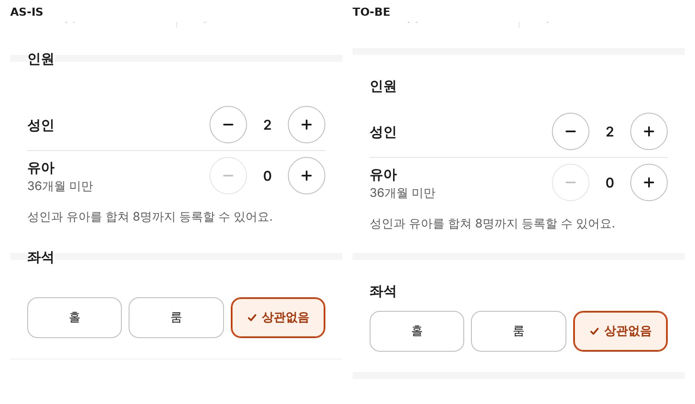

# 검사 규칙 legend-on-border

| 항목 | 내용 |
|------|------|
| 날짜 | 2026-11-16 |
| 작성 | Claude Code |
| 관련 경로 | `skills/suta/patterns/layout-audit/assets/auditLayout.ts`·`PATTERN.md`, `demo/src/tests/auditLayout.test.ts`, README 2벌 배지 |

## 1. 개요

정보 위계 재측정의 웨이팅 등록 화면에서 "인원"·"좌석" 제목이 구역 사이 띠와 겹쳐 그려졌다(사용자 지적). 캡처의 문제가 아니라 생성된 화면의 결함이다. 편집 후 검사가 이 결함을 잡게 규칙을 더했다.

## 2. 작업내용

### 원인

생성된 화면은 구역을 `<fieldset class="section">`으로 묶고 제목을 `<legend>`로 두었다. 묶음의 이름을 낭독기에 전하는 옳은 마크업이다. 그런데 구역 사이 띠를 그 `fieldset`의 `border-top: 8px solid`로 그렸다. 브라우저는 `legend`를 `fieldset`의 테두리 선 위에 그리므로 제목이 띠에 걸친다.

지난 실행 60개를 새 규칙으로 검사하니 두 파일에서 잡혔다. 둘 다 웨이팅 등록의 첫 실행이다(0.19 판, 고친 기준 판). 0.19 판의 판정 이유에 적힌 "인원·좌석 제목 아래의 어색하게 큰 빈 공간"도 같은 원인이다.

### 규칙

- `legend-on-border`(error): 위쪽에만 테두리를 준 `fieldset` 안에 `legend`가 있으면 알린다.
- CSS는 `fieldset`이나 그 클래스의 `border-top`·`border-block(-start)`을, Tailwind는 `border-t`를 본다.
- 빼는 경우: 네 변 테두리(묶음 상자 — `legend`가 선을 끊고 앉는 것이 본래 모양), `legend`를 떼어 낸 경우(`float`·`position: absolute`·`display: contents`·`sr-only`), 위 테두리가 0·none인 경우.
- 고침 안내: `fieldset`의 테두리를 걷고 띠를 바깥 요소나 `::before`에 두거나, `legend`에 `float: left; width: 100%`를 준다. 태그는 바꾸지 않는다.
- 테스트 7개를 먼저 쓰고 실패를 확인한 뒤 구현했다. 검사 규칙은 28 → 29개다.

### 화면 비교

왼쪽은 생성된 화면 그대로, 오른쪽은 규칙이 권한 고침(`legend`에 `float: left; width: 100%`, 다음 요소에 `clear: both`)을 그 파일에 적용한 것이다. 390px 헤드리스 Chromium에서 찍었다.

### 검증

`npm run build`·`npm run lint`·`npm test`·`npm run validate`. 생성 화면 파일에 통합 검사를 돌려 두 `legend` 줄에서 error가 나오는 것을 확인했다. 나머지 58개 파일과 스킬 전체(200개 파일)에서는 나오지 않았다.

## 3. 주의사항

- **잡지 못하는 경우.** 검사는 한 번에 받은 파일 묶음 안에서만 CSS와 마크업을 잇는다. 편집 후 검사 훅은 고친 파일 하나만 보므로, 마크업(JSX)과 CSS가 다른 파일이고 테두리를 클래스로 준 경우는 잡지 못한다. `fieldset` 태그 선택자, 한 파일 안의 `<style>`, Tailwind 클래스는 잡는다. 폴더 전체를 `audit.mjs`로 검사하면 파일이 달라도 잡는다.
- **확인하지 못한 것.** Safari·Firefox에서의 그려지는 모양은 보지 않았다. `legend`가 `fieldset` 테두리 위에 놓이는 것은 HTML 표준의 렌더링 규칙이다.
- **버전.** 매니페스트는 0.20.0 그대로다. 검사 규칙이 늘었고 기본값 문서도 바뀌었으므로(정보 위계), 배포하려면 버전을 올리고 릴리스 노트를 써야 한다.
