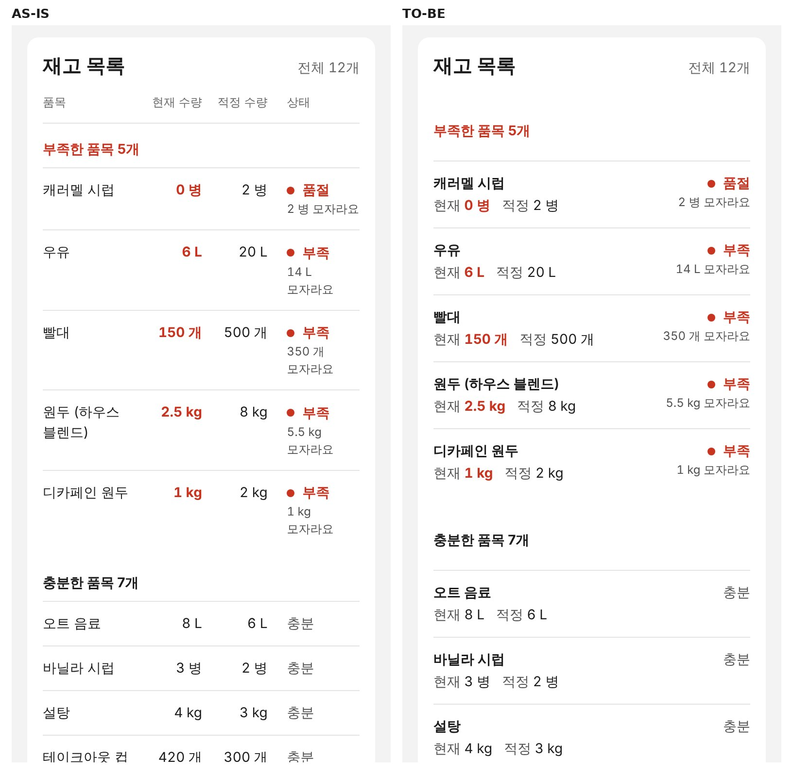

# 검사 규칙 table-squeeze

| 항목 | 내용 |
|------|------|
| 날짜 | 2026-11-17 |
| 작성 | Claude Code |
| 관련 경로 | `skills/suta/patterns/layout-audit/assets/auditLayout.ts`·`PATTERN.md`, `skills/suta/scripts/hookCore.ts`, `demo/src/tests/auditLayout.test.ts`, README 2벌 배지 |

## 1. 개요

정보 위계 재측정에서 재고 관리는 위계를 이기고도 마감에서 졌다(0 : 4·0 : 3). 이유는 모바일에서 4열 표가 그대로 좁아져 품목 이름이 두세 줄로 꺾인 것이다. "표는 값을 빼지 않고 행으로 다시 놓는다"는 기준은 `SKILL.md`에 이미 있었지만 실행마다 지켜지는 정도가 달랐다. 문서의 기준보다 검사 규칙이 확실히 잡으므로, 이 결함을 검사 규칙으로 옮겼다.

## 2. 작업내용

### 규칙

- `table-squeeze`(warn, 사용 문제): 열이 4개 이상인 표에 좁은 화면 규칙이 없으면 알린다.
- "좁은 화면 규칙이 있다"는 둘 중 하나다.
  - 미디어·컨테이너 쿼리 안에서 표(또는 표의 부분에 쓴 클래스)의 `display`를 바꾼다.
  - 표 자신에 `min-width` 400px 이상이나 `width: max-content`가 있고, 넘기는 칸(`overflow-x: auto`)이 있다.
- 표의 CSS가 검사 범위에 없으면 판단하지 않는다. 다른 파일이나 유틸리티 클래스로 처리했을 수 있다.
- 열 수는 첫 행(머리 행)의 칸 수로 센다.
- 편집 후 검사 훅의 사용 문제 목록(`USABILITY_WARN_RULES`)에 넣었다. warn이라 훅이 멈추지는 않고 `[사용 문제]`로 알린다.
- 테스트 10개를 먼저 쓰고 실패를 확인한 뒤 구현했다. 검사 규칙은 29 → 30개다.

### 지난 실행으로 확인

표가 있는 웹 실행 14개를 390px로 열어 첫 열 이름이 실제로 꺾이는지 재고, 규칙의 판정과 견줬다.

| | 규칙이 알림 | 규칙이 조용함 |
|---|---|---|
| 390px에서 표가 그대로이고 이름이 꺾임 | 6 | 0 |
| 행으로 다시 놓였고 꺾임 없음 | 0 | 8 |

- 처음 구현은 두 개를 놓쳤다. 칸 하나의 `white-space: nowrap`과 메뉴의 `overflow-x: auto`를 "옆으로 넘기는 장치"로 봤기 때문이다. 표 자신의 최소 폭만 보도록 좁혔고, 놓친 경우를 테스트로 먼저 재현했다.
- 앱 실행 36개, 스킬 전체, 데모에서는 나오지 않았다.

### 화면 비교

왼쪽은 재측정의 재고 관리 둘째 실행 그대로다(390px). 오른쪽은 규칙이 권한 고침(행마다 이름 + 상태, 그 아래 현재·적정 한 줄)을 그 파일에 적용한 것이다. 고침은 사람이 직접 썼다. 모델이 이 안내를 받고 어떻게 고치는지는 재지 않았다.

### 검증

`npm run build`·`npm run lint`·`npm test`·`npm run validate`.

## 3. 주의사항

- **잡지 못하는 경우.** 편집 후 검사 훅은 고친 파일 하나만 본다. 마크업(JSX)과 CSS가 다른 파일이면 훅에서는 판단하지 않는다. 한 파일 안의 `<style>`(HTML·Vue·Svelte)은 잡고, 폴더 전체를 `audit.mjs`로 검사하면 파일이 달라도 잡는다. Tailwind만 쓴 표는 판단하지 않는다.
- **틀릴 수 있는 경우.** 열이 4개여도 내용이 짧아 390px에 들어가는 표(숫자만 있는 표)는 꺾이지 않는데 알릴 수 있다. warn이고 무시 주석(`layout-audit-ignore: table-squeeze`)을 둘 수 있다. 지난 실행 표본에서는 이런 경우가 없었다.
- **효과를 재지 않았다.** 이 규칙이 있을 때 생성 화면의 모바일 표가 실제로 나아지는지는 다시 만들어 봐야 안다. 훅은 warn을 알리기만 하고 멈추지 않는다.
- **버전.** 매니페스트는 0.20.0 그대로다. 0.20.0 뒤로 main에 쌓인 변경(정보 위계 기본값, `legend-on-border`)에 이 규칙이 더해진다.
