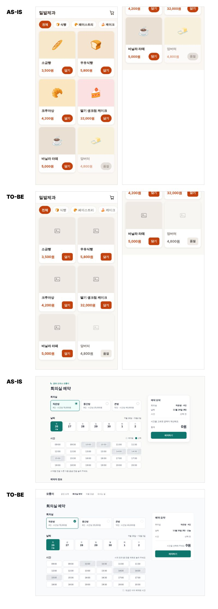

# 요구 충족률 시험 실행(4번)과 검사기·보존 단계 고침

| 항목 | 내용 |
|------|------|
| 날짜 | 2026-11-26 |
| 작성 | 에이전트 |
| 관련 경로 | `scripts/benchmark/fidelity.mjs`, `scripts/lib/runArchive.ts`, `scripts/benchmark/archive.mjs`, `evals/benchmark/fidelity/requirements.json`·`pilot-summary.json`, `evals/benchmark/artifacts/fidelity-pilot.json.gz`, `demo/src/tests/runArchive.test.ts` |

## 1. 개요

요구 충족률 검사기는 손으로 쓴 견본 화면에서만 돌려 봤다. 실제 모델 산출물에서도 요소를 잘 찾는지 보려고 작은 시험 실행을 했다. 목적은 두 조건의 우열이 아니라 "찾지 못함"과 오판을 찾아 검사기를 고치는 것이다.

## 2. 작업내용

- 실행: 요청 2개(`bakery-pickup` 앱, `meeting-room` 웹) × 조건 2(suta 없이·suta 0.20.0) × 1번 = 4번. 실행당 예산 상한 8달러, 실제 비용 합계 9.18달러(2.23·2.25·2.56·2.14). 네 번 모두 산출물이 나왔고 권한 거절은 0이다.
- 첫 판정에서 지킴이 아닌 것이 5건 나왔다. 산출물을 열어 하나씩 가렸다.

| 요구 | 조건 | 첫 결과 | 가린 결과 | 고침 |
|---|---|---|---|---|
| R01·R15 장바구니 숫자 | suta | 찾지 못함 | 검사기의 잘못 — 장바구니를 `<a>`(링크)로 만들었는데 요구가 버튼 역할만 찾았다 | 요구의 대상을 `button\|link`로 |
| M16 390px 한 열 | 둘 다 | 찾지 못함 | 검사기의 잘못 — `연락처필수`의 글자가 "연락처필수"가 되어 낱말 경계로 못 찾았다 | 요소 자신의 글자 마디가 앵커와 같아도 찾은 것으로 |
| M05 고른 구간 바탕색 | suta 없이 | 지킴 ↔ 어김(실행마다 다름) | 검사기의 잘못 — 조작 50ms 뒤에 읽어 120ms 바탕색 전환의 중간색(#137870)을 읽었다 | 조작이 일으킨 전환이 끝난 뒤 읽는다(최대 1초, 움직임·시각 확인은 그대로) |
| R12 품절 카드를 흐리게 | suta | 어김 | 화면이 요청과 다르다 — 아래 | — |

- 고친 뒤 시험 산출물에 세 번 돌려 결과가 같았다. 견본 화면도 그대로다(지킨 판 111/111, 어긴 판 11곳).

| 조건 | 지킴 | 어김 | 찾지 못함 | 엄격 충족률 |
|---|---|---|---|---|
| suta 없이 | 38 | 0 | 0 | 100% |
| suta | 37 | 1 | 0 | 97.4% |

- 남은 어김 하나(R12): 요청은 "앙버터는 카드를 흐리게". suta 없이는 카드 전체를 흐리게 했다. suta는 사진만 흐리게 하고 이름·가격을 회색으로 바꿨고, 보고에 "카드 전체를 반투명하게 하면 가격 글자가 읽기 어려워져서"라고 적었다. `SKILL.md` 우선순위는 명시된 요구에 사용 문제가 있으면 "따르고 보고한다"인데, 여기서는 "바꾸고 보고"했다. 표본 하나라 경향이라고 할 수 없다.
- suta 기본값과 일부러 부딪치게 한 요구(이모지 칩·그림자 카드·빨간 배지 등)는 suta 조건에서도 모두 지켰다.
- 보존 단계(`archive.mjs`)를 실제 산출물에 처음 썼고 결함 둘을 고쳤다(테스트 먼저, 10 → 13개).
  - 실행 폴더 경로가 남았다: 실행 폴더 자체로 `cd`한 명령, 자식 세션의 임시 폴더 경로. 둘 다 지우고, `--out` 폴더 아래 남은 경로는 `<out>`으로 바꾼다. 다시 묶은 묶음에 절대 경로가 없는 것을 확인했다.
  - 읽은 스킬 문서를 놓쳤다: 스킬 도구로 부른 것(SKILL.md)과, 스킬 폴더로 옮겨 간 뒤 상대 경로로 읽은 것을 센다.
- 묶음에서 본 것: suta 두 실행 모두 `references/`의 문서(defaults·detail·design·checklist)를 하나도 읽지 않았다. 빵집 픽업은 패턴 문서 넷(sticky-header·long-press-menu·toast-stack·skeleton), 회의실 예약은 SKILL.md뿐이다.
- 산출물 보존: `evals/benchmark/artifacts/fidelity-pilot.json.gz`(30KB). 집계: `evals/benchmark/fidelity/pilot-summary.json`.
- 화면: 줄 머리 AS-IS는 suta 없이, TO-BE는 suta다. 위 두 줄은 빵집 픽업(390px 첫 화면과 품절 카드), 아래 두 줄은 회의실 예약(1280px).

## 3. 주의사항

- 4번은 표본이 너무 작다. 두 조건의 충족률 차이(100% ↔ 97.4%)는 요구 하나의 차이이고 우열을 말할 수 없다.
- 요청 6개 중 2개만 돌렸다. 나머지 넷(전기차 충전소·식물 물주기·청구서 표·꽃 구독 랜딩)의 요구는 실제 산출물에서 돌려 보지 않았다. 이번에 두 요청에서 검사기의 잘못이 셋 나왔으므로 나머지에서도 나올 것으로 본다.
- 지킴으로 나온 75건을 사람이 하나씩 확인하지는 않았다. 어겼는데 지킴으로 나온 것이 있는지는 모른다.
- 충족률이 두 조건 모두 높다. 지금 요청문은 요구를 또렷하게 적어 두어서, 요구를 놓치는 문제를 드러내기에 쉬운 편일 수 있다.
- 판정 필요 3개와 수정 요청 흐름(회귀)은 아직 재지 않는다.
