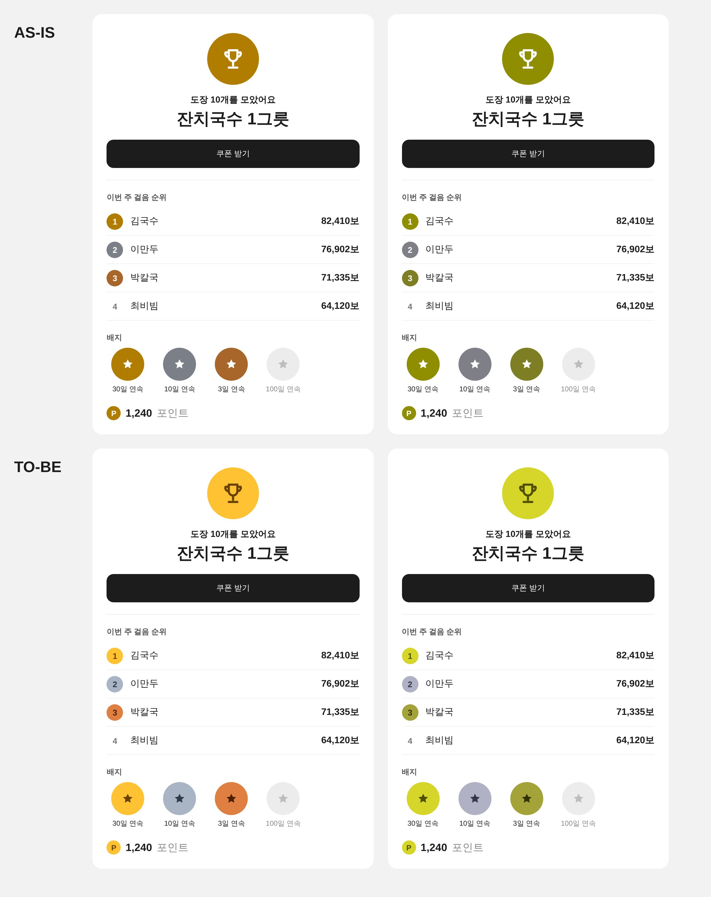

# 색각 이상 시뮬레이션과 색 짝 검사(cvd-pair), 보상 색 두 톤 — 0.24.0

| 항목 | 내용 |
|------|------|
| 날짜 | 2026-11-27 |
| 작성 | Claude Code (Opus 5.5) |
| 관련 경로 | `skills/suta/patterns/layout-principles/assets/cvd.ts`(+ `layout-audit/assets/cvd.ts` 공유 코어 복사본)·`palette.ts`·`layout-tokens.css`·`layoutTokens.ts`(두 벌)·`references/tone.md`, `skills/suta/patterns/layout-audit/assets/auditLayout.ts`·`PATTERN.md`, `skills/suta/scripts/palette.mjs`·`hookCore.ts`, `skills/suta/SKILL.md`, `skills/suta/references/defaults.md`, `celebration`(CSS 대체값·잉크 기본값·PATTERN.md), `layout-principles/PATTERN.md`·`references/screen-conventions.md`, `skills/suta/references/checklist.md`, `demo/src/tests/palette.test.ts`·`auditLayout.test.ts`·`hookCore.test.ts`·`layoutTokens.test.ts`, 매니페스트 3개, README 2벌 배지, guide 2벌 |

## 1. 개요

색 조사(`docs/research/2026-11-26-color-science.md` 6절, 10절 후보 1·2)를 코드로 옮겼다. suta는 "색만으로 알리지 않는다"를 문장으로만 두었는데, 오류 빨강 ↔ 완료 초록이 적록 색각 이상(한국 남성 약 6%)에서 OKLab 거리 0.27 → 0.11로 붙는 것을 숫자로 확인할 방법이 없었다. 계산 중 보상 색 금 ↔ 동이 **정상 시각에서도 0.070**으로 가깝다는 것도 나와 값을 고쳤다. 처음 고른 어두운 한 톤 값은 사용자 확인에서 "탁하고 죽었다"로 거절되어, 밝은 채움 + 짙은 잉크 두 톤으로 다시 정했다. 문턱(얼마나 가까우면 알릴지)은 연구 근거가 없는 판단값이라 검사 규칙은 warn으로 넣고 오탐을 보존된 실행 산출물로 셌다.

## 2. 작업내용

### 함수 — `cvd.ts`(공유 코어, `palette.ts`가 다시 내보냄)

- `simulateCvd({ hex, type })` — `protan`·`deutan`은 Viénot 1999, `tritan`은 Brettel 1997(분리 평면 법선과의 내적이 0 이상이면 첫 행렬). 선형 sRGB에서 곱하고 0~1로 자른다. 행렬은 libDaltonLens(Unlicense) 값.
- `cvdPairCheck({ a, b })` — 정상·세 유형의 `{ distance, lightness }`(OKLab 거리·밝기 차), `verdict`(`distinct`·`cvd`·`all`), `worst`, `distinct`.
- 문턱 상수(판단값, 주석에 명시): `CVD_MIN_DISTANCE = 0.12`·`CVD_MIN_LIGHTNESS = 0.1`(색각 이상에서 둘 다 미만이면 `cvd`), `NORMAL_MIN_DISTANCE = 0.1`(정상에서 미만이면 `all`). 제안값 그대로다. 자료(아래 오탐 표)에서 문턱 근처 짝이 없어 조정할 근거가 없었다.
- `worst`는 문턱 안에 든 유형 중 거리가 가장 짧은 것이다. 오류 ↔ 완료는 적색 계열 거리가 0.110으로 더 짧지만 밝기 차 0.103이 남아 문턱 밖이다 — 가장 나쁜 유형은 녹색 계열(0.114, 밝기 0.048)이다. 처음 구현은 거리만 보고 적색 계열을 골라 메시지가 틀렸다(고침).
- 왜 공유 코어인가: `layout-audit`는 다른 패턴을 import하지 않는다(규칙 8). `palette.ts`를 통째로 복사하는 대신 행렬·OKLab만 담은 작은 파일을 두 패턴에 같은 바이트로 둔다(`@shared-core cvd.ts origin: layout-principles`).
- CLI: `node scripts/palette.mjs --check`(토큰 짝 5개 표), `--check '<색>' '<색>'`(내 두 색). 기본 출력은 그대로 — 강조색 한 벌 출력이 길어지지 않게 옵션으로 뺐다.

테스트(먼저 씀, Red 8 → Green): 회색은 세 유형에서 그대로, 순수 빨강·초록의 deutan 색상각이 5도 안으로 모임, 세 짝의 거리(소수 둘째 자리), 문턱 상수, 보상 채움 세 짝이 모두 `distinct`.

### 계산표 — 짝 × 시각(OKLab 거리, 괄호는 그 시각의 밝기 차)

| 짝 | 정상 | 적색 계열 | 녹색 계열 | 청색 계열 | 판정 |
|---|---|---|---|---|---|
| 오류 `#c8341f` ↔ 완료 `#13795b` | 0.271 (0.04) | 0.110 (0.10) | 0.114 (0.05) | 0.263 (0.03) | cvd(녹색 계열) |
| 국내 등락 `#d0262d` ↔ `#1b64da` | 0.354 (0.02) | 0.265 (0.12) | 0.309 (0.03) | 0.301 (0.02) | distinct |
| 해외 등락 `#13795b` ↔ `#d0262d` | 0.292 (0.04) | 0.114 (0.11) | 0.109 (0.05) | 0.279 (0.04) | cvd(녹색 계열) |
| 옛 금 `#b07d00` ↔ 은 `#7b8088` | 0.145 (0.03) | 0.142 (0.01) | 0.154 (0.03) | 0.097 (0.03) | cvd(청색 계열) |
| 옛 금 `#b07d00` ↔ 동 `#a8662b` | 0.070 (0.05) | 0.074 (0.06) | 0.058 (0.05) | 0.056 (0.05) | all |
| 옛 은 `#7b8088` ↔ 동 `#a8662b` | 0.127 (0.03) | 0.125 (0.07) | 0.125 (0.02) | 0.110 (0.02) | cvd(청색 계열) |
| 거절한 금 `#bb7f00` ↔ 은 `#6d7580` | 0.175 (0.08) | 0.155 (0.04) | 0.182 (0.09) | 0.139 (0.09) | distinct |
| 거절한 금 `#bb7f00` ↔ 동 `#934a00` | 0.158 (0.15) | 0.170 (0.17) | 0.153 (0.15) | 0.154 (0.15) | distinct |
| 거절한 은 `#6d7580` ↔ 동 `#934a00` | 0.156 (0.07) | 0.167 (0.12) | 0.144 (0.06) | 0.140 (0.07) | distinct |
| **채움** 금 `#ffc233` ↔ 은 `#a9b4c5` | 0.205 (0.08) | 0.192 (0.04) | 0.221 (0.08) | 0.129 (0.08) | distinct |
| **채움** 금 `#ffc233` ↔ 동 `#e07f42` | 0.178 (0.16) | 0.193 (0.18) | 0.161 (0.15) | 0.157 (0.15) | distinct |
| **채움** 은 `#a9b4c5` ↔ 동 `#e07f42` | 0.182 (0.07) | 0.187 (0.14) | 0.170 (0.07) | 0.167 (0.07) | distinct |
| 잉크 금 `#6b4100` ↔ 은 `#2f3948` | 0.141 (0.07) | 0.118 (0.04) | 0.144 (0.08) | 0.118 (0.08) | cvd — 짝에서 뺌(아래) |
| 잉크 금 `#6b4100` ↔ 동 `#4d1f00` | 0.117 (0.11) | 0.124 (0.12) | 0.115 (0.11) | 0.115 (0.11) | distinct |
| 잉크 은 `#2f3948` ↔ 동 `#4d1f00` | 0.115 (0.04) | 0.118 (0.08) | 0.104 (0.04) | 0.103 (0.04) | cvd — 짝에서 뺌(아래) |

조사 문서의 값과 소수 셋째 자리까지 같다(청색 계열 분기 방향도 이것으로 확인). 옛 보상 색은 세 짝 모두 걸렸다 — 금 ↔ 은·은 ↔ 동도 청색 계열에서 0.12 미만이었다. 채움 세 줄은 `node skills/suta/scripts/palette.mjs --check`의 출력과 같다(잉크 짝은 그 표에 없다 — 따로 계산).

### 보상 색 — 한 톤에서 두 톤으로

**1차(거절).** 처음에는 한 색에 두 조건을 걸었다. 그림이라 흰 면·옅은 바탕 `#f3f3f3`에서 3:1 이상(금의 OKLab 밝기 상한 약 0.645), 그리고 그 위에 흰 아이콘을 얹어도 보일 것. 금이 0.61~0.645에 묶여 은·동을 금보다 어둡게 벌리는 길만 남았고, 후보 A′(금 `#bb7f00`·은 `#6d7580`·동 `#934a00`, 밝기 0.642 / 0.559 / 0.491, 최소 여유 1.16)를 골랐다. 색각 이상 판정은 통과했지만, 사용자 확인에서 **"탁하고 죽었다, AI스럽다"로 거절됐다.** 원인은 두 조건을 한 색에 건 것이다 — 두 조건을 함께 만족하는 밝기대는 중간 밝기의 황토·쇳빛·갈색뿐이다.

**2차(고름) — 밝은 채움 + 짙은 잉크.** 원판(채움)은 금빛으로 밝게, 그 위 아이콘·순위 숫자는 같은 계열의 짙은 잉크로 나눴다. 사용자가 초안 그림(아래 화면 비교와 같은 구성)을 보고 승인한 값이다.

| | 채움 | 잉크 | 잉크/채움 | 채움/흰 면 | 채움/옅은 바탕 | 잉크/흰 면 | 잉크/옅은 바탕 | 흰색/채움 |
|---|---|---|---|---|---|---|---|---|
| 금 | `#ffc233` | `#6b4100` | 5.47 | 1.61 | 1.45 | 8.82 | 7.95 | 1.61 |
| 은 | `#a9b4c5` | `#2f3948` | 5.57 | 2.10 | 1.89 | 11.67 | 10.52 | 2.10 |
| 동 | `#e07f42` | `#4d1f00` | 4.82 | 2.88 | 2.60 | 13.89 | 12.52 | 2.88 |

- 채움의 OKLCH: 금 L 0.847·C 0.161·h 83.4, 은 0.767·0.027·259.0, 동 0.692·0.141·50.6. 잉크는 같은 색상각 근처(금 68.9·은 258.4·동 49.4)에 밝기 0.30~0.42.
- 대비는 `layoutTokens.ts`의 `contrastRatio`로 계산했다(위 표 전부). 채움은 흰 면에서 3:1을 못 채운다(1.61~2.88). 그래서 규칙을 "채움만으로 선 아이콘·글자를 그리지 않는다 — 원판 없이 선 아이콘만 그릴 때는 잉크"로 문서에 적었다. 검사 규칙은 만들지 않았다(지시대로 문서로만).
- 잉크 세 값은 서로 가깝다(금 ↔ 은·은 ↔ 동이 색각 이상에서 0.12 미만, 정상 시각은 0.115~0.141로 문턱 0.1 위). 잉크는 구별 신호가 아니라 채움 위 글자색이라 `cvd-pair`가 짝에서 뺀다(아래).
- 토큰: `--color-reward`·`--color-reward-silver`·`--color-reward-bronze`는 채움 값으로 바꾸고 `--color-reward-ink`·`--color-reward-silver-ink`·`--color-reward-bronze-ink`를 더했다(`layout-tokens.css`, `layoutTokens.ts` 두 벌 — 바이트가 같다). 색 역할 토큰은 15개 → 18개다(PATTERN.md의 "16개"는 원래 틀린 숫자였고 18개로 고침).
- 문서를 한꺼번에 맞췄다: `tone.md` 2절 보상 색 절(두 톤 표·채움만으로 선을 그리지 않기·왜 두 톤인가·어두운 원판이면 잉크도)과 토큰 표(잉크 행 추가), `defaults.md`(금지선 행·값 표), `screen-conventions.md` 게이미피케이션 절(색·순위·배지), `checklist.md` 게이미피케이션 줄, `celebration/PATTERN.md`, `layout-principles/PATTERN.md`(토큰 표·화면 유형 표), `layout-audit/PATTERN.md`(`hue-count`·`cvd-pair` 행), guide 2벌(한 구절). `SKILL.md`에는 보상 색 값이 없어 고치지 않았다.
- `celebration`: 원판 기본은 금 채움(대체값 `#ffc233`), `--celebration-figure-ink` 기본은 흰색(`--_on-accent`) → `var(--color-reward-ink, #6b4100)`. 조각 대체값도 `#ffc233`·`#a9b4c5`. PATTERN.md에 "원판을 어두운 색으로 바꾸면 잉크도 함께 바꾼다"를 적었다.
- `layoutTokens.test.ts`의 보상 색 테스트를 두 톤 기준으로 바꿨다: 잉크/채움 4.5:1 이상, 잉크/흰 면·옅은 바탕 4.5:1 이상, 채움/흰 면 3:1 미만(문서의 전제), 흰색/금 채움 3:1 미만. `auditLayout.test.ts`의 `hue-count` 견본 hex를 새 채움 값으로 바꿨다. 옛 값 `#b07d00` 등을 일부러 쓰는 "가까운 짝" 견본은 그대로다.
- 오류 빨강 ↔ 완료 초록은 바꾸지 않았다. 토큰 주석·`tone.md`·`defaults.md`에 계산값(0.27 → 0.11)과 "늘 글자·아이콘과 함께"를 적었다.
- `docs/research/2026-10-12-walking-reward.md`의 옛 값은 그때의 기록이라 두었다.

### 검사 규칙 `cvd-pair`(30 → 31, warn·사용 문제)

- 짝은 이름으로만 짓는다. 묶음은 셋이고 서로 짝이 아니다 — 상태(`error`·`danger`·`negative`·`invalid`·`fail` ↔ `success`·`positive`·`ok`·`valid`), 등락(`rise`·`up`·`gain`·`bull` ↔ `fall`·`down`·`loss`·`bear`), 보상(`gold`·`reward` ↔ `silver` ↔ `bronze`). 상승 빨강과 오류 빨강은 짝이 아니다. 이름은 camelCase도 낱말로 가른다(RN `dotUp`).
- ① 정의: 한 블록에 함께 정의된 같은 틀(뜻 단어를 뺀 나머지가 같은 이름, `--color-reward`는 `--color-reward-@` 틀)의 짝이 **정상 시각에서도** 0.1 미만이면 알린다. 색각 이상에서만 가까운 짝은 정의만으로는 알리지 않는다.
- ② 쓰임: 한 요소의 두 상태(선택자에서 뜻 단어를 @로 바꾼 열쇠가 같다 — `.dot.is-ok`·`.dot.is-error`)를 면·선·그림 색(`background`·`border*`·`fill`·`stroke`·`outline`·`box-shadow`)으로 가르는데 두 색이 `cvd`·`all`이면 알린다. 색은 검사 범위 전체의 변수 정의 → `var()` 대체값 → 직접 쓴 값 순으로 찾는다.
- 뺀 것: 이름에 `ink`가 든 변수(보상 원판 위 잉크 — 정의 짝에서도, 그 변수로 칠한 쓰임에서도), 글자 색(`color`), 글자를 담는 요소(선택자에 `button`·`btn`·`badge`·`chip`·`tag`·`pill`·`label`·`toast`·`alert`·`message`·`text` 등), 옅은 바탕 짝(두 색 모두 밝기 0.9 이상), 콘텐츠 그림(`.art`).
- 고치는 법(fix): 색을 바꾸라가 아니라 "다른 신호(아이콘 모양·글자·부호·선 모양·위치)를 함께, 또는 밝기 차를 0.1 이상". 다른 신호가 있으면 예외 주석.
- `hookCore.ts` 사용 문제 목록, `SKILL.md` "사용 문제와 취향" 절 목록에 `cvd-pair`를 더했다(본문 28,921 → 28,932바이트, 다른 문장은 줄이지 않음).
- 테스트(먼저 씀, Red 5 → Green, 이후 오탐으로 1개 추가): 정의만 있는 토큰 파일 조용, 옛 금·동 정의 알림, 점의 두 상태 알림, 다른 파일의 토큰 정의, `var()` 대체값, 글자 색 조용, 국내 등락 조용, 열쇠가 다르면 조용, 이름 없는 두 색 조용·등락 ↔ 오류 조용, 옅은 바탕 조용, RN StyleSheet, 예외 주석, 새 보상 색 조용, 글자를 담는 요소 조용. 두 톤으로 바꾸며 3개를 더 먼저 썼다(Red 2 → Green): 일부러 가깝게 둔 잉크 세 값의 정의 조용, 원판 위 아이콘을 잉크 `fill`로 그린 세 상태 조용, 잉크를 빼도 옛 금·동 채움 짝은 알림. `hue-count`가 잉크 변수(`--color-reward-ink`·`--medal-gold-ink`)를 보상 색으로 따로 세는지도 테스트로 확인했다 — 기존 정규식(`REWARD_VAR`)이 이미 잡아 코드는 바꾸지 않았다. `hookCore.test.ts`에 `[사용 문제]` 표시 1개.

### 오탐 세기

`archive.mjs --restore`로 묶음 다섯 개(fidelity-pilot·kit-pilot-v020·v021·accent·v022)를 풀어 산출물 13개(index.html)에 돌렸다. `skills/suta`(213개)·`demo/`(133개)·`evals/`(html 7개)에도 돌렸다. 좁히기 전(글자 색·글자 담는 요소 포함) 판과 지금 판을 함께 적는다.

| 어디 | 잡힌 곳 | 판정 | 좁히기 전 | 지금 |
|---|---|---|---|---|
| kit-pilot-v021 dental-booking `index.html:63` | `--color-reward` ↔ `--color-reward-bronze`(옛 값 0.07) | 짝이 가깝다는 판정은 맞다(옛 토큰을 통째로 복사). 그 화면은 보상 색을 쓰지 않아 화면 결함은 아니다 | 잡힘 | 잡힘 |
| kit-pilot-v022 bookstore-dashboard `index.html:208` | `b[data-trend='up']` 완료 초록 ↔ `down` 오류 빨강, 글자 색 | 오탐 — 글자가 `▲ +`·`▼ −` 부호와 함께 나온다 | 잡힘 | 조용(글자 색 제외) |
| `skills/suta/patterns/loading-button/assets/loading-button.css:56` | `[data-status='success']` ↔ `error` 버튼 면 | 오탐 — 버튼 글자("완료"·"실패")와 아이콘이 함께 바뀌고 오류는 흔들린다 | 잡힘 | 조용(글자 담는 요소 제외) |
| `demo/src/demos/otp-input/otp-input-demo.css:35` | `.otp-message` 오류 ↔ 완료 글자 색 | 오탐 — 안내 문장이다 | 잡힘 | 조용(글자 색 제외) |

- 지금 판: 산출물 13개에서 1건(맞는 판정, 화면 영향 없음), `skills/suta`·`demo`·`evals` 0건. `skills/suta` 전체 warn 0.
- **색만으로 가른 진짜 사례는 자료에 없었다.** 규칙이 그런 곳을 잡는다는 것은 테스트의 견본으로만 확인했다. 자료가 13개뿐이라 오탐률을 일반화할 수 없다.

### 화면 비교

- 실제 데모 캡처가 아니라, 승인받은 초안과 같은 구성(축하 그림·걸음 순위 1~4위·배지 4개·포인트)을 HTML로 그려 Playwright로 찍었다. 보상 색 세 값을 모두 쓰는 데모 화면이 없어서다. AS-IS는 main의 0.23.1 값(금 `#b07d00`·은 `#7b8088`·동 `#a8662b`, 흰 아이콘·숫자), TO-BE는 두 톤(채움 + 같은 계열 잉크)이다. 오른쪽 열은 각 색을 `simulateCvd`(deutan)로 바꿔 그렸다.
- AS-IS 오른쪽은 금·동 원판이 같은 올리브로 붙고, TO-BE는 밝기로 갈린다. TO-BE 정상 시각에서 원판이 금빛으로 밝아졌다.
- 브라우저 확인(게이트 3): 데모 `#/celebration`에서 도장 10개로 축하를 띄우고 계산된 스타일을 읽었다. 원판 `background-color` `rgb(255, 194, 51)`(= `#ffc233`), 원판·아이콘 `color`와 SVG `stroke` `rgb(107, 65, 0)`(= `#6b4100`), 조각 색 `rgb(255, 194, 51)`·`rgb(28, 28, 28)`·`rgb(169, 180, 197)`. `:root`의 여섯 토큰이 새 값으로 읽혔다.

## 3. 주의사항

- **문턱은 판단값이다.** 0.12·0.1·0.1은 조사 문서의 제안값 그대로다. 작은 글자·가는 선에서 필요한 거리는 크기에 따라 다르다는 것만 알려져 있다. 문턱 근처(여유 1.0~1.2)인 짝이 실제로 구별되는지는 사람 눈으로 확인하지 못했다. 보상 채움의 가장 가까운 짝은 청색 계열 금 ↔ 은 0.129(여유 1.08)다.
- **정적 검사의 한계.** 점 옆의 상태 글자, 아이콘 모양 차이, JS로 넣는 부호는 보지 못한다. 그래서 글자 색과 글자를 담는 요소는 아예 세지 않는다 — 대가로 부호 없는 숫자를 색으로만 칠한 곳, 같은 모양 아이콘을 색으로만 가른 곳(`color`로 칠한 SVG)은 놓친다. Tailwind 클래스(`bg-green-600`·`bg-red-600`)와 인라인 `style`, JS 토큰 객체(`colors.danger`)는 읽지 않는다.
- **정의 쪽은 정상 시각만 본다.** suta 토큰의 오류 ↔ 완료(0.11)처럼 "색만으로 쓰지 않는다"는 약속으로 두는 짝이 있어, 정의만으로 색각 이상 경고를 내면 쓸모가 없다(첫 테스트가 토큰 파일 조용을 지킨다). 어두운 테마의 재정의는 이번 범위가 아니다 — 블록마다 따로 재므로 어두운 블록의 짝도 같은 기준으로 본다.
- 시뮬레이션은 이색형(가장 강한 정도) 평균 관찰자 모델이다. 이상 삼색형(약한 정도)은 Machado 2009가 맞지만 넣지 않았다.
- **보상 색은 동작이 바뀐다.** `--color-reward`가 `#b07d00` → `#ffc233`으로 밝아졌다. 토큰 이름이 같아서, 이 토큰으로 흰 아이콘을 얹거나 선 아이콘·글자를 그리던 기존 프로젝트는 토큰 파일을 새로 받으면 대비가 떨어진다(흰색/금 채움 1.61, 채움/흰 면 1.61). `celebration`은 원판 위 아이콘이 흰색 → 금 잉크로 바뀌었다. 릴리스 노트에 적어야 한다.
- 잉크 제외는 이름(`ink` 낱말)으로만 한다. 잉크를 `--medal-dark`처럼 다른 이름으로 정의하거나 hex를 직접 `fill`에 쓰면 짝으로 세어질 수 있다. 반대로 이름에 `ink`가 든 진짜 구별 신호도 빠진다.
- 채움으로 선 아이콘·글자를 그리는 것을 잡는 검사 규칙은 없다(지시대로 문서로만). 모델이 문서를 읽지 않으면 그대로 나올 수 있다.
- 두 톤 값은 사람 눈으로는 사용자 한 명의 초안 확인뿐이다. 모델 실행으로 새 값이 실제 화면에서 어떻게 쓰이는지는 재지 않았다.
- `layout-principles/PATTERN.md` 사용 예시에 남아 있던 "국수집이라 따뜻한 주황" 강조색 줄은 강조색 규칙과 어긋나 "받은 브랜드색이 있을 때만 잇는다"로 고쳤다.
- 모델 실행(벤치마크)으로는 재지 않았다.
