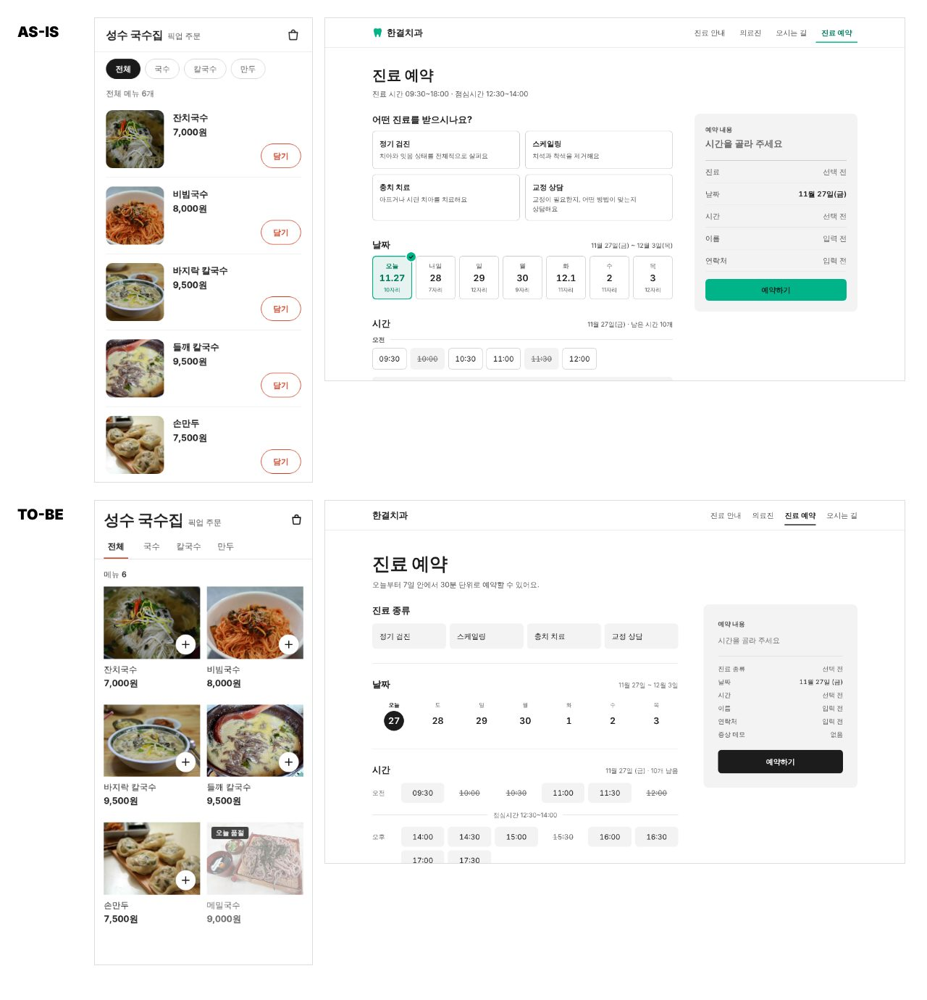

# 화면 바탕 부품 시험 실행(0.20 ↔ 0.21, 4번)과 강조색 줄

| 항목 | 내용 |
|------|------|
| 날짜 | 2026-11-27 |
| 작성 | 에이전트 |
| 관련 경로 | `evals/benchmark/kit-pilot-prompts.json`, `evals/benchmark/artifacts/kit-pilot-v020.json.gz`·`kit-pilot-v021.json.gz`, `scripts/benchmark/run.mjs`, `skills/suta/SKILL.md`, `skills/suta/patterns/screen-kit/PATTERN.md`, `docs/benchmark(.en).md` |

## 1. 개요

`screen-kit`(화면 바탕 부품)을 넣은 0.21이 실제 모델 실행에서 부품을 쓰는지, 결과가 사용자가 승인한 초안 쪽으로 움직이는지 보려고 0.20과 같은 요청을 한 번씩 돌렸다. 요청은 모양(카드·그림자·색)을 정하지 않았다. 하나는 부품 데모와 가까운 화면(사진이 있는 국수집 메뉴 목록, 모바일), 하나는 먼 화면(치과 진료 예약, 데스크톱)이다.

## 2. 작업내용

- 벤치마크 실행에 두 가지를 더했다(`scripts/benchmark/run.mjs`).
  - 요청 세트의 `seed`: 실행마다 작업 폴더에 파일을 미리 넣는다. 이번에는 `demo/public/photos`의 사진 18장. 두 조건이 같은 파일을 받는다.
  - `--plugin-root`: suta 조건이 실을 플러그인 폴더. 0.20은 `git archive origin/main skills .claude-plugin`으로 풀어 썼다.
- 실행 4번, 합계 10.92달러(0.20 메뉴 1.91·예약 3.73, 0.21 메뉴 2.27·예약 3.01). 모두 산출물이 나왔고 권한 거절 0.

| 화면 | 0.20 | 0.21 |
|---|---|---|
| 메뉴 목록 | 사진 왼쪽 목록 행, 행마다 빨간 윤곽선 "담기" 6개, 분류는 알약 칩. 강조색 `#cf3a1c`("비빔국수 양념장의 붉은색") | 상자 없는 2열 칸, 1:1 사진, 사진 위 원 더하기 버튼, 글자 탭 + 밑줄, 품절 사진 흐림 + 표시. 강조색 `#c9401f`("비빔국수 양념장의 고추 빨강") |
| 진료 예약 | 테두리 상자 27개(진료 카드·날짜 카드·시간 칸), 강조색 `#00b388`("양치 뒤의 민트") | 쪽 제목 크게, 날짜 띠는 숫자 + 검정 원, 시간 칸 회색 채움, 예약된 시간 줄, 요약 패널 회색 면. 강조색 거의 검정. 상자 6개 |
| 읽은 스킬 문서 | 메뉴: SKILL.md만. 예약: SKILL.md·defaults·design·detail·screen-conventions | 메뉴: SKILL.md만. 예약: SKILL.md·screen-conventions + `screen-kit` 패턴 |

- 보인 것
  - **구조는 0.21 쪽으로 크게 움직였다.** 메뉴 목록은 `screen-kit` 패턴 폴더를 열지 않았는데도 SKILL.md 절차의 세 줄(바탕 부품부터, 쪽 제목 1.7배, 사진 자리)만으로 상자 없는 칸·사진 틀·글자 탭이 나왔다. 예약은 패턴을 읽었고 부품 구조가 거의 그대로 나왔다.
  - **강조색은 두 버전 모두 업종에서 떠올린 색을 칠했다**(0.20 두 번, 0.21 메뉴 한 번). 0.21의 메뉴 실행은 바로 앞에 고친 `tone.md`("업종에서 떠올린 색은 근거가 아니다")를 갖고 있었지만 그 문서를 읽지 않았다. 늘 읽히는 SKILL.md에는 그 줄이 없었다. 근거 주석까지 "양념장의 고추 빨강"으로 같은 꼴이다.
  - **접근성**: 0.21 예약에 axe `label-content-name-mismatch` 7곳(날짜 칸에 보이는 "토 28"과 다른 `aria-label="11월 28일 토요일"`). 부품 문서는 그렇게 쓰라고 하지 않지만 막지도 않았다. 0.20은 0.
- 고친 것
  - `SKILL.md` 절차 4의 바탕 부품 아래에 한 줄: "강조색은 받은 브랜드색, 없으면 거의 검정이다. 업종에서 떠올린 색(국수집의 고추 빨강, 치과의 초록)은 칠하지 않고 제안한다." 본문 한도(30,000바이트) 안에 넣으려고 요청 범위 절의 겹치는 표현 세 곳을 줄였다(29,995바이트).
  - `screen-kit/PATTERN.md` 날짜 띠: 월·요일 전체 이름이 필요하면 `aria-label`로 덮지 말고 `.kit-sr` 낭독 전용 글자를 덧붙인다.
  - `docs/benchmark(.en).md`에 `seed`·`--plugin-root` 설명.
- 산출물 보존: `evals/benchmark/artifacts/kit-pilot-v020.json.gz`·`kit-pilot-v021.json.gz`(사진은 저장소에 이미 있어 묶음에서 빠졌다 — 풀 때 `demo/public/photos`를 `photos/`로 복사한다).
- 화면: 줄 머리 AS-IS는 0.20, TO-BE는 0.21. 왼쪽 메뉴 목록(390), 오른쪽 진료 예약(1280 첫 화면).

## 3. 주의사항

- 요청마다 한 번씩이다. 구조 변화는 두 요청 모두에서 컸지만 우연일 수 있다.
- SKILL.md의 강조색 줄을 넣은 뒤 메뉴 목록을 두 번 더 돌렸다(3.65달러). 두 번 모두 강조색이 거의 검정(`#1c1c1c`)이었고, 보고에 "브랜드색이 있으면 `--color-accent`만 바꾸면 된다"고 적었다. 구조(상자 없는 2열 칸·사진 틀·글자 탭)는 그대로였고 axe 위반 0이다. 두 실행 모두 SKILL.md만 읽었다. 산출물 `evals/benchmark/artifacts/kit-pilot-accent.json.gz`. 예약 폼과 다른 업종으로는 확인하지 않았다.
- SKILL.md 본문이 한도 30,000바이트에서 5바이트 남았다. 다음에 늘 읽히는 줄을 더하려면 다른 줄을 references로 옮겨야 한다.
- 메뉴 목록의 쪽 제목은 가게 이름(약 26px)이 맡았고 따로 "오늘의 국수" 같은 제목은 없었다. 1.7배 기준은 지켰다.
- 블라인드 판정과 요구 충족률은 돌리지 않았다.
