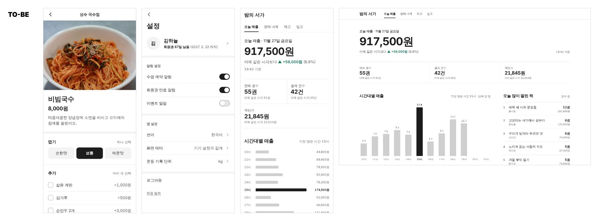

# 화면 바탕 부품 시험 실행 2(상세·설정·대시보드, 0.22)와 읽은 파일 집계 정정

| 항목 | 내용 |
|------|------|
| 날짜 | 2026-11-27 |
| 작성 | 에이전트 |
| 관련 경로 | `evals/benchmark/kit-pilot2-prompts.json`, `evals/benchmark/artifacts/`, `scripts/lib/runArchive.ts`, `scripts/benchmark/archive.mjs`, `demo/src/tests/runArchive.test.ts`, `AGENTS.md`, `docs/worklog/2026-11-27-kit-pilot.md`·`skill-budget.md` |

## 1. 개요

`screen-kit` 0.22(상세·설정·대시보드 부품)가 실제 모델 실행에서 쓰이는지 요청 셋을 한 번씩 돌렸다. 결과를 보다가 "읽은 스킬 문서" 집계가 틀렸다는 것을 찾았다. 오늘 앞선 보고의 "모델이 진입 문서만 읽었다"는 그 집계에 기댄 말이라 함께 바로잡는다.

## 2. 작업내용

### 시험 실행

- 요청 3개 × suta 0.22 × 1번, 합계 7.66달러(상세 1.88·설정 2.62·대시보드 3.16). 요청은 모양을 정하지 않았다. 사진 18장을 작업 폴더에 미리 넣었다.

| 요청 | 결과 | 읽은 스킬 파일 |
|---|---|---|
| 국수집 비빔국수 메뉴 상세(390) | 폭 가득 사진 머리, 이름 26·가격 22, 옵션 구역(회색 채움 칸·체크 행), 수량, "1개 담기 8,000원" 하단 바. 강조색 거의 검정 | SKILL.md, 화면 관례, `screen-kit-detail.css`, `ScreenKitDetail.tsx` |
| 헬스장 회원 앱 설정(390) | 쪽 제목, 프로필 줄, 묶음 이름, 폭 가득 행, 8px 띠, 켜진 스위치 거의 검정. 탈퇴는 밑줄 글자 | SKILL.md, 화면 관례, `switch.css` |
| 독립서점 매출 대시보드(1280·390) | 답 머리(큰 수치 + 비교 줄), 선으로 나눈 지표 줄, 무채색 막대 + 강조 하나, 순위 목록, 모바일에서 표가 행 목록·막대는 가로 막대로. 강조색 거의 검정, 오른 금액만 초록 | SKILL.md, 화면 관례, `screen-kit-dashboard.css`, `ScreenKitDashboard.tsx`, PATTERN.md, `screen-kit.css`, `defaults.md`, 토큰 CSS |

- 세 화면 모두 axe 위반 0, 320px 가로 넘침 없음, 칸 밖으로 잘린 글자 0, 테두리·그림자 상자 0~3개.
- 업종에서 떠올린 색은 나오지 않았다(헬스장·서점 모두 거의 검정).
- 설정 실행은 `screen-kit-settings.css`를 읽지 않았다. 한 번 읽으려던 명령(`cat … ; grep kit-…`)이 권한 거절로 막혔고, 화면 관례 문서와 `switch.css`로 만들었다. 구조는 부품과 같다(관례 문서와 부품의 값이 같아서다).
- 산출물: `evals/benchmark/artifacts/kit-pilot-v022.json.gz`.

같은 요청의 이전 판 실행이 없어 TO-BE만 있다.

### 읽은 파일 집계의 결함과 정정

- 결함: `archive.mjs --list`의 "읽은 스킬 문서"가 세 가지를 세지 못했다. ① 셸 변수에 담은 경로(`S=…/plugin/skills/suta; cat $S/…` — 경로를 지우는 정규식이 `S=`까지 지워 변수 이름이 사라졌다) ② `.md`가 아닌 파일(CSS·TSX) ③ 200자에서 줄인 명령의 뒤쪽.
- 고침(테스트 먼저, 13 → 17개): 경로 지우기는 `/`에서 시작하는 부분만 지운다. 읽은 파일은 변수를 펼쳐서, 줄이지 않은 전체 명령에서 세고(`skillFilesRead`), 묶음에 `read`로 담는다. `wc`·`ls`·`node`의 인자와 별표가 든 경로는 세지 않는다.
- 남아 있던 실행 폴더로 묶음 다섯 개를 다시 만들었다. 다시 센 값:

| 실행 | 처음 보고 | 다시 센 값 |
|---|---|---|
| 0.21 메뉴 목록 | SKILL.md만 | SKILL.md, 화면 관례, `defaults.md`, `detail.md`, `screen-kit` PATTERN.md, 목록 CSS |
| 강조색 확인 2번 | 둘 다 SKILL.md만 | 둘 다 SKILL.md, 화면 관례, `screen-kit` PATTERN.md·CSS |
| 0.20 메뉴 목록 | SKILL.md만 | SKILL.md, `defaults.md`, 화면 관례 |
| 요구 충족 시험(0.20) | references 문서를 읽지 않음 | 같다(빵집은 패턴 문서만, 회의실은 SKILL.md만) |

- 바뀌는 해석:
  - "진입 문서의 세 줄만으로 구조가 바뀌었다"는 틀렸다. 모델은 진입 문서의 "바탕 부품부터 깐다"를 따라 부품 파일을 열고 만들었다. 부품이 통한 이유는 이쪽이다.
  - 0.21 메뉴 실행이 업종 색을 칠한 까닭은 "`tone.md`를 읽지 않아서"만이 아니다. 그 실행은 `defaults.md`를 읽었고, 거기 색 문단에 "서비스 성격에서 강조색을 고른다"는 옛 문장이 남아 있었다. 같은 규칙을 한 문서에서만 고친 탓이다(0.22에서 남은 문장을 모두 맞췄다).
  - 그대로인 것: SKILL.md에 넣은 강조색 한 줄 뒤로 다섯 실행(확인 2 + 이번 3) 모두 거의 검정이다.
- `AGENTS.md`의 진입 문서 문단, `2026-11-27-kit-pilot.md`, `2026-11-27-skill-budget.md`를 다시 센 값으로 고치고 정정한 사실을 적었다. 병합된 PR 83·84의 본문에는 처음 판의 문장이 남아 있다.

## 3. 주의사항

- 요청마다 한 번씩이다.
- 읽은 파일 집계는 여전히 하한이다. 스크립트(python 등) 안에서 연 파일, 여러 줄에 걸친 명령의 일부는 잡지 못한다.
- 지난 기록(2026-11-10·11)의 "새 참조 문서는 18번 중 한 번씩만 읽힘"은 다른 방법(run.mjs의 요약)으로 센 값이다. 같은 결함이 있었는지 확인하지 않았다 — 그 실행 폴더는 남아 있지 않다. `run.mjs`의 `patterns` 요약도 셸 변수 경로를 놓칠 수 있다(이번 실행 여러 개에서 `patterns`가 비어 있었다).
- 설정 실행의 권한 거절 1건은 벤치마크 실행 설정의 문제다(셸 명령은 모두 허용인데 거절됐다). 원인은 보지 않았다.
