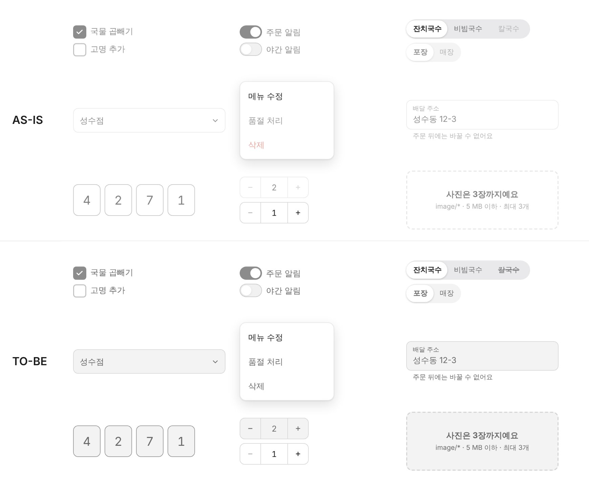

# 모션 사이 단계 둘과 잠김 색 (0.23.1)

| 항목 | 내용 |
|------|------|
| 날짜 | 2026-11-27 |
| 작성 | 에이전트 |
| 관련 경로 | `skills/suta/patterns/motion-principles/assets/motion-tokens.css`·`motionTokens.ts`·`PATTERN.md`·`references/decision-table.md`, 패턴 CSS 19개(시간 사슬)·13개(잠김), 패턴 문서 12개, `skills/suta/references/defaults.md`, `scripts/lib/motionTokenChain.ts`·`scripts/validateSkills.mjs`, `demo/src/styles.css`·`demo/src/demos/motion-principles/`·`demo/src/demos/index.ts`, `docs/guide.md`·`guide.en.md`, README 2벌 배지, 매니페스트 셋 |

## 1. 개요

0.23(`2026-11-27-motion-token-chain.md`)이 남긴 후속 두 가지다.

- 패턴 11개가 200ms, 8개가 300ms를 썼다. 가까운 토큰 단계와 50ms씩 떨어져 `/* 토큰 밖 */` 주석과 함께 숫자로 남아 있었다. 그래서 토큰 파일을 넣어도 이 패턴들은 따라오지 않았다.
- 0.23에서 잠김 색 토큰(`--disabled-surface`·`--disabled-text`)을 만들었다. 그런데 패턴 대부분은 아직 불투명도로 흐리게 잠갔다. 흐린 글자는 2~3.8:1까지 떨어졌다.

## 2. 작업내용

### 시간 단계 둘 — `fast-plus` 200ms, `base-plus` 300ms

- 이름: 앞 단계 이름 뒤에 `-plus`를 붙였다. "그 단계보다 한 걸음 긴 사이 단계"라는 뜻이다. 순서는 `instant < fast < fast-plus < base < base-plus < slow < page`이고, 이름만 보고 순서를 안다. `snappy`·`moderate` 같은 새 형용사는 `fast`와의 앞뒤가 이름에서 읽히지 않아 쓰지 않았다. 기존 다섯 이름과 값은 그대로다.
- 쓰임(지금 그 값을 쓰는 패턴의 공통점):
  - `fast-plus`: 컨트롤 자신의 상태 전환이다(스위치 손잡이·체크 표시·세그먼트 알약·셀렉트 펼침·로딩 버튼 상태·끌어 놓은 항목의 정착). 같은 값을 쓰는 작은 페이드도 있다(유리 면 색·오류 문구·파일 행 등장·축하 배경·테마 아이콘 교차). 이것들은 "컨트롤 상태"로 묶이지 않는다.
  - `base-plus`: 두 무리다. 하나는 자리를 만들며 들어오는 덩어리다(아코디언·토스트·나타남/사라짐·햄버거 패널·라이트박스 백드롭). 다른 하나는 손을 뗀 뒤 제자리로 돌아오는 복귀다(당겨서 새로고침·늘어나는 머리·핀치 확대). 하나의 뜻으로 묶이지 않아 주석에 두 무리를 함께 적었다.
- `fast`의 주석에서 "토글 손잡이·체크 표시"를 뺐다. 그 패턴들은 실제로 200ms를 써 왔다. 대신 실제로 150ms를 쓰는 예(툴팁·메뉴·자동완성·입력칸 테두리)를 적었다.
- 동작 줄이기: `fast-plus` 1ms(= `fast`), `base-plus` 80ms(= `base`). 기존 규칙은 "작은 상태 변화는 거의 즉시, 컴포넌트 이상은 짧은 페이드"다. 사이 단계는 앞 단계의 줄인 값을 따른다.
- TS 상수 `DURATION`·`MotionSize`에 두 단계를 더했다. 데모의 시간 고르기 목록도 7단계로 늘렸다.

### 바뀐 값 — 출처만 토큰이 되고 값은 그대로

| 패턴 | 변수·자리 | 전 → 후 |
|---|---|---|
| checkbox-radio | `--check-duration` | `200ms` → `var(--motion-duration-fast-plus, 200ms)` |
| switch | `--switch-duration` | 같음 |
| segmented-control | `--segment-duration` | 같음 |
| select | `--select-duration` | 같음 |
| loading-button | `--loading-button-duration` | 같음 |
| form-shake-error | `--error-duration`(오류 문구) | 같음 |
| glass-surface | `.glass-interactive` 바탕·테두리 | 같음(2곳) |
| file-upload | 행 등장, 진행 막대 | 같음(2곳) |
| celebration | 배경 들어옴 | 같음 |
| theme-toggle | 아이콘 흐림 | 같음 |
| drag-to-reorder | `--reorder-duration` | 같음. 코어 `settleMs` 200과 짝이라 주석에 "토큰을 260ms 넘게 늘리면 `settleMs`도 맞춘다"를 남겼다 |
| accordion | `--accordion-duration` | `300ms` → `var(--motion-duration-base-plus, 300ms)` |
| enter-exit | `--fx-duration` | 같음 |
| hamburger-menu | `--hamburger-duration`, `--drawer-duration`(백드롭·패널) | 같음(3곳) |
| pinch-zoom | `--pinch-duration` | 같음 |
| pull-to-refresh | `--ptr-duration` | 같음 |
| stretchy-header | `--stretch-duration` | 같음 |
| toast-stack | `--toast-duration` | 같음 |
| zoom-lightbox | 백드롭 | 같음 |

패턴 19개, 23곳이다. "토큰 밖" 주석은 패턴 CSS에서 40줄 → 17줄이 됐다. 남은 17줄은 200·300이 아니거나 시간 길이가 아니다.

- 흔들림 400/420ms와 감쇠 곡선(form-shake-error·loading-button·otp-input)
- 좋아요 팝 400ms·큰 하트 900ms, 축하 그림 480ms·조각 900ms
- 진행 링 600ms·회전 1s, 스피너 700·800ms, 시머 주기 1.4s
- 지연 셋: search-suggest 200ms(코어 `loadingDelayMs`와 짝인 응답 대기 문턱), card-expand 200ms(상자가 절반쯤 자란 뒤), loading-button 60ms
- card-expand 닫힘 페이드의 가속 곡선

### 검사 — 토큰 파일에 없는 이름

- `findUnknownTokens`(`scripts/lib/motionTokenChain.ts`)를 더했다. 토큰 이름의 철자가 틀리면(`--motion-duration-fast-pluss`) 사슬은 늘 맨 끝 숫자로 떨어진다. 처음 모습은 같아서 눈으로는 모른다. 기존 두 검사는 모르는 이름을 건너뛰어 이것을 잡지 못했다.
- `validateSkills.mjs`가 `--motion-`·`--focus-ring-`·`--hover-`·`--disabled-` 이름이 토큰 파일 두 개에 있는지 본다. 지금 패턴 CSS에서는 0건이다.
- 테스트를 먼저 썼다(Red → Green). `motionTokens.test.ts`에 2개(7단계 순서·값, 줄인 값의 순서와 규칙), `motionTokenChain.test.ts`에 2개를 더했다.

### 잠김 — 불투명도 → 잠김 색

다시 센 결과는 13곳이다. 지시의 9곳에 넷이 더해졌다: segmented-control(전체·일부), switch, wheel-picker, screen-kit 사진 카드(`.kit-choice`). 0.23에서 screen-kit은 버튼만 옮겼다.

공개 변수 사슬은 `var(--{패턴}-disabled-…, var(--disabled-text, var(--color-text-tertiary, #686868)))`이다(바탕은 `--disabled-surface` → `--color-canvas`). 잠김 불투명도를 받는 공개 변수는 원래 어느 패턴에도 없었다. 그래서 없앤 공개 변수는 없고, 호환을 위해 남길 것도 없었다.

흰 면 위 대비는 조상의 불투명도까지 합성해 쟀다(Chromium). 기준은 4.5:1이다.

| 패턴 | 자리 | 전 | 후 | 새 공개 변수 |
|---|---|---|---|---|
| checkbox-radio | 라벨 글자 | 3.3:1 | 5.57:1 | `--check-disabled-text` |
| switch | 라벨 글자 | 3.3:1 | 5.57:1 | `--switch-disabled-text` |
| segmented-control | 일부 잠긴 칸(+ 가로줄) | 1.68:1 | 4.61:1(트랙 위) | `--segment-disabled-text` |
| segmented-control | 전체 잠김 — 고른 칸 / 다른 칸 | 3.0 / 1.9:1 | 5.02 / 5.02:1 | `--segment-disabled-bg`·`-text` |
| select | 잠긴 트리거 | 3.3:1 | 5.02:1 | `--select-disabled-bg`·`-text` |
| select | 고를 수 없는 옵션 | 2.85:1 | 5.57:1 | `--select-disabled-text` |
| dropdown-menu | 잠긴 항목 / 잠긴 위험 항목 | 2.85 / 2.07:1 | 5.57 / 5.57:1 | `--menu-disabled-color` |
| floating-label | 값 / 라벨 / 도움말 | 3.3 / 2.09 / 2.09:1 | 5.02 / 5.02 / 5.57:1 | `--field-disabled-bg`·`-text` |
| otp-input | 칸의 숫자 | 3.84:1 | 5.02:1 | `--otp-disabled-bg`·`-text` |
| quantity-stepper | 전체 잠김 — 숫자 / −·+ | 3.3 / 1.44:1 | 5.02 / 5.02:1 | `--qty-disabled-bg`·`-text` |
| file-upload | 잠긴 칸 — 안내 / 제한 줄 | 3.84 / 2.27:1 | 5.02 / 5.02:1 | `--upload-disabled-bg`·`-text` |
| wheel-picker | 가운데 값(선택 띠 위) | 2.1:1 | 4.8:1 | `--wheel-disabled-color` |
| screen-kit | 사진 카드 이름 / 보조 줄 | 3.3 / 2.36:1 | 5.57 / 5.57:1 | (공용 토큰 직접, screen-kit 방식) |

- 글자가 있는 곳만 색으로 바꿨다. 같은 컨트롤 안의 그림은 불투명도로 두었다: 체크박스 박스, 스위치 트랙·손잡이, 사진 카드의 사진. 고른 채로 잠긴 상태가 모양 그대로 남는다.
- 세그먼트의 일부 잠긴 칸에는 가로줄을 더했다. 고르지 않은 칸의 글자도 같은 옅은 글자색이라, 색만으로는 잠긴 칸이 갈리지 않는다(screen-kit의 고를 수 없는 칸과 같은 규칙).
- 메뉴의 잠긴 위험 항목도 같은 회색이 된다. "지금 누를 수 없다"는 표시가 먼저이고, 무엇을 하는 항목인지는 글자가 말한다.
- 꺼진 입력(floating-label·otp-input·quantity-stepper 숫자 칸)에는 `-webkit-text-fill-color: currentColor; opacity: 1`을 더했다. Safari가 꺼진 입력에 덧씌우는 흐림을 걷는다.
- 고대비 블록에서 이제 쓸모없는 `opacity: 1`은 걷었다. 불투명도로 남긴 그림(박스·트랙)에는 `opacity: 1`을 더해 시스템 색이 흐려지지 않게 했다.

그대로 둔 곳과 이유(CSS 주석에도 적었다):

| 패턴 | 자리 | 이유 |
|---|---|---|
| quantity-stepper | 끝에 닿은 −·+ (0.35, 2.18:1) | 글자가 아니라 아이콘이다. 바로 옆의 눌리는 버튼과 한눈에 달라 보여야 한다. 잠김 글자색 #686868은 주 글자색과 가까워 끝에 닿았는지 잘 안 보인다. 이름은 `aria-label`이 읽는다 |
| theme-toggle | 버튼 전체 (0.45) | 글자 없는 아이콘 버튼이다. 색이 `currentColor`라 두 테마 어디에나 놓인다. 밝은 테마의 회색으로 바꾸면 어두운 바탕에서 묻힌다 |
| range-slider | 슬라이더 전체 (0.45) | 안에 글자가 없다(트랙·채움·손잡이). 고른 구간이 옅게 남아 범위가 보이는 편이 낫다 |

### 잠긴 상태의 반응·포커스 (Chromium)

- 호버·눌림 바탕과 축소: theme-toggle, 수량 버튼(끝에 닿음·전체 잠김), 메뉴 잠긴 항목, 체크박스 박스, 스위치 손잡이, 셀렉트 트리거, 사진 카드. 모두 반응이 없고 `cursor: not-allowed`다.
- **고친 결함 하나:** 잠긴 theme-toggle에 정밀 포인터로 호버하면 바탕이 칠해졌다(전: `color(srgb 0.11 … / 0.1)`). `.theme-toggle:not(:disabled):hover`로 막았다.
- quantity-stepper의 `aria-disabled` 버튼에 `:active` 바탕을 막는 규칙을 더했다. 지금 마우스로는 `:hover` 규칙이 이미 덮고 있어 차이가 없다. 호버 없이 눌림만 생기는 경우를 위한 것이다.
- Tab: 네이티브 `disabled`(체크박스·스위치·셀렉트 트리거·입력·인증번호·테마 버튼)에는 닿지 않는다. `aria-disabled`(메뉴 항목·수량 끝 버튼)에는 닿는다. 전과 같다.

### 데모 셸

- 데모 셸(`demo/src/styles.css`)은 어둡다. 패턴 기본 잠김 색(#686868)이 셸 바탕 #171a21 위에서 3.12:1이었다. 전에는 밝은 셸 글자를 0.5로 흐린 값이라 약 4.4:1이었다.
- 셸 `:root`에서 새 공개 변수들을 셸의 옅은 글자색(`--text-dim`, 6.71:1)과 더 어두운 바탕(`--bg`)에 이었다. 셸이 강조색 공개 변수를 잇는 방식과 같다.
- 밝은 면 데모(press-feedback 상태 한 벌, screen-kit)는 이 패턴들을 잠그지 않는다. 공용 토큰을 그대로 써서 5.02:1이 유지된다.

### 문서

- `motion-principles/PATTERN.md`: 파일 표(7단계), 원칙 표에 두 행. 컴포넌트 전환의 예에서 아코디언·토스트를 `base-plus` 행으로 옮겼다(실제 300ms). "토큰 밖" 설명과 예시도 바꿨다(`--ring-duration: var(--motion-duration-page)`).
- `decision-table.md`: "토큰 밖 200ms/300ms" 행 11개를 `fast-plus`·`base-plus`로.
- `references/defaults.md` 6절: 시간 표에 두 행, 줄인 값 설명(1ms는 200ms 이하·80ms는 250~350ms·120ms는 420ms).
- celebration·drag-to-reorder `PATTERN.md`(시간), 잠김 행이 있는 패턴 문서 9개(checkbox-radio·switch·dropdown-menu·file-upload·floating-label·select·segmented-control·wheel-picker·quantity-stepper).
- `docs/guide.md`·`guide.en.md`·데모 레지스트리: "시간 5단계" → "7단계". 레지스트리 사용 예의 토스트 주석도 고쳤다.
- `react-native.md`: 시간 표가 없다(들어옴 250·나감 190만 있음). 고치지 않았다.
- `skills/suta/SKILL.md`: 시간 단계 나열이 없다. 건드리지 않았다(본문 28,921바이트 그대로).
- 버전 0.23.0 → 0.23.1(매니페스트 셋), README 2벌 tests 배지 1,448 → 1,452.

패턴 CSS와 토큰 파일만 불러온 흰 면 최소 페이지다. 전 캡처는 고치기 전에 CSS를 복사해 둔 것으로 찍었다. 컨트롤은 체크박스·스위치·세그먼트(일부·전체)·셀렉트·메뉴·떠오르는 라벨·인증번호·수량·파일 칸이다. 수량의 아래 줄(끝에 닿은 −)은 바뀌지 않은 비교용이다.

### 검증

- `npm run build`·`npm run lint`·`npm test`(1,572 통과, 배지 수 1,452), `npm run validate`(구조 통과·선택 평가 493/493·통합 검사 error 0·warn 0). 데모 셸 CSS 검사 error 0·warn 0.
- 브라우저(Playwright Chromium):
  - (a) 200·300을 쓰던 패턴 12곳의 `transition-duration`을 쟀다(switch·checkbox·segmented·select·glass·drag·accordion·toast·enter-exit·hamburger·drawer·lightbox). 토큰 파일이 없을 때와 있을 때 모두 0.2s·0.3s로, 전과 같다. `:root`에 `--motion-duration-fast-plus: 333ms`·`--motion-duration-base-plus: 444ms`를 주면 각각 0.333s·0.444s를 따른다. 토큰 파일 없이 주입해도 같다.
  - (b) 위 표의 대비와 반응·포커스.
  - (c) 동작 줄이기 + 토큰 파일: 스위치 트랙·셀렉트 패널 페이드 0.001s, 토스트·나타남/사라짐·라이트박스 백드롭 페이드 0.08s. 패턴이 전이를 끄는 곳은 0s, drawer는 패턴 고유 0.15s다. 토큰 파일이 없으면 0.2s·0.3s로 전과 같다.
  - 데모 빌드: 모션 원칙 데모의 시간 목록이 7단계, 페이지 오류 0. 잠긴 라벨은 어두운 셸에서 6.71:1, press-feedback 흰 면은 5.02:1.
- 모션 리뷰: 값이 바뀌지 않아 (a)로 갈음했다.

## 3. 주의사항

- **기존 사용자에게 바뀌는 것**
  - 토큰 파일을 넣고 동작 줄이기를 켠 경우: 19개 패턴의 남은 페이드가 200ms → 1ms, 300ms → 80ms로 짧아진다. 전에는 토큰 밖이라 길게 남았다.
  - 토큰 파일의 `--motion-duration-fast-plus`·`-base-plus`를 바꾸면 이 패턴들이 따라온다. 프로젝트가 같은 이름을 다른 뜻으로 이미 쓰고 있었다면 영향을 받는다.
  - 잠긴 컨트롤 13곳이 흐린 모양에서 옅은 바탕 + 옅은 글자로 바뀐다. 입력류(셀렉트 트리거·떠오르는 라벨·인증번호·수량·파일 칸·전체 잠긴 세그먼트)는 회색 면이 생긴다. 체크박스·스위치는 라벨만 바뀌고 박스·트랙은 전처럼 흐리다.
  - 잠긴 메뉴 위험 항목이 빨강이 아니라 회색이다. 일부 잠긴 세그먼트 칸에 가로줄이 생긴다.
  - **어두운 테마 프로젝트:** 잠김 기본색은 밝은 면 기준이다. 전에는 불투명도라 어떤 바탕에서도 어느 정도 읽혔다. 이제는 `--disabled-text`·`--disabled-surface`(또는 패턴 공개 변수)를 어두운 값으로 다시 주지 않으면 3:1 안팎으로 묻힌다. 데모 셸이 그 경우였다. 이 안내는 `layout-tokens.css` 주석에도 아직 없다(아래 제안).
  - 잠긴 theme-toggle이 호버에 반응하지 않는다(결함 수정).
- **확신이 낮은 것**
  - `base-plus`의 쓰임이 한 뜻으로 묶이지 않는다. "덩어리 등장"과 "제스처 뒤 복귀" 두 무리다. `fast-plus`에도 컨트롤 상태가 아닌 작은 페이드가 섞여 있다.
  - 세그먼트 일부 잠긴 칸은 4.61:1로 기준을 겨우 넘는다(기본 트랙색 위). `--segment-track-bg`를 더 진하게 준 프로젝트에서는 4.5 아래로 갈 수 있다.
  - 수량 끝 버튼을 0.35 불투명도(2.18:1)로 둔 것은 "아이콘·옆 버튼과의 구별" 판단이다. 잠긴 컨트롤은 WCAG 대비 요건의 예외지만, suta는 "읽히게 둔다"(0.23 결정)와 어긋난다는 반론이 있을 수 있다.
  - drag-to-reorder: 토큰을 260ms보다 길게 바꾸면 코어의 상한(`settleMs + 60`)이 전이를 끊는다. 주석과 문서에 적었지만 코드로 막지는 않았다.
- **확인하지 못한 것**: Safari·Firefox(특히 `-webkit-text-fill-color`가 실제로 Safari의 흐림을 걷는지), 고대비 모드의 실제 렌더, 화면 낭독기. 터치 기기에서의 `:active`.
- **제안(하지 않음)**: `layout-tokens.css`의 잠김 주석에 "어두운 테마는 `--disabled-text`·`--disabled-surface`를 다시 준다"를 한 줄 더한다. screen-kit 상세의 고를 수 없는 칸·체크 행은 `--color-text-tertiary`를 직접 써서 `--disabled-text`를 거치지 않는다. 이번 범위(불투명도)가 아니라 그대로 두었다. 패턴 문서의 커스터마이즈 표에는 새 공개 변수를 아직 따로 적지 않았다(CSS 머리 주석과 상태 표에만 있다).
