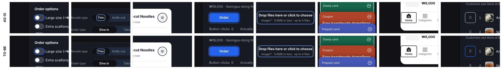

# 모션 토큰 사슬과 상호작용 상태 한 벌 (0.23.0)

| 항목 | 내용 |
|------|------|
| 날짜 | 2026-11-27 |
| 작성 | 에이전트 |
| 관련 경로 | `skills/suta/patterns/motion-principles/assets/motion-tokens.css`·`motionTokens.ts`·`references/decision-table.md`, `skills/suta/patterns/layout-principles/assets/layout-tokens.css`·`layoutTokens.ts`(+ `layout-audit` 복사본), 패턴 CSS 52개(시간·이징·링), `scripts/lib/motionTokenChain.ts`, `scripts/validateSkills.mjs`, `skills/suta/SKILL.md`, `skills/suta/references/defaults.md`, `demo/src/demos/press-feedback/` |

## 1. 개요

조사(`docs/research/2026-11-26-layout-motion-depth.md` 3절·6절 후보 2·3)에서 두 어긋남을 찾았다.

- 패턴 CSS 53개 중 모션 토큰을 참조하는 파일이 0개였다. 프로젝트가 `motion-tokens.css`를 넣어도 패턴은 따라오지 않았다. 공개 시간 변수의 기본값은 14종, 이징은 리터럴 9종과 키워드 `ease` 44곳이었다.
- 포커스 링은 `outline: 2px solid …` 뒤의 색이 15가지, `outline-offset`이 8가지였다. 호버·잠김 토큰은 없었다.

0.18에서 층(그림자·겹치는 순서) 토큰을 사슬로 묶은 방식을 그대로 썼다. 사슬은 `var(--패턴 공개 변수, var(--토큰, 토큰과 같은 숫자))`다. 맨 끝 숫자가 토큰 값과 같아서, 토큰 파일을 넣든 안 넣든 처음 모습은 같다.

## 2. 작업내용

### 토큰

- `motion-tokens.css`: 눌림 한 짝을 더했다. `--motion-duration-press` 60ms, `--motion-duration-release` 220ms, `--motion-press-scale` 0.96이다. press-feedback의 값이 정본이다. 시간 단계를 새로 만든 것은 아니다. 동작 줄이기 블록에서는 바꾸지 않는다(패턴이 축소를 끄고 밝기만 남긴다).
- `layout-tokens.css`: 상호작용 상태 한 벌을 더했다. 색·굵기·간격은 레이아웃 토큰 파일에 두고, 시간은 모션 토큰 파일에 둔다(층 토큰과 같은 나눔).
  - `--focus-ring-width` 2px, `--focus-ring-offset` 2px, `--focus-ring-offset-inset` −2px(잘리는 칸만).
  - `--focus-ring-color`는 `var(--color-accent)`다. 강조색이 거의 검정이면 링도 검정이다. 강조색이 흰 면에서 3:1이 안 되는 밝은 색이면 `--color-text`로 바꾸라고 주석에 적었다.
  - `--focus-ring-color-inverse`는 `var(--color-on-accent)`다. 강조색 면이나 어두운 그림 위 요소에 쓴다(카드 묶음, 밀어서 나온 행동 버튼).
  - `--hover-mix` 5%: 면을 주 글자색과 섞는다. 흰 면은 #f4f4f4쯤(옅은 바탕), 옅은 바탕은 #e8e8e8쯤(선)이 된다. 강조색으로 칠한 면은 그 위 글자색과 두 배로 섞는다.
  - `--disabled-surface`(옅은 바탕)·`--disabled-text`(옅은 글자): 잠김은 불투명도가 아니라 색이다. 거의 검정 버튼을 0.45로 흐리면 흰 글자가 2.6:1이고, 옅은 바탕 + 옅은 글자는 5.0:1이다.
- TS 상수(`PRESS`, `STATE`)와 테스트. `layout-audit`의 공유 코어 복사본도 맞췄다.

### 바뀐 시간·배율 전체 (토큰 파일 없이 계산된 값)

| 패턴 | 변수·자리 | 전 → 후 | 이유 |
|---|---|---|---|
| dropdown-menu | `--menu-duration` | 140 → 150ms | `fast`, 10ms |
| search-suggest | `--suggest-duration` | 160 → 150ms | `fast`, 10ms |
| search-suggest | 찾는 중 흐림 | 120 → 100ms | `instant`, 20ms |
| floating-label·tooltip | 이징 | `(0.23, 1, 0.32, 1)` → `--motion-ease-out` | 토큰과 눈에 띄지 않게 다른 곡선 |
| modal-dialog | `--modal-duration` | 240 → 250ms(닫힘 180 → 187.5) | `base`, 10ms. 제자리에서 커지는 모달이라 `slow`(350)가 아니다 |
| long-press-menu | `--lpm-duration` | 220 → 250ms | `base`, 30ms |
| page-transition | `--page-transition-duration` | 280 → 250ms | `base`, 30ms. 아래 "모순 1" |
| swipe-to-delete | `--swipe-duration` | 260 → 250ms | `base`, 10ms |
| infinite-scroll | 새 항목 등장 | 260 → 250ms | `base` |
| infinite-scroll | 등장 간격 | 40 → 30ms(상한 240 → 180ms) | `--motion-stagger`. 순번 6에서 멈추는 것은 그대로 |
| card-expand | 본문 등장 | 260 → 250ms | `base` |
| celebration | 패널 들어옴 | 320 → 350ms, 곡선 `(0.2, 0.8, 0.2, 1)` → ease-out | `slow`, 30ms |
| celebration | 패널·배경 나감 | 240 → 250ms | `base` |
| celebration | 조각 곡선 | `(0.2, 0.7, 0.3, 1)` → ease-out | 근사 곡선 |
| loading-button | 체크 그리기 | 320 → 350ms | `slow`, 30ms |
| loading-button | 눌림 | 140ms 대칭·0.97 → 누름 60ms·복귀 220ms·0.96 | **80ms 넘게 바뀜.** 눌림 토큰 한 짝(정본 press-feedback) |
| screen-kit | `.kit-button` 눌림 | 120ms 대칭·0.98 → 60·220ms·0.96 | **100ms 넘게 바뀜.** 눌림 토큰 |
| screen-kit | `.kit-cell-add` 눌림 | 120ms 대칭 → 60·220ms(0.92는 그대로) | 눌림 시간 토큰. 36px 손잡이라 배율은 깊게 둔다 |
| quantity-stepper | 버튼 바탕 | 120 → 100ms | `instant` |
| quantity-stepper | 숫자 밀림 | 180 → 150ms | `fast`, 30ms |
| range-slider | 손잡이 커짐 | 120 → 100ms | `instant` |
| swipe-dismiss-viewer | 닫기·캡션 흐림 | 120 → 100ms | `instant` |
| theme-toggle | 바탕 | 160 → 150ms | `fast` |
| theme-toggle | 아이콘 회전 | 260 → 250ms | `base` |
| file-upload | 끌어 놓는 칸 | 140 → 150ms | `fast` |
| otp-input | 칸 테두리 | 140 → 150ms | `fast` |
| scroll-reveal | `--reveal-duration` | 600 → 420ms | **180ms 바뀜.** 아래 "모순 2" |
| 여러 패턴 | 키워드 `ease`·`ease-out` | → `--motion-ease-out` | 페이드·색 전이의 곡선이 조금 바뀐다(`ease`는 처음이 느리다) |

값은 그대로이고 토큰을 거치게만 바뀐 것: bottom-sheet 350·drawer 곡선, card-expand·card-stack 420, bottom-nav·glass-nav·sticky-header·tab-indicator 250, tooltip·floating-label·carousel 점·like-pop 선 150, press-feedback 60·220·0.96, card-stack 스태거 30ms(상한 240ms는 `min(순번, 8) × 스태거`로).

정리하면 패턴 CSS 57개(토큰 파일 둘 제외) 중 47개가 모션 토큰을 참조한다(전 0개). 나머지 10개는 움직임이 없는 파일이다. 공개 시간 변수의 기본값은 14종 → 토큰 5단계(`fast`·`base`·`slow`·`page`·`release`) + 토큰 밖 4종(200·300·400·600ms)과 시머 주기 1.4s다.

### 토큰 밖으로 남긴 값

같은 줄에 `/* 토큰 밖: 이유 */`를 적었다(41줄). 토큰을 바꿔도 따라오지 않는다. 맞추려면 그 패턴의 공개 변수에 토큰을 준다.

| 값 | 패턴 | 이유 |
|---|---|---|
| 200ms | checkbox-radio, switch, segmented-control, select, loading-button, form-shake-error(오류 문구), glass-surface, file-upload(행 등장·진행 막대), celebration(배경 들어옴), theme-toggle(아이콘 흐림) | `fast`(150)·`base`(250) 모두 50ms 차이 |
| 200ms | drag-to-reorder | 위와 같고, 코어의 `settleMs` 200과 짝이다 |
| 200ms 지연 | search-suggest(흐림 지연), card-expand(본문 지연) | 응답 대기 문턱(`loadingDelayMs` 200), 상자가 절반쯤 자란 뒤 |
| 300ms | accordion, enter-exit, hamburger-menu(`--hamburger-duration`·`--drawer-duration`), pinch-zoom, pull-to-refresh, stretchy-header, toast-stack | `base`(250)·`slow`(350) 모두 50ms 차이 |
| 300ms | zoom-lightbox 백드롭 | 위와 같다. 확대 이동은 코어 `durationMs` 350 |
| 400·420ms + 곡선 | form-shake-error, loading-button, otp-input의 흔들림 | 왕복 횟수가 정하는 길이와 감쇠 곡선이다 |
| 400ms | like-pop | 커졌다 넘치고 돌아오는 세 박자. `page`(420)는 화면 전환의 값이라 묶지 않았다 |
| 480ms + 지연 80ms, 900ms | celebration 그림 튀기·조각, like-pop 큰 하트 | 연출 길이, 화면 요소의 이동이 아니다 |
| 600ms, 1s | progress-ring 호·회전 | 값을 따라가는 길이와 회전 주기 |
| 700·800ms, 1.4s | 스피너(infinite-scroll·loading-button·pull-to-refresh), skeleton 시머 | 반복 주기다 |
| 지연 60ms | loading-button 체크 | 초록 면이 먼저 깔린 뒤 |
| `cubic-bezier(0.7, 0, 1, 1)` | card-expand 닫힘 페이드 | 움직임이 아니라 교차 시점을 끝으로 미루는 곡선. 퇴장 가속 곡선은 이번 범위가 아니다 |

동작 줄이기 블록 안의 값(150ms 페이드 등)은 손대지 않았다. 검사도 그 블록은 보지 않는다.

### 모순 두 가지

1. **화면 전환 420 ↔ 280.** 전환 중에는 포인터 입력이 잠긴다는 page-transition 문서의 이유를 따랐다. 기본값은 가장 가까운 단계인 `base`(250ms)로 했다(30ms 차이). `page`(420)는 카드 확장·카드 묶음처럼 공유 요소가 멀리 옮겨 가는 전환과 구역 크기의 등장에 남겼다.
   - 문서의 "280ms를 넘기지 않는 편이 좋다"는 이렇게 고쳤다: "기본값은 토큰 `page`(420ms)가 아니라 `base`(250ms)다. `page`는 카드 확장처럼 공유 요소가 멀리 옮겨 가는 전환의 값이다. 길게 바꾸더라도 `slow`(350ms)를 넘기지 않는다".
   - `decision-table.md`의 페이지 전환 행을 `page / out` → `base / out`으로, 모달 행을 `slow / drawer` → `base / out`으로 고쳤다. 토큰 주석(`--motion-duration-base`·`-page`)과 원칙 표도 같이 고쳤다.
2. **스크롤 등장 600ms·`i * 80` ↔ 스태거 30ms·10개.**
   - 예시를 `delayMs={Math.min(i, 9) * 30}`으로, 격자 예시를 `(i % 3) * 30`으로, "상태와 경계" 표와 커스터마이즈 표도 스태거 토큰에 맞췄다. 데모의 간격 기본값도 80 → 30ms다.
   - 600ms는 `page`(420)로 옮겼다. 30ms 원칙으로는 토큰 밖이지만, 토큰 파일 스스로 "500ms 위는 기다리는 느낌"으로 선을 그었고, 스태거 30ms × 9가 더해지면 마지막 항목이 0.9초 뒤에야 자리를 잡았다. 구역 크기의 등장은 `page` 단계의 역할(공유 요소 확장·구역 크기의 이동)에 들어간다.

### 포커스 링 — 15가지 → 기본 한 벌 + 이유가 적힌 예외 4가지

- 기본: `outline: var(--focus-ring-width, 2px) solid var(--{패턴} 공개 변수, var(--focus-ring-color, var(--color-accent, #1c1c1c)))`, `outline-offset: var(--focus-ring-offset, 2px)` 또는 잘리는 칸만 `var(--focus-ring-offset-inset, -2px)`. 공개 변수(`--range-accent`·`--qty-accent`·`--menu-focus`·`--lpm-focus`·`--segment-focus-color`·`--check-accent`·`--upload-accent`·`--switch-on-bg`·`--select-accent`·`--bottom-nav-current`·`--stack-focus-color`·`--loading-button-focus` 등)는 호환을 위해 사슬 앞에 남겼다.
- 예외(주석으로 이유):
  - `currentColor` 5곳 — glass-nav 링크·로고, glass-surface(유리는 어떤 바탕 위에도 놓이고 글자색이 그 바탕에서 보이는 색), theme-toggle(테마를 바꾸는 버튼이라 두 테마의 글자색을 따른다), card-expand 닫기(사진 위 어두운 원).
  - `--focus-ring-color-inverse` 2곳 — card-stack 카드, swipe-to-delete 행동 버튼.
  - `#fff` 2곳 — swipe-dismiss-viewer 닫기, zoom-lightbox 백드롭(바탕이 테마와 상관없이 늘 검정).
  - `Highlight` — 고대비 모드 블록. 굵기·간격도 토큰으로 바꿨다.
- 간격: 8가지(−6·−4·−2·1·2·3·4·6) → 2가지(2·−2). screen-kit 고르기 칸의 3px는 포커스가 아니라 선택 윤곽선이라 그대로다.
- 링이 없던 패턴 컨트롤 넷에 링을 더했다: accordion 트리거(안쪽), select 트리거, carousel 점, tab-indicator 탭(스크롤 줄은 안쪽). 전에는 브라우저 기본 링이었다.
- wheel-picker의 안쪽 그림자 링, screen-kit 입력칸의 `:focus-within` 링도 굵기·색 토큰으로.

### `outline: none` 9곳 판정(모두 대신하는 표시가 있어 그대로, 주석을 더함)

| 패턴 | 자리 | 대신하는 표시 |
|---|---|---|
| bottom-sheet | `.bottom-sheet:focus` | 시트 컨테이너는 낭독 시작점이다. Tab을 누르면 안의 첫 컨트롤에 링 |
| card-expand | 상세 루트·컨테이너 | 같은 이유. Tab의 첫 자리인 닫기 버튼에 링 |
| hamburger-menu | `.drawer:focus` | 같은 이유(이미 주석 있음) |
| page-transition | `[data-page-view]:focus` | 같은 이유. 화면 자체가 바뀌었다 |
| dropdown-menu | `.menu-item:focus` | 옅은 바탕 + 키보드일 때 `:focus-visible` 링 |
| long-press-menu | `.lpm-menu-item:focus` | 같다 |
| floating-label | `.field-input:focus` | 테두리가 강조색으로 바뀌고 옅은 3px 띠 |
| otp-input | `.otp-cell:focus` | 같다 |
| wheel-picker | `.wheel-track` | `:focus-visible`의 안쪽 그림자 링(원근 변형 때문에 outline 대신) |

0.21~0.22에 들어온 screen-kit의 셋(`.kit-day`, `.kit-cell-link`, `.kit-field-input`)도 날짜 원·칸 전체 `::after`·행 `:focus-within`에 링이 있어 그대로다. 사용 문제로 고친 곳은 없다.

### 호버·잠김·눌림을 토큰으로

- 호버 미디어 쿼리 `(hover: hover)` → `(hover: hover) and (pointer: fine)`: bottom-nav, dropdown-menu, file-upload, glass-nav, glass-surface, quantity-stepper, theme-toggle, screen-kit 6개 파일.
- 호버 색: file-upload(`#f3f4f6` 푸른 회색 → `--hover-mix`), quantity-stepper(`rgb(0 0 0 / 0.05)` → 같은 값의 토큰식, 누름은 두 배), screen-kit 아이콘 버튼·윤곽선 버튼.
- 잠김: loading-button(`opacity: 0.45` → 잠김 색), screen-kit 버튼(같은 색을 토큰 사슬로).
- 눌림: loading-button, screen-kit `.kit-button`·`.kit-cell-add`, press-feedback.

### 검사 — `scripts/lib/motionTokenChain.ts` + `validateSkills.mjs`

- `findUnchainedMotion`: transition·animation 계열과 `--변수` 값의 시간·`cubic-bezier`·`ease` 키워드가 `var(--motion-…, 기본값)` 사슬 끝이 아니면 잡는다. 같은 줄에 "토큰 밖"이 있으면 통과. 동작 줄이기 블록·주석·문자열·0s·`linear`는 보지 않는다.
- `findStaleFallbacks`: `var(--motion-…|--focus-ring-…|--hover-…|--disabled-…, 기본값)`의 기본값이 토큰 파일 값과 다르면 잡는다.
- 테스트 18개를 먼저 썼다(Red → Green). 작업 전 패턴 CSS에서 205건, 작업 뒤 0건. tooltip에 `cubic-bezier(0.23, 1, 0.32, 1)`과 사슬 끝 160ms를 넣어 보니 두 줄 모두 잡혔다.
- 오탐 처리: 처음부터 범위를 transition·animation 계열과 `--변수`로 좁혔다. 동작 줄이기 블록을 빼서 줄인 페이드(150ms 등)에 예외 주석을 달 필요가 없다.

### 진입 스킬·문서

- `SKILL.md` 절차 6 (본문 28,565 → 28,921바이트):
  - 고친 문장: "패턴 CSS는 토큰을 거친다(`var(--sheet-duration, var(--motion-duration-slow, 350ms))`). 기준이 없으면 `…/layout-tokens.css`와 `…/motion-tokens.css`를 함께 넣는다 — 넣으면 패턴이 따라온다. 프로젝트 토큰이 있으면 그 값을 이 토큰 이름에 잇는다."
  - 더한 문장: "직접 만드는 컨트롤의 포커스 링·호버·잠김은 `layout-tokens.css`(`--focus-ring-*`·`--hover-mix`·`--disabled-*`), 눌림은 `motion-tokens.css`(`--motion-duration-press`·`-release`·`--motion-press-scale`)에서 가져온다."
- `references/defaults.md` 6절: 모션 표에 페이지 전환 행, 토큰으로 쓰라는 문단, 상태 한 벌 표.
- `motion-principles/PATTERN.md`: 손으로 8줄을 잇던 예시를 "넣으면 따라온다 + 바꾸는 법 + 토큰 밖 설명"으로. 원칙 표에 눌림·화면 전환 행. `decision-table.md` 전체를 지금 기본값으로.
- 기본값·링을 적은 패턴 문서 17개(dropdown-menu·long-press-menu·modal-dialog·page-transition·scroll-reveal·search-suggest·swipe-to-delete·infinite-scroll·celebration·press-feedback·card-stack·glass-nav·switch·tab-indicator·loading-button·wheel-picker·screen-kit)와 `react-native.md`(들어옴 250·나감 190).
- `docs/guide.md`·`guide.en.md`, README 2벌 tests 배지(1,425 → 1,448), 매니페스트 0.22.0 → 0.23.0.

### 데모

- press-feedback 데모에 "상태 한 벌" 구역(흰 면 위 주문하기·장바구니에 담기·품절 + 잠긴 이유 한 줄, 한·영). 숫자 없이 토큰만 쓴다.
- 기본값을 쥐고 있던 슬라이더를 새 기본값으로: page-transition 280 → 250, modal 240 → 250, swipe-to-delete 260 → 250, scroll-reveal 600 → 420·간격 80 → 30(단계 폭도 새 값에 닿게).
- **셸 충돌:** 셸(`demo/src/styles.css`)은 어둡고, 패턴 공개 변수만 사이트 파랑에 잇는다. 링 토큰만 쓰는 데모 다섯(loading-button·tab-indicator·carousel·accordion·drag-to-reorder)에서 거의 검정 링이 어두운 바탕에 묻혔다(대비 1.02~1.11). 셸은 건드리지 않고 각 데모 CSS에 `.playground:has(…) { --focus-ring-color: var(--demo-pattern-accent) }`를 더했다. 모든 데모를 Tab으로 돌며 링 색과 뒤 바탕의 대비를 다시 쟀고, 3:1 아래는 layout-principles의 브라우저 기본 링(`auto`, 전부터 그대로)만 남았다.

같은 데모 화면에서 Tab으로 포커스를 준 컨트롤 8개다(스위치·세그먼트·테마 버튼·로딩 버튼·파일 칸·카드 묶음·하단 탭·끌기 손잡이). 스위치는 바뀌지 않은 비교용이다. 끌기 손잡이는 회색 글자색 → 데모 파랑, 나머지는 간격이 2px(바깥)·−2px(안쪽)로 모였다.

### 검증

- `npm run build`·`npm run lint`·`npm test`(1,568 통과, 배지 수 1,448)·`npm run validate`(구조·선택 평가 493/493·통합 검사 error 0·warn 0).
- 브라우저(Playwright Chromium):
  - (a) 토큰 파일 없이 패턴 CSS만 넣은 쪽에서 21곳의 계산값이 표의 "후"와 같다(시트 0.35s, 모달 250ms, 메뉴 150ms, 툴팁 0.15s + ease-out, 탭 밑줄 0.25s, 스크롤 등장 0.42s, 길게 누르기 0.25s, 밀어서 삭제 250ms, 자동완성 150ms, 눌림 0.22s, 캐러셀 점 0.15s, 수량 0.1s, 테마 0.15s, 무한 스크롤 순번 3의 지연 0.09s, 카드 묶음 13번째 지연 0.24s, 고정 머리·유리 머리 250ms, 햄버거 300ms·스위치 200ms는 토큰 밖 그대로).
  - (b) 토큰 파일을 넣고 `--motion-duration-slow: 500ms`를 주면 시트가 350 → 500ms(데모에서도 0.5s). 모달·페이지 전환은 `base`를 따르므로 `--motion-duration-base: 400ms`에 400ms·0.4s. 햄버거 패널은 토큰 밖이라 300ms 그대로이고, `--drawer-duration: var(--motion-duration-slow)`를 주면 500ms. `--motion-duration-release: 300ms`에 눌림 복귀가 0.3s. 데모 페이지의 모달·페이지 전환은 슬라이더가 공개 변수를 인라인으로 주므로 토큰 주입에 따라오지 않는다(의도된 우선순위).
  - (c) Tab 포커스: screen-kit 버튼·탭, 상태 한 벌 버튼 둘, 하단 탭은 2px solid rgb(28, 28, 28), 간격 2px 또는 −2px(토큰과 같음). accordion·select·segmented·checkbox는 데모가 준 파랑(공개 변수·데모 덮어쓰기), card-stack은 흰색 −2px.
  - (d) 동작 줄이기: 시트는 opacity·visibility만 0.15s, 눌림 축소 없음, 스크롤 등장은 opacity만, 탭 밑줄 전이 없음. 토큰 파일이 있을 때 사슬로 이어진 페이드는 토큰의 줄인 값(80ms)이 된다.
- 모션 리뷰: 시트·모달·메뉴·토스트·탭 밑줄·툴팁을 열고 닫으며 실행 중 애니메이션을 읽었다(시트 350ms drawer, 모달 250ms·닫힘 187.5ms, 메뉴 150ms, 토스트 300ms, 탭 250ms, 툴팁 150ms). 10~30ms 바뀐 곳은 체감 차이가 없다. 눌림은 screen-kit·상태 한 벌·loading-button 모두 누름 60ms → 0.96, 복귀 220ms로 잰다.

## 3. 주의사항

- **동작이 바뀐 공개 동작.** 패턴을 다시 복사하는 프로젝트에서 달라지는 것이다.
  - 위 표의 기본 시간. 특히 scroll-reveal 600 → 420ms, page-transition 280 → 250ms, loading-button·screen-kit 버튼 눌림(비대칭, 0.96).
  - 키워드 `ease`였던 페이드·색 전이가 ease-out 곡선이 된다.
  - 토큰 파일을 넣은 프로젝트에서 동작 줄이기를 켜면, 사슬로 이어진 패턴의 남은 페이드가 토큰의 줄인 시간(80·120ms)이 된다. 전에는 패턴 기본값 그대로 길게 남았다.
  - loading-button의 포커스 링 색이 버튼 면 색이 아니라 링 토큰을 먼저 따른다. `--loading-button-bg`만 바꾸고 강조색을 바꾸지 않은 프로젝트는 링 색이 면과 달라질 수 있다(`--loading-button-focus`로 맞춘다).
  - 잠긴 loading-button이 흐린 버튼이 아니라 옅은 바탕 + 옅은 글자다.
  - 호버가 터치 겸용 기기(`pointer: coarse`)에서 꺼진다.
  - 어두운 화면에서 강조색을 거의 검정으로 둔 프로젝트는, 전에 브라우저 기본 링이나 `currentColor`였던 아코디언·셀렉트·캐러셀 점·탭·끌기 손잡이 링이 바탕에 묻힐 수 있다. 데모가 그 경우였다. 어두운 테마에서는 `--focus-ring-color`(또는 `--color-accent`)를 테마에 맞게 다시 준다.
- **토큰 단계 제안(만들지 않음).** 토큰 밖 200ms가 11개 패턴, 300ms가 8개 패턴이다. Material 3(200·300)과 Fluent 2(200·300)에도 있는 값이다. `--motion-duration-snappy` 200ms·`--motion-duration-moderate` 300ms 같은 두 단계를 더하면 토큰 밖이 거의 사라진다. 사용자 결정이 필요하다.
- **잠김 색으로 바꾸지 않은 곳.** checkbox-radio(0.5)·dropdown-menu(0.45)·file-upload(0.55)·floating-label(0.5)·otp-input(0.55)·quantity-stepper(0.5·0.35)·range-slider(0.45)·select(0.5)·theme-toggle(0.45)는 아직 불투명도로 흐린다. 그림과 글자가 섞인 컨트롤이라 색만 바꾸면 모양이 달라진다. 다음 작업 후보다.
- **확인하지 못한 것.** 헤드리스 Chromium만 봤다. Safari·Firefox의 `color-mix()` 안 `calc(퍼센트 × 2)`, 실제 화면 낭독기, 고대비 모드의 실제 렌더는 확인하지 않았다. 체감 모션 리뷰는 실행 중 애니메이션 값과 정지 캡처로 했다.
- 동작 로직(.ts)은 바꾸지 않았다. drag-to-reorder의 `settleMs` 200은 CSS 200과 짝이라 둘 다 그대로다. zoom-lightbox 코어의 350ms·modal의 닫힘 폴백 500ms·toast 폴백 600ms는 새 CSS 시간보다 길어 그대로 맞다.
