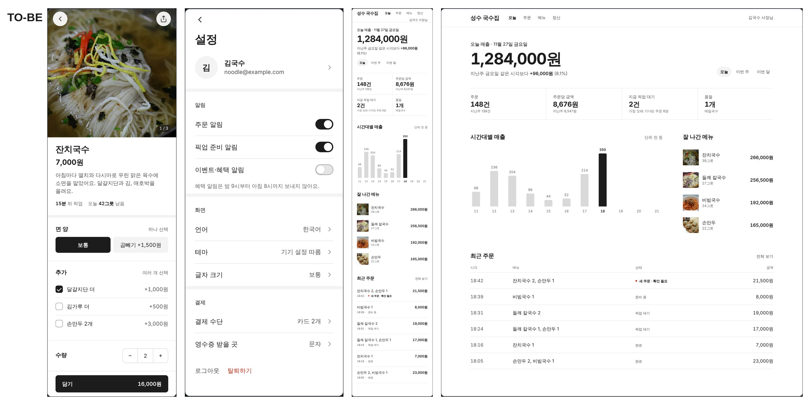

# screen-kit 넓히기 — 상세·설정·대시보드 부품과 켜진 스위치 색 통일

| 항목 | 내용 |
|------|------|
| 날짜 | 2026-11-27 |
| 작성 | Claude Code |
| 관련 경로 | `skills/suta/patterns/screen-kit/`, `skills/suta/SKILL.md`, `skills/suta/references/`, `skills/suta/patterns/layout-principles/`, `skills/suta/patterns/switch/`, `demo/src/demos/screen-kit/`, `demo/src/tests/screenKitScreens.test.tsx` |

## 1. 개요

0.21의 `screen-kit`은 목록·예약 화면의 바탕 부품만 있었다. 시험 실행에서 모델은 진입 문서(SKILL.md)만 읽는 일이 많았고, 그 몇 줄만으로 구조가 부품 쪽으로 바뀌었다. 같은 방식으로 상세·설정·대시보드 화면의 부품을 더한다. 오케스트레이터가 초안(메뉴 상세·설정·사장님 매출 대시보드)을 손으로 만들어 사용자에게 보였고, 사용자가 "방향 좋아"로 승인했다. 그 초안을 정본 품질로 부품에 넣었다.

사용자 결정이 하나 더 있다. 켜진 스위치는 거의 검정으로 통일한다. 지금까지는 "스위치가 있는 앱 화면은 근거가 없어도 맑은 강조색(파랑)을 정한다"는 예외가 있었다. 규칙이 둘이면 모델이 업종 색을 칠하는 실수로 이어져서 없앴다.

AS-IS가 없는 이유: 세 화면 모두 이 패턴에 처음 생긴 부품이라, 같은 화면의 "이전" 데모가 없다. 그래서 그림의 줄 머리는 TO-BE 하나다.

## 2. 작업내용

- **부품 CSS 셋**(`skills/suta/patterns/screen-kit/assets/`) — 화면 유형마다 파일 하나다. 한 프로젝트가 필요한 파일만 복사한다.
  - `screen-kit-detail.css`: 사진 머리(폭 가득 1:1, 위에 뜬 원 버튼 44, 사진 장수), 이름 묶음(이름 26/700 → 가격 22/700 → 설명 → 한 줄 메타), 옵션 구역(제목 17/700 + 고르는 법), 하나 고르는 칸(숨긴 라디오 + 회색 채움, 고른 칸은 주 글자색 채움 + 600), 체크 행(실제 체크 상자), 수량 줄(자리만 — 스테퍼는 `quantity-stepper`), 하단 고정 바(행동 + 합계).
  - `screen-kit-settings.css`: 프로필 줄(첫 글자 원 56), 묶음 이름 13/600, 폭 가득한 행(높이 56, 선은 글자 시작선부터, 현재 값 + 꺾쇠), 스위치 행 자리(`.switch.kit-row-switch` — `switch` 패턴의 label이 행 전체가 된다), 묶음 아래 안내, 글자 링크(로그아웃·탈퇴).
  - `screen-kit-dashboard.css`: 답 머리(라벨 16/600 + 큰 수치 56/700 + 비교 한 줄), 기간 알약, 지표 줄(위아래 선 + 칸 사이 세로 선, 좁으면 2열), 두 열 판(본문 | 320), 구역 머리, CSS 막대 줄, 상자 없는 표(화면 틀 600px 미만이면 행마다 "이름 + 핵심 값 / 나머지 한 줄"), 상태 표시, 사진 있는 순위 목록.
  - 바탕 `screen-kit.css`에 더한 것: 상단 바·아이콘 버튼, 구역 띠(8px), 앱 화면 열(`.kit-column` — 화면 틀 768px 이상이면 옅은 바탕 가운데 흰 열 560). 기존 목록·예약 부품의 값과 동작은 바꾸지 않았다.
- **React 래퍼 셋**(얇게): `ScreenKitDetail.tsx`(`OptionSection`·`PickGroup`·`CheckList`·`ActionBar`), `ScreenKitSettings.tsx`(`ProfileRow`·`SettingsGroup`·`SettingsRow`), `ScreenKitDashboard.tsx`(`AnswerHead`·`Periods`·`Metrics`·`BarChart` + 막대 높이 순수 함수 `barShare`). 각 파일은 바탕과 자기 CSS만 불러온다. 다른 패턴(`switch`·`quantity-stepper`)은 import하지 않는다.
- **테스트 먼저**(`demo/src/tests/screenKitScreens.test.tsx`, 26개): 모듈이 없어 실패하는 것을 본 뒤 구현했다(Red → Green). `barShare`(최댓값 비율·null 칸·모두 0·음수), 접근 이름이 보이는 글자인지(체크 행 "이름 + 금액", 하단 바 "행동 + 합계", 설정 행 "라벨 + 값"), 라디오·체크 상태, 표의 좁은 화면 규칙이 컨테이너 쿼리 안의 `display`인지. 기존 `screenKit.test.tsx`의 "틀 규칙이 .art 속성을 건드리지 않는다" 검사를 새 CSS 셋까지 넓혔다.
- **PATTERN.md**: description을 다섯 유형으로(266자), 파일 표, 유형별 부품·값 표 셋, 근거가 약한 점, 사용 방법(React 셋), "관례와 다른 곳" 표, 상태와 경계 13행, 커스터마이즈, 함께 쓰는 패턴, 주의사항. 표·순위·스위치 행의 순수 HTML은 `references/markup.md`로 옮겼다(본문 478줄).
- **진입 스킬** `SKILL.md` 절차 4의 괄호에 새 유형을 낱말로 더했다: "상세는 사진 머리·옵션 구역·하단 바, 설정은 폭 가득 행, 대시보드는 답 머리·지표 줄·상자 없는 표". 본문 28,428 → 28,565바이트(여유 1,435).
- **켜진 스위치 예외 없앰**: `tone.md` 3절(예외 항목을 "예외가 없다"로, 이유 한 줄), 세기 표의 "켜진 스위치" 칸, `defaults.md`(색 문단·설정 행), `checklist.md` 설정, `screen-conventions.md` 설정·마이의 스위치·하지 말 것, `switch/PATTERN.md` 커스터마이즈 표, `switch.css` 머리 주석. 같은 흐름에서 "서비스 성격에서 강조색을 고른다"가 남아 있던 곳(`defaults.md` 색 문단 첫 줄, `layout-principles/PATTERN.md` 3단계·주의사항, `principles.md` 두 곳, `tone.md`의 "서비스 성격이 파랑이면")도 "받은 브랜드색, 없으면 거의 검정"으로 맞췄다. `layout-principles` 데모의 설정 TO-BE가 "국수집이라 누룽지 주황"(`#b4580f`)이던 것을 거의 검정으로 바꿨다.
- **관례 문서 맞춤**: `screen-conventions.md` 상세(회색 채움 칸 허용, 옵션이 단가를 바꾸면 수량 줄은 옵션 아래), 설정·대시보드(흰 면 + 선 방식 한 줄)의 관련 패턴에 `screen-kit`. `defaults.md`·`checklist.md`의 설정·대시보드 행이 `screen-kit`을 가리킨다.
- **데모**(`demo/src/demos/screen-kit/`): `DetailScreen.tsx`(잔치국수 상세), `SettingsScreen.tsx`, `DashboardScreen.tsx`(오늘·이번 주·이번 달)를 더하고 틀 폭 고르기를 셋 더했다. 문구는 `defineCopy({ ko, en })` 두 벌. 숫자는 한곳에서 계산한다 — 상세 합계 = (7,000 + 옵션) × 수량, 대시보드 합계 = 막대 값의 합(오늘 1,284천 원), 주문당 금액 = 합계 ÷ 주문 수, "지금 픽업 대기" = 표의 픽업 대기 행 수, 순위 금액 = 그릇 수 × 메뉴 가격, 표 금액 = 메뉴 가격 × 수량. 데모 셸이 패턴 공개 변수를 사이트 파랑에 잇고 있어(`styles.css`), 틀 안에서 `--switch-on-bg`·`--qty-accent`를 강조색 토큰으로 되돌렸다.
- **선택 평가**: `evals/selection/screen-kit.json`에 should 4개(상세·설정·대시보드·영어)와 shouldNot 1개(스위치 하나). 처음 description은 "설정 화면이랑 폼 화면은 보통 어떤 구조로 짜?"(layout-principles 차례)와 동점이 나서 낱말을 고쳤다.
- **버전** 0.21.0 → 0.22.0(매니페스트 셋), README 2벌 tests 배지 1395 → 1421, 상세 안내 2벌 패턴 표 행.

### 브라우저 확인(Playwright Chromium, 한국어·영어)

| 화면 | 폭 | 잰 값 |
|---|---|---|
| 상세 | 390·320 | 이름 26px · 가격 22px · 옵션 제목 17px, 사진 비율 1.000(폭 가득), 그림자 상자 0, 가로 넘침 없음 |
| 상세 | 1120 | 사진 폭 560(흰 열), 넘침 없음 |
| 상세(스크롤 끝) | 390 | 하단 바 `sticky`, 수량 줄 아래 끝 = 바 위 끝(가리지 않음) |
| 설정 | 390·320·1120 | 쪽 제목 28px, 묶음 이름 13px/600, 행 높이 56, 켜진 트랙 rgb(28,28,28)·꺼진 트랙 rgb(229,229,229), 넘침 없음 |
| 대시보드 | 1280 | 큰 수치 56px(자간 −1.68px), 지표 값 24px, 구역 제목 20px, 축 12px, 판 680 \| 320, 지표 4열, 표 `table-row` |
| 대시보드 | 390·320 | 큰 수치 42.7px·36px, 지표 2열, 표의 행 `flex`(목록), 머리 행 숨김(낭독 전용), 넘침 없음 |

키보드: 체크 행 Space → 합계 16,000 → 17,000원, 하나 고르는 칸 → 화살표 → 곱빼기(20,000원), 칸에 2px 포커스 링. 설정 스위치 Space로 켜짐, 행의 글자 쪽을 눌러도 토글, 접근 이름 "이벤트·혜택 알림"(보이는 라벨), 링크 행 포커스 링 2px 안쪽. 대시보드 기간 Enter → 이번 주 4,420,000원, `aria-pressed` 바뀜. axe-core: 세 화면 × 세 폭 × 두 언어 위반 0.

## 3. 주의사항

- **근거가 약하다.** 상세의 옵션·하단 바, 설정, 대시보드는 수상작 조사(공개 화면 46쪽)에서 보지 못했다. 원칙을 옮긴 값이고 사용자가 초안을 눈으로 승인했다. 같은 요청으로 다시 재지는 않았다(claude CLI 벤치마크를 돌리지 않음).
- **관례와 다른 곳**(PATTERN.md 표): 하나 고르는 칸(관례는 라디오 행), 수량 줄 위치(관례는 가격 줄), 대시보드 면(관례는 옅은 바탕 + 흰 패널, 기본값 표는 "흰 바탕 하나에 선만 두지 않는다"), 기간(관례는 직접 선택 포함), 지표 숫자 배율(관례 2~3배, 부품 1.7배). 모두 사용자가 승인한 초안을 따랐다.
- **초안에서 바꾼 값**: 좌우 여백 20 → `--kit-inline`(16, 목록·예약과 같은 선). 검사 규칙(글자 크기 6종 이하·4px 척도·굵기 3종)에 맞추려고 상세의 설명·칸 글자 15 → 16, 고르는 법·메타 13 → 14, 대시보드의 비교 줄·표 15 → 16, 표 머리·지표 보조·상태·순위 보조 13 → 12, 표 머리 굵기 500 → 400, 기간 알약 좌우 14 → 12, 순위 행 위아래 10 → 12. 체크 상자 테두리 #c4c4c4 → #8a8a8a(흰 면 3:1), 꺾쇠 #a3a3a3 → #8a8a8a. 막대마다 값 글자를 더했다(관례 "값은 막대 위에"). 초안의 "18시 지금" 뒤에 19~21시 막대가 있던 데이터를 고쳤다(오지 않은 시간은 빈 칸). 하단 바는 `position: sticky`가 기본이다(본문 여백이 필요 없다) — 창에 고정하려면 `data-fixed` + `.kit-actionbar-space`.
- **사파리의 표 의미**: 좁은 화면에서 표의 `display`를 바꾸면 사파리가 표 의미를 버린다. PATTERN.md 상태와 경계에 `role` 보충을 적었고, 데모는 달지 않았다.
- **데모 셸의 파랑**: 데모 사이트는 `styles.css`에서 패턴 공개 변수(`--switch-on-bg` 등)를 사이트 파랑에 잇는다. `switch` 데모 페이지의 켜진 스위치는 여전히 파랑이다(셸의 표시 색). 바꾸려면 셸 결정이 필요하다.
- `ScreenKit.tsx`는 그대로 목록·예약 CSS를 모두 불러온다. 상세·대시보드에서 `PhotoFrame`만 쓰려고 이 파일을 복사하면 그 두 import 줄을 지워야 한다(PATTERN.md에 적었다).
