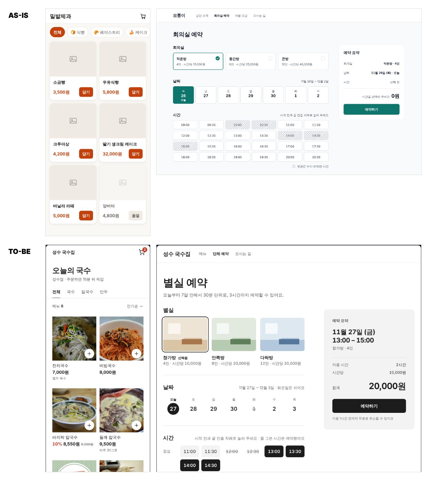

# 새 패턴 screen-kit — 화면 바탕 부품 한 벌

| 항목 | 내용 |
|------|------|
| 날짜 | 2026-11-27 |
| 작성 | Claude Code |
| 관련 경로 | `skills/suta/patterns/screen-kit/`, `skills/suta/SKILL.md`, `skills/suta/references/defaults.md`·`checklist.md`, `skills/suta/patterns/layout-principles/references/screen-conventions.md`, `demo/src/demos/screen-kit/`, `demo/src/tests/screenKit.test.tsx`·`screenKitSlots.test.ts`, `evals/selection/screen-kit.json`, 매니페스트 3개, README 2벌·guide 2벌·AGENTS.md 숫자 |

## 1. 개요

사용자가 suta가 만든 화면을 보고 "색상 사용, 레이아웃, 폰트, 구조가 실제 제품이나 디자이너가 만든 것처럼 매끄럽지 않다"고 했다. 수상작 46쪽을 잰 조사(`docs/research/2026-11-26-polish-gap.md`)의 결론은 suta가 빼는 규칙은 강하지만 더하는 쪽(사진 자리·쪽 제목·상자 없는 칸·글꼴)이 문서의 글로만 있고, 시험 실행이 그 문서를 읽지 않는다는 것이었다. 그래서 값을 복사해 쓰는 코드로 준다. 사용자가 손으로 만든 초안의 전후를 보고 "훨씬 좋아졌다"고 확인했고, 이 작업은 그 초안을 정식 패턴으로 만든 것이다. 버전은 0.21.0이다.

## 2. 작업내용

### 패턴 `screen-kit`(57 → 58종)

이름은 지시대로 `screen-kit`이다. 다른 패턴 이름(`glass-surface`·`bottom-nav`)처럼 "무엇-형태" 두 낱말이라 바꾸지 않았다. 데모 묶음은 "표면과 스타일"이다.

| 파일 | 내용 |
|---|---|
| `assets/screen-kit.css` | 바탕 — 화면 틀(`.kit-screen`, 이름 있는 컨테이너)·쪽 머리·탭 줄·버튼·사진 틀·낭독 전용 글자 |
| `assets/screen-kit-list.css` | 목록 — 목록 머리·상품 격자(2 → 3 → 4열)·상품 칸(할인·정가·품절·담기·칸 덮는 링크) |
| `assets/screen-kit-form.css` | 예약·입력 — 본문 + 요약 두 열·구역·사진 카드·날짜 띠·시간 칸·입력칸 묶음·요약 패널 |
| `assets/slotRange.ts` | 시간 칸 구간 고르기 코어(의존성 0) — `timeSlots`·`pickSlotRange`·`inSlotRange`·`slotRangeTime` |
| `assets/ScreenKit.tsx` | 얇은 React 래퍼 — `PageHead`·`PhotoFrame`·`ProductCell`·`FieldGroup`·`Field`·`SummaryPanel` |
| `PATTERN.md` | 언제 쓰는가(근거 표), 부품과 값 표, 사용 방법(React·순수 HTML), 글꼴 불러오기 세 길, 상태와 경계, 커스터마이즈, 주의사항 |

결정과 이유.

- **넓은 화면 값은 컨테이너 쿼리.** 화면 폭이 아니라 `.kit-screen`의 폭으로 제목(28 → 40)·격자 열·입력칸 배치·두 열이 바뀐다. 미리보기 틀이나 사이드바 옆처럼 창보다 좁은 자리에서도 모바일 값이 맞게 나온다. 데모의 휴대폰 틀이 이 덕에 정직하게 그려진다.
- **CSS를 세 파일로 나눔.** 화면의 일(목록·예약)에 맞는 것만 복사하게 하고, 파일마다 글자 크기 종류를 6개 이하로 둬 레이아웃 검사의 `font-size-variety`(7종 이상 warn)를 피했다.
- **사진 틀과 `.art`.** 초안의 함정(틀이 `.art`의 `display`·`background`·`aspect-ratio`를 덮어 그림이 깨짐)을 막으려고, 틀은 `.art`에 비율·모서리를 변수(`--art-ratio`·`--art-radius`)로만 넘기고 모양 속성은 `.kit-frame:not(.art)`에만 준다. 테스트가 세 CSS의 규칙을 읽어 `.art`에도 걸리는 틀 규칙이 그 속성을 건드리지 않는지 본다. 브라우저에서 그림 칸이 `display: grid`, 그라데이션 바탕, 비율 1, 그림이 가운데(오차 0px)인 것을 확인했다.
- **값의 사슬.** `--kit-*` → 프로젝트 토큰(`--color-*`·`--text-*`·`--space-*`·`--radius-*`·`--shadow-low`) → 숫자. 기본값은 `--_*` 내부 변수의 폴백이다(switch 등 기존 패턴과 같은 방식).
- **hover 배경을 명시.** 프로젝트의 전역 `button:hover`(데모 셸에도 있다)가 칸 배경을 덮지 않게 `@media (hover: hover)` 안에서 부품마다 배경을 다시 적었다.
- **사진 카드의 포커스.** 라디오는 화살표로 옮기면 바로 골라져 선택 윤곽선만으로는 포커스 위치를 모른다. 선택 윤곽선 바깥에 주 글자색 고리 한 겹(box-shadow) + 이름 밑줄을 더했다.

TDD: `screenKitSlots.test.ts`(구간 고르기 13개)와 `screenKit.test.tsx`(사진 틀·`.art` 충돌 3개 + 래퍼의 접근성 연결 14개)를 먼저 쓰고 실패를 확인한 뒤 구현했다.

### 초안에서 바꾼 값

| 무엇 | 초안 | 패턴 | 이유 |
|---|---|---|---|
| 요약 패널의 답 | 22/700 | 24/700(`--text-title`) | 토큰 척도 밖 값을 하나 줄였다 |
| 날짜 숫자 | 18/600 | 20/600(`--text-heading`) | 같은 이유, 예약 파일의 글자 크기 6종 |
| 시간 칸 글자 | 15 | 16(`--text-body`) | 같은 이유 |
| 좌우 여백 | 20 | `--page-inline`(토큰 16, 넓으면 24) | 토큰을 따른다. 초안은 `:root`에서 20으로 덮었다 |
| 쪽 머리 위·아래(넓은 화면) | 56·40 | 48·32(`--space-12`·`--space-8`) | 토큰 척도 |
| 요약 패널 안쪽 여백 | 28 | 24, 넓으면 32 | 토큰 척도 |
| 두 열 | 본문 \| 340, 간격 72(늘) | 화면 틀 960px 이상일 때만 | 좁으면 한 열 |
| 입력칸 포커스 | `outline: 0`(포커스가 보이지 않았다) | 칸 전체에 안쪽 2px 강조색 고리 | 사용 문제 |
| 자리표시 글자색 | #a3a3a3(흰 면 2.5:1) | 옅은 글자색 #686868 | 대비 |
| 예약된 시간 칸 글자 | #a3a3a3 | #686868 + 줄 + `disabled` + 이름 "10:00 예약됨" | 대비·색만으로 알리지 않기 |
| "선택됨" 표시 | CSS `content: "선택됨"` | 마크업의 `.kit-choice-mark`(aria-hidden) | 다른 언어로 바꿀 수 있게 |
| 버튼 아래 한 줄 | 가운데 정렬 | 왼쪽 정렬 | 레이아웃 검사 `centered-text-block` |
| 시간 칸 열(좁은 화면) | 6열 + 왼쪽 라벨 | 4열 + 라벨 위, 화면 틀 480px 이상에서 6열 + 왼쪽 라벨 | 320 폭에서 칸이 좁아진다 |

### 진입 스킬과 참조 문서

- `SKILL.md` 작업 절차 4단계에 세 줄(697바이트)을 더했다. 바탕 부품을 먼저 복사해 그 위에 짓는다, 이 부품은 suta 기본값이라 요청·기존 체계가 먼저다, 쪽마다 본문의 1.7배 이상인 제목 하나, 사진 자리를 회색 칸 + 아이콘으로 두지 않는다.
- 본문 한도(30,000바이트) 안에 넣으려고 겹치는 문장을 줄였다. "읽을 문서" 표의 랜딩 행(바로 위 행이 랜딩을 이미 가리킨다), 한계 절의 우선순위 되풀이, 절차 8의 "검사는 소스 텍스트만 읽는다"(한계 절에 같은 문장), 소개 문단의 예시 나열을 괄호 한 줄로. 본문은 29,966 → 29,999바이트다(여유 1바이트).
- 패턴 수 57 → 58(description·소개).
- `references/defaults.md`: 사진 자리 행(사진과 그림을 같은 틀에, 상품 목록은 상자 없이), 고르는 칩 행(시간 칸 격자는 회색 채움 칩이 예외 — 잠긴 칸은 채움을 뺀다), 보조 버튼 행(회색 채움에 시간 칸 추가), 가격 행(목록 칸의 가격 16/700), 글꼴 행(세 길은 PATTERN.md), 값 표의 글자 크기(쪽 머리 28·40)·이미지 비율(사진 모서리 0).
- `references/checklist.md`: 1순위 항목에 쪽 제목, 사진 항목에 같은 틀·상자 없는 상품 칸.
- `screen-conventions.md` 커머스 절의 관련 패턴에 `screen-kit`.

### 데모

`demo/src/demos/screen-kit/` — 국수집 테마 두 화면. 메뉴 목록(휴대폰 390 틀: 가게 머리 + 쪽 머리 + 탭 + 목록 머리 + 상품 칸 8개 — 사진 6개, 콘텐츠 그림 2개, 할인 1개, 품절 1개)과 별실 예약 폼(넓은 틀: 사이트 머리 + 사진 카드 3개 + 날짜 띠 + 시간 칸 + 입력칸 묶음 + 요약 패널). 틀 폭을 휴대폰·넓게로 바꿀 수 있다. 강조색은 거의 검정이다. 처음에는 "국수집이라 주황"(`#d34203`)으로 바꿨는데, 사용자가 근거를 물었고 업종에서 떠올린 색이라 되돌렸다. 같은 실수를 부르던 스킬 문구도 함께 고쳤다(`tone.md` 3절 "고르는 법", `defaults.md`, `layout-tokens.css` 주석, `palette.ts` 안내 — "없으면 서비스 성격에서 고른다" → "없으면 거의 검정, 받은 자료의 색이 있을 때만 고른다. 업종에서 떠올린 색은 칠하지 말고 제안한다"). 문구는 `defineCopy` 두 벌. 넓은 틀은 창이 1180px 이상이면 데모 본문 열(880) 밖으로 넓힌다.

### 화면 비교

AS-IS는 조사의 시험 실행에서 suta 0.20이 만든 첫 화면(빵집 픽업 메뉴 목록 390, 회의실 예약 1280)이다. TO-BE는 이 패턴의 데모 첫 화면(메뉴 목록 390, 별실 예약 넓은 틀 992)이다. 같은 요청을 다시 생성한 것이 아니라 내용(빵집 ↔ 국수집, 회의실 ↔ 별실)이 다르다. 두 쪽 모두 글꼴 파일 없이 이 환경의 글꼴로 그려졌다.

### 게이트

- `npm run build && npm run lint && npm test` — 통과, 테스트 1,512개(배지는 `it(` 수 1,395).
- `npm run validate` — 구조 통과(패턴 58), 선택 평가 488/488, 통합 검사 205개 파일 error 0·warn 0.
- 브라우저(Playwright Chromium, 데모 개발 서버): 아래 "브라우저에서 잰 값".
- 모션: 전환은 버튼·담기의 누름 축소(`transform`, 120ms, ease-out 곡선) 둘뿐이다. 동작 줄이기에서 `transition-duration` 0s와 누름 축소 꺼짐을 확인했다.

브라우저에서 잰 값.

| 무엇 | 값 |
|---|---|
| 쪽 제목(휴대폰 틀) | 28px/700, 행간 36.4px(1.3), 자간 −0.56px(−2%), `text-wrap: balance`, 본문 대비 1.75 |
| 쪽 제목(넓은 틀) | 40px, 자간 −0.8px |
| 상품 칸 | 테두리 0·그림자 none·바탕 투명, 이름 15/400, 가격 16/700 #1c1c1c, 사진 틀 비율 1.000·모서리 0 |
| 콘텐츠 그림 칸 | `display: grid`, 그라데이션 바탕, 비율 1.000, 그림 중심 오차 0px |
| 격자 | 휴대폰 2열(28·12), 넓은 틀 4열 |
| 담기 | 보이는 원 36, 원 밖 3px 지점을 눌러도 버튼(누르는 영역 44) |
| 예약 폼(넓은 틀 992) | 두 열 530 \| 340, 요약 패널 sticky(내려도 창 위 24px에 붙음), 시간 칸 6열·높이 44, 입력칸 라벨 열 120·칸 높이 56·글자 16 |
| 좁은 화면 | 390·320px 페이지 가로 넘침 0. 320에서 날짜 원 36(칸에 맞춰 줄어듦), 시간 칸 4열, 입력칸 라벨 위 |
| 키보드 | 탭·담기·시간 칸·버튼은 2px 윤곽선, 입력칸은 칸 전체 안쪽 2px 고리, 사진 카드는 선택 윤곽선 밖 고리 + 이름 밑줄 |
| 상태 | 시간 칸 두 개를 누르면 요약 답이 "11월 27일 (금) 11:00 – 12:00", 연락처를 비우고 예약하면 `aria-invalid="true"` + 오류 문장 |

## 3. 주의사항

- **SKILL.md 본문 여유가 1바이트다.** 다음에 진입 문서에 더할 때는 같은 만큼 덜어내거나, `scripts/validateSkills.mjs`의 한도를 사용자와 정한다.
- **입력칸 묶음·요약 패널은 근거가 약하다.** 수상작 공개 화면의 폼은 1쪽뿐이었고 나머지 값은 사용자가 승인한 초안에서 왔다. PATTERN.md에 적었다.
- **글꼴 순서는 바꾸지 않았다.** 한 파일 산출물의 대체 목록에서 한국어 글꼴을 라틴 시스템 글꼴보다 앞에 둘지는 맥·윈도·안드로이드에서 확인하지 못했다. `layout-tokens.css`의 `--font-sans`는 그대로다.
- **모바일 예약 폼의 하단 고정 바는 부품에 없다.** 좁은 틀에서 요약 패널은 본문 아래로 내려간다. 앱 관례(합계 + 주 버튼 하단 바)는 PATTERN.md "상태와 경계"에 프로젝트 몫으로 적었다.
- **재측정하지 않았다.** 같은 요청(빵집 픽업·회의실 예약)을 suta 0.21로 다시 만들어 조사의 지표(사진 면적·위계 비·상자 수·글꼴)가 움직이는지는 아직 모른다. claude CLI 벤치마크는 이번 범위가 아니었다.
- 검사 규칙 후보(이번 범위 아님): 사진 아이콘 하나만 든 회색 칸(`placeholder-icon`), 첫 화면의 가장 큰 글자 ÷ 본문 1.5 미만.
- `demo/index.html`의 설명 문장이 "56 patterns"로 낡아 있어 58로 고쳤다.
